# Del comportamiento productivo al pronóstico semanal y diario en La Gaitana Farms

**Versión 7 para revisión académica — 28 de octubre de 2026**

Esta edición reorganiza el argumento y completa indicadores a partir de predicciones archivadas; no reentrena modelos. Distingue los paneles históricos, el benchmark anual nominal actualizado y los ensayos recientes. Las nuevas cargas del prototipo no se presentan como una nueva validación de la tesis.

Elián Durán · Julián Osorio · Anderson Gonzalez

Universidad de los Andes · Facultad de Ingeniería Industrial · Maestría en Inteligencia Analítica para la Toma de Decisiones

## Resumen

Este trabajo desarrolla un pronóstico semanal de tallos reportados para GAITANA y, como tarea aparte aún en revisión, explora la distribución diaria de H1. El modelo semanal seleccionado antes de evaluar 2026 es HistGradientBoosting sin clima: usa un ajuste para H1–H2 y otro para H3–H5, con los mismos parámetros, y corrige la teoría o la media de cuatro semanas según corresponda. En 16.325 comparaciones, obtiene 19,36 % de WAPE frente a 19,71 % del ingeniero; gana en H1–H2 y en el total, mientras el ingeniero gana en H3–H5. Los resultados son retrospectivos. El pronóstico diario tiene evaluaciones exploratorias y aún no cuenta con una comparación equivalente contra el ingeniero.

Palabras clave: producción florícola, curvas, calidad, clima, pronóstico semanal, distribución diaria, validación temporal.

## 1. Introducción: qué se necesita anticipar y por qué

La pregunta que organiza este trabajo es cuánto corte puede esperarse de cada combinación de producto, color y variedad, con qué anticipación y cómo podría distribuirse durante la semana. La combinación comercial importa porque dos estimaciones con el mismo total de tallos pueden describir disponibilidades muy diferentes. Un exceso en una variedad no compensa automáticamente una falta en otra. Por ello, evaluar únicamente el total de la finca sería insuficiente para el propósito de planeación planteado en el proyecto.

El punto de partida combina tres perspectivas. El plano informa las plantas y composiciones registradas en una fecha; las estadísticas de camas piloto describen rendimientos observados a distintas edades; y el estimado del ingeniero aporta una referencia experta con la cual contrastar el sistema. La producción real permite comprobar lo ocurrido. El clima y el comportamiento reciente del corte se incorporan para estudiar si ayudan a explicar las diferencias entre lo proyectado y lo registrado.

La contribución buscada es construir una secuencia comprensible desde esas fuentes hasta una predicción evaluable. Primero se examina si los registros se pueden unir sin mezclar ciclos ni duplicar cantidades. Después se reconstruyen curvas por edad y proyecciones, distinguiendo cuándo pueden representar todo el inventario del plano. Finalmente se evalúa si las señales recientes permiten corregirlas y si el pronóstico semanal ayuda a anticipar la distribución diaria. Cada paso responde a una dificultad encontrada en los datos.

### 1.1. Objetivos del Plan de proyecto y resultados que deben responderlos

Se retoman literalmente el objetivo general y los cuatro objetivos específicos de Plan de proyecto_final.docx, sección 2.1–2.2. Los resultados y las conclusiones distinguen el desarrollo realizado de la validación organizacional aún pendiente. [E22]

**Objetivo general (OG).** Desarrollar un modelo predictivo que estime la producción exportable de flores en La Gaitana a nivel diario y semanal por variedad-color, integrando información histórica, estimaciones actuales y variables operativas disponibles, con el fin de reducir la incertidumbre en ventas, compras y poscosecha.

**OE1.** Caracterizar el proceso actual de estimación de producción y consolidar una base analítica histórica a nivel de fecha, semana, variedad y color, integrando información de producción real, estimaciones actuales, siembras, camas piloto y variables climáticas y operativas, con el fin de identificar patrones de estacionalidad y desviaciones frente a los estimados.

**OE2.** Desarrollar, entrenar y comparar diferentes modelos predictivos para la estimación de la producción exportable (modelos base, series de tiempo y modelos de machine learning), evaluando su desempeño mediante métricas de error (MAE, RMSE, MAPE y WMAPE) y el porcentaje de predicciones dentro de un rango operativo aceptable de ±8%.

**OE3.** Diseñar e implementar una salida analítica que traduzca las predicciones en señales operativas (faltante, normalidad o sobrante) por variedad y color, facilitando la toma de decisiones comerciales, de compras a terceros y de planeación de poscosecha.

**OE4.** Validar el modelo en un entorno operativo mediante comparación con estimaciones actuales y análisis de impacto en la reducción de desviaciones.

| Objetivo | Evidencia y alcance de respuesta |
| --- | --- |
| OE1 · Proceso y base histórica | Fuentes, pilotos, curvas, proyecciones, EDA y base analítica; 2–4.1. Conclusión 7.2. |
| OE2 · Desarrollo y comparación de modelos | Modelos semanales y pilotos diarios, métricas y banda ±8 %; 4.2–5.6. Conclusión 7.3. El diario continúa en revisión. |
| OE3 · Salida y señales operativas | Prototipo de consulta, comparación, ajuste y publicación; 4.3.2 y 6.3. Conclusión 7.4. Semáforos de faltante/sobrante sin validación empresarial. |
| OE4 · Validación en entorno operativo | Comparación retrospectiva y protocolo propuesto; 4.3.1 y 6.3. Conclusión 7.5. Piloto e impacto organizacional pendientes. |

La integración del estimado del ingeniero se utiliza como referencia de evaluación y consulta, no como predictor del candidato autónomo. El Plan pide producción exportable y resolución diaria/semanal; esta revisión no da esos alcances por cumplidos sólo por mejorar el error semanal sobre tallos reportados.

El relato sigue el proceso que hace verificables esos objetivos: establecer el significado de cada fuente, construir referencias por edad, comparar correcciones con información pasada y valorar su uso y sus límites para la organización.

### 1.2. Alcance de la evidencia

El análisis principal se limita a la finca GAITANA; GAITANA PPTO se conserva como una categoría distinta. La variable efectivamente observada son tallos reportados. Aunque la motivación del proyecto y el estimado del ingeniero se refieren a producción exportable, su equivalencia con esa variable debe ser confirmada antes de presentar los resultados como un pronóstico certificado de tallos exportables.

Se estudian cinco horizontes semanales y los siete días de la primera semana pronosticada. Los periodos ya examinados corresponden a desarrollo retrospectivo. La información se ordena temporalmente para evitar usar producción o clima futuro observado, pero la fecha histórica de publicación o corrección de algunas fuentes no está acreditada. Por tanto, el ejercicio aproxima una situación de pronóstico bajo supuestos de disponibilidad que se hacen explícitos.

## 2. Entender las fuentes antes de construir el pronóstico

### 2.1. Tres cantidades que no deben confundirse

El inventario de plantas, el rendimiento de una cama piloto y los tallos cortados son cantidades distintas. El plano es una fotografía de existencias: si una cama con mil plantas aparece en dos planos consecutivos, no se han observado dos mil plantas nuevas. Las estadísticas piloto permiten relacionar un corte con las plantas de una cama y su edad. La producción real, por su parte, reúne movimientos de corte y se agrega para evaluar los pronósticos. Esta distinción determina los denominadores, las llaves de integración y las reglas para interpretar cambios. [E1–E3]

| Fuente | Qué representa | Papel en el trabajo | Precaución principal |
| --- | --- | --- | --- |
| Planos de siembra | Existencias y composición reportadas en una fecha | Ubicar plantas y edades para proyectar | No sumar fotografías como nuevas siembras |
| Estadísticas y camas piloto | Corte y plantas de observaciones identificadas por cama y ciclo | Estimar rendimiento por variedad y edad | No confundir pilotos con producción total |
| Producción real | Movimientos de tallos registrados | Historia reciente y variable de evaluación | Ausencia de registro no equivale a cero |
| Clima | Mediciones ambientales con frecuencia mayor que la producción | Señales históricas agregadas | Confirmar unidades y disponibilidad |
| Estimados del ingeniero | Pronóstico comercial por entrega | Referencia independiente | Comparar mismas llaves y entregas oportunas |

### 2.2. La edad y el ciclo dan sentido a una curva

Para relacionar un corte piloto con las plantas que lo originaron no basta con que coincida el nombre de la variedad. Una referencia de cama puede aparecer en distintos ciclos. La integración utiliza el archivo, la variedad homologada y la referencia completa de la cama; añade la fecha de siembra cuando existe y, en su defecto, año y semana. Una coincidencia ambigua permanece pendiente. Forzarla podría alterar el rendimiento aun cuando el total de filas pareciera razonable. [E1]

La edad se expresa en semanas completas entre la semana de siembra y la de corte. La curva describe el rendimiento observado para una variedad a cada edad disponible. Es una representación empírica construida con los pilotos utilizables, no una ley biológica validada para todas las camas. Diferencias de época, condiciones de cultivo y representatividad de los pilotos pueden afectar su traslado al inventario de plantas; aquí se reconocen como explicaciones por investigar, sin atribuirles efectos causales no medidos.

### 2.3. Qué cambia cuando cambia un plano

Una ubicación física se identifica mediante finca, invernadero y número de cama. Esa ubicación puede persistir mientras cambia su variedad o su fecha de siembra. Por eso el análisis original separa camas persistentes, apariciones, desapariciones y cambios de composición, e incluye la comparación directa de las semanas 32 y 33. Una aparición en el archivo se interpreta como un cambio reportado; por sí sola no prueba que se haya realizado una nueva siembra. [E1]

Esta lectura evita atribuir toda revisión del pronóstico a la curva. Entre dos planos pueden cambiar las plantas, las edades, la composición, la historia utilizada para estimar rendimientos o la cobertura. El estudio de versiones permite observar el resultado conjunto de esos cambios, aunque no constituye todavía una descomposición causal de sus aportes.

### 2.4. Decisiones y límites al interpretar las fuentes

Se eligió trabajar con tallos reportados y mantener GAITANA separada de ARABELLA y de GAITANA PPTO. Los movimientos se agregan sólo después de homologar la identidad y verificar la fecha; la repetición de historia en ediciones anuales no representa nuevos cortes. La conservación de cantidades valida la transformación de la fuente, no certifica por sí sola su exactitud agronómica ni su equivalencia con producción exportable.

Las fechas de los archivos y su contenido permiten reconstruir una disponibilidad nominal; no siempre acreditan cuándo se publicó o corrigió cada dato. Por eso los resultados son retrospectivos y condicionados a esa reconstrucción. [PENDIENTE: confirmar con la empresa la equivalencia entre tallos reportados y exportables, y documentar el calendario de publicación/corrección de cada fuente.]

## 3. Análisis exploratorio: qué enseñan los datos sobre el problema

### 3.1. Calidad e historia utilizable de los pilotos

Las camas piloto identifican plantas y ciclos; sus estadísticas registran el corte de esas camas. Se normalizan nombres, espacios y mayúsculas, y se verifica referencia de cama, identidad comercial y ciclo de siembra. Esta correspondencia se mide antes de construir rendimientos por edad. No se utiliza el porcentaje de teoría completa de la base analítica como tasa de éxito de estas uniones. [E9]

La revisión del 19 de octubre conserva los 530.250 registros de estadísticas de la edición 2026 y sus cantidades originales. Hay 510.237 correspondencias únicas. Al restringir a cortes fechados en 2026, 32.986 de 33.039 tienen correspondencia única (99,84 %). El total de la edición incluye años anteriores; no representa exclusivamente la operación de 2026.

| Estado técnico | Historia de edición 2026 | Cortes fechados en 2026 |
| --- | --- | --- |
| ambigua | 4.710 | 52 |
| conflicto_ciclo | 3.383 | 0 |
| llave_incompleta | 10.894 | 1 |
| sin_pareja | 1.026 | 0 |
| unica | 510.237 | 32.986 |

Los estados restantes son controles de referencia, identidad o ciclo, no errores de pronóstico ni edades improductivas. Se mantienen trazables, sin convertirlos en un problema general de la fuente. En los 53 registros fechados en 2026 que siguen pendientes se reportan 13.508 tallos en conjunto (0,15 % de los tallos anotados en esas estadísticas); al ser filas semanales repetidas, no representan tallos físicos únicos. Las observaciones utilizables deben además tener plantas positivas, fecha y edad válidas y corte no negativo. Se conservan los ceros registrados: la vista actual contiene 477.426 observaciones, de las cuales 92.337 tienen corte cero.

### 3.1.1. Corrección verificada de nombres y referencias equivalentes

Se encontró una pérdida evitable: la comparación de candidatos incluía campos originales con diferencias de mayúsculas. Así, dos copias de la misma cama y ciclo podían tratarse como alternativas. En el Excel de clavel 2026, las filas 5908 y 5931 de Camas Piloto corresponden a CAROLINE GOLD-26-3, con igual fecha de siembra y 1.194 plantas; sólo cambia la escritura en mayúsculas/minúsculas. Ahora se compara la identidad normalizada y los atributos del ciclo. Se consulta una sola referencia equivalente, conservando las filas fuente y sin duplicar movimientos de corte.

Cuando falta el nombre de variedad en estadísticas, sólo se recupera si la referencia completa dentro del mismo archivo identifica una única combinación comercial compatible con el producto. En la edición 2026 se recuperan así 399 identidades. No se usa semejanza aproximada de nombres ni se mezclan colores o ciclos.

| Edición | Utilizables antes del 19/10 | Utilizables después | Adicionales |
| --- | --- | --- | --- |
| 2021 | 205.321 | 208.255 | 2.934 |
| 2022 | 257.545 | 262.015 | 4.470 |
| 2023 | 316.185 | 322.344 | 6.159 |
| 2024 | 379.560 | 386.340 | 6.780 |
| 2025 | 410.583 | 443.460 | 32.877 |
| 2026 | 444.476 | 477.426 | 32.950 |

Los libros anuales repiten historia: estas recuperaciones no se suman como observaciones únicas del cultivo. La corrección verifica conservación del corte y de todas las observaciones previamente utilizables, incluidas sus plantas, fechas y edades. Diferencias reales de denominador o fecha permanecen pendientes; no se elige un valor arbitrario. El catálogo común de 00 conserva identidad comercial y códigos de procedencia.

### 3.1.2. Procedencia de los pilotos

Las hojas de estadísticas no contienen la finca. La atribución a GAITANA requiere coincidencia de bloque, cama, identidad comercial y fecha de siembra con un plano. En la edición 2026, 271.872 observaciones utilizables tienen coincidencia atribuible a GAITANA y 205.554 no tienen esa evidencia. No hay coincidencia inequívoca con ARABELLA. Las cifras describen la procedencia comprobada; no permiten asignar los casos desconocidos a otra finca por descarte. [E14]

Las curvas compartidas del proyecto se mantienen para el alcance actual. La curva atribuida a GAITANA se evalúa como sensibilidad y su diferencia de cobertura o WAPE puede reflejar tanto qué pilotos entran como qué edades quedan representadas. No se interpreta esa comparación aislada como prueba de que una finca deba usar una curva propia.

Las curvas y proyecciones se recalculan antes de reconstruir la base y ajustar los modelos.

### 3.2. Cómo se obtiene y cómo se lee una curva

En cada fecha de plano se utilizan las 78 semanas anteriores de historia. Cada observación aporta el cociente entre corte y plantas. Dentro de cada grupo variedad–edad se calcula el promedio de esos rendimientos, después de limitar los extremos con el criterio de 1,5 rangos intercuartílicos cuando existen al menos cuatro observaciones. El dato original permanece disponible para auditoría; con menos observaciones no se aplica ese ajuste. No se extrapolan edades sin datos. [E1–E2]

La elección del promedio es relevante: la curva utilizada promedia rendimientos de observaciones, mientras que algunos resúmenes del EDA calculan suma de cortes dividida por suma de plantas observadas. Este último es un promedio ponderado por plantas y su denominador acumula exposiciones planta–semana; no cuenta plantas únicas. Ambos resúmenes describen aspectos relacionados, pero no son intercambiables.

Para leer una curva se deben mirar conjuntamente el rendimiento y su soporte. Una edad sostenida por muchas observaciones tiene una base empírica diferente de otra con una sola observación. Se conserva el ejemplo de Solomio–Ard elegido en la revisión inicial, ahora recalculado con las correcciones, para observar su soporte sin escogerlo por un buen error de predicción. Los huecos se mantienen y el número de observaciones se presenta en un panel separado. La figura ilustra la lectura del procedimiento; no representa por sí sola todas las variedades. La agrupación utiliza la identidad comercial y la edad; los IDs del maestro se conservan como trazabilidad.

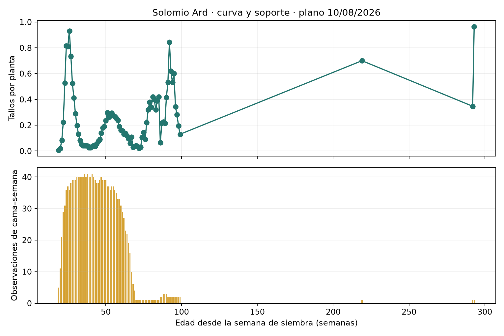

En el ejemplo de Solomio–Ard, el soporte se concentra en las edades más tempranas del tramo observado y disminuye considerablemente después. Aparecen además puntos aislados por encima de doscientas semanas, respaldados por una sola observación por edad. Su presencia exige revisar fechas y ciclos con el equipo agronómico antes de interpretar esos rendimientos como un comportamiento representativo. No se eliminan ni se unen visualmente a través de las edades ausentes. La curva hace visible así una necesidad concreta de revisión de calidad que quedaría oculta si se mostrara únicamente la proyección agregada.

La producción teórica de una semana se obtiene multiplicando las plantas de cada cohorte por el rendimiento correspondiente a su variedad y edad proyectada, y sumando los aportes cubiertos. Si una cohorte no tiene rendimiento disponible, su aporte es desconocido. La suma calculada en ese caso es parcial, aunque pueda verse como un número perfectamente válido en una tabla. Esa distinción es central para interpretar las proyecciones y para decidir cuándo el modelo puede corregirlas.

Normalizar aquí tiene dos sentidos concretos. Homologar nombres permite unir la misma combinación de producto, color y variedad sin borrar diferencias comerciales; dividir corte entre plantas expresa rendimiento en tallos por planta y permite comparar observaciones con tamaños distintos. No se escala la curva para que su suma sea uno ni se ajusta su total usando la producción futura. El recorte de extremos limita rendimientos atípicos dentro de variedad–edad; no borra ceros reportados ni completa edades ausentes. Por ejemplo ilustrativo, 600 tallos de 1.000 plantas equivalen a 0,6 tallos por planta; una cohorte de 5.000 plantas con ese rendimiento aportaría 3.000 tallos teóricos.

Una cohorte reúne las plantas del mismo plano, finca, producto, color, variedad, clave de curva y fecha de siembra. Puede sumar varias camas; no es sinónimo de cama física. Si las fechas son distintas se conservan grupos distintos, incluso cuando su edad redondeada a semanas coincide. La agregación final suma sus aportes para obtener una serie comercial y una semana objetivo.

### 3.2.1. Decisiones y límites de la curva construida

La ventana de 78 semanas, el promedio de rendimientos por observación y el ajuste de extremos de 1,5 rangos intercuartílicos son reglas adoptadas, no parámetros demostrados como óptimos. Cada observación piloto pesa igual aunque cambie el número de plantas. La curva compartida supone que esas observaciones informan sobre las cohortes a las que se aplica; su representatividad espacial, estacional y de manejo no fue validada agronómicamente. No se extrapolan edades ni se convierten ausencias en cero.

La regla que exige representar todas las edades evita presentar una suma parcial como total. Su consecuencia es usar una corrección de producción reciente en parte del inventario, aun cuando los registros reales y las identidades comerciales estén conservados. [PENDIENTE: validación agronómica de edades improductivas y sensibilidad a ventana, ponderación por plantas y tratamiento de extremos.]

### 3.3. Cuándo aplica la curva empírica por edad

Se distinguen tres pasos: vincular cada observación piloto con su cama y ciclo, resumir el rendimiento observado por variedad y edad, y aplicar esos rendimientos a las cohortes del plano en una semana objetivo. La unión identifica correctamente el origen de las observaciones; la curva representa las edades que aparecen en la historia piloto usada para construirla. Son controles distintos y el segundo no indica que se hayan perdido registros reales.

El plano es una fotografía de inventario. La edad de cada grupo se calcula desde el lunes de su semana de siembra hasta el lunes de la semana que se quiere proyectar. Por ejemplo, un grupo de 10 semanas tendrá 15 semanas cinco semanas después; para esa fecha se consulta la curva a edad 15. La fecha del plano determina qué inventario e historia estaban disponibles, pero no sustituye la fecha de siembra al calcular la edad. Se recalculó esta diferencia en los 477.426 cortes utilizables de la edición 2026 y en las 1.064.620 filas de proyección con siembra fechada: todas coinciden con las fechas fuente.

Se procesan 292 versiones seleccionadas entre 2021 y 2026 y diez semanas por plano. El horizonte de construcción se distingue de H1–H5 del modelo, definido desde su fecha de emisión. Las curvas se construyen con las 78 semanas de cortes anteriores a cada plano. Para aplicar una curva a un inventario se consulta la edad de cada cohorte en la semana objetivo. El cálculo directo solo se habilita cuando todas esas edades están representadas en la curva; esto delimita el alcance empírico del método, no la presencia de la producción real ni la calidad del cruce. [E2, E9]

La producción real se conserva en el panel observado. La teoría sólo actúa como referencia de un total cuando las edades de todos los grupos del plano están representadas; en los demás casos admisibles se corrige la producción reciente. Es una decisión de uso de la curva, no un porcentaje de producción perdida ni una tasa de fallas del cruce de camas. [E3–E4]

El cruce piloto–cama–estadística se revisó por separado: 99,84 % de los cortes fechados en 2026 tienen correspondencia única. Por ejemplo, si un plano tiene dos grupos de siembra y la curva representa la edad de uno, pero no del otro, no se presenta una suma teórica parcial como total del plano; se conserva la producción real y el modelo admisible puede usar producción reciente.

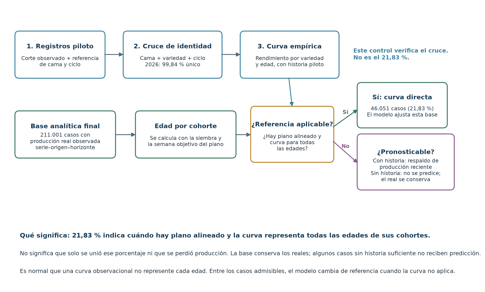

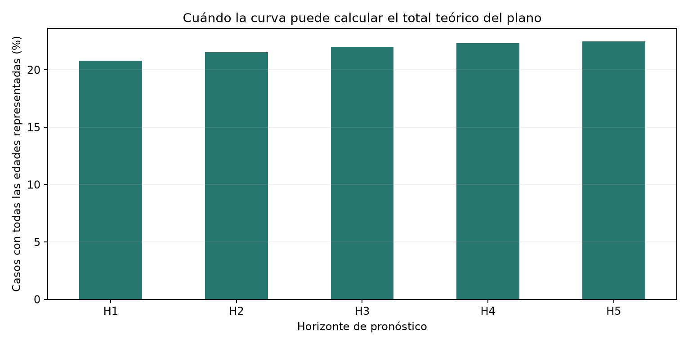

Que una edad no esté representada por un corte piloto no significa que falte el registro de producción del plano, ni permite asumir que la planta producía cero. El EDA distingue ceros registrados, edades anteriores al rango empírico, huecos entre edades representadas y edades posteriores. Son situaciones sobre el alcance de la curva; solo una regla agronómica confirmada permitiría asignar un cero teórico. El notebook 02 muestra estas situaciones y el ejemplo DINO. Un rendimiento cero que sí fue registrado se conserva como tal.

El ejemplo DINO amarillo de GAITANA muestra por qué la aplicación de la curva y el cruce de camas son preguntas distintas. El plano del 13 de julio de 2026 tiene 25 cohortes para el objetivo del 31 de agosto; la curva piloto usada representa 23 de esas edades. Esto no indica que falten las camas ni la producción real: indica que no se asigna una tasa teórica a las otras dos cohortes y el modelo usa su ruta de producción reciente. Primera edad con corte positivo en la ventana: 14 semanas. Existe un registro de 288 tallos a edad 14, referencia dino-16-175, fecha 2026-02-23. La edad original y calculada coinciden; esto no certifica el dato agronómicamente. A edades 20 y 21 hay ceros registrados en otro piloto. No es evidencia suficiente para imponer cero en 9 o 16. La edad 9 es anterior al rango observado; 16 es un hueco dentro del rango con producción. No se completan esos grupos con cero sin una regla agronómica confirmada.

La implicación para el modelo es concreta: se ajusta la referencia teórica cuando puede calcularse completa; en los demás casos se utiliza producción reciente como referencia. No se considera la falta de soporte por edad un error de pronóstico. El error sólo se calcula al comparar una predicción numérica válida con la producción observada.

### 3.4. Qué muestran cinco planos del corte analítico

Los cinco planos comparados en el corte analítico original corresponden a las semanas 29 a 33 de 2026; en la semana 32 se utiliza la edición actualizada. Para compararlos se alinean las mismas semanas objetivo. Comparar únicamente el primer punto de cada proyección mezclaría fechas de producción diferentes y no mediría una revisión del mismo objetivo. [E2]

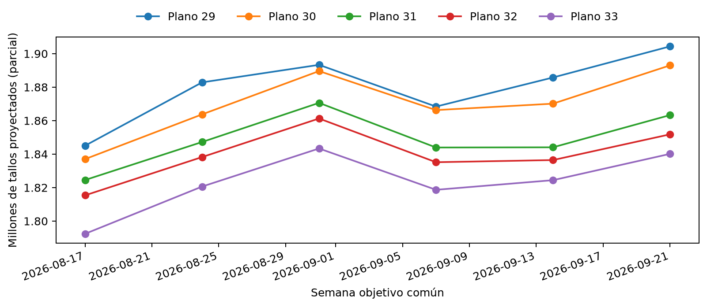

Para el objetivo del 17/08/2026, el total teórico parcial pasa de 1.839.272 tallos en el plano 29 a 1.792.025 en el plano 33. Entre los planos 32 y 33 cambia -21.552 tallos (-1,19 %). Las cinco versiones se alinean por objetivo común; no se interpreta la última como más precisa sin contrastarla con producción real.

Esto justifica conservar versiones anteriores como posibles señales del modelo. Permite preguntar si las revisiones contienen información sobre el error futuro, en lugar de asumir que toda actualización constituye una mejora. También obliga a conservar la fecha de emisión: la misma cantidad teórica tiene un significado distinto si se obtuvo una o varias semanas antes del objetivo.

### 3.5. Escala, composición y evolución de la producción real

La base de GAITANA conserva 327.991.200 tallos en 44.053 combinaciones observadas de serie y semana. Miniclavel reúne el 62,87 % del volumen y clavel el 18,47 %; juntos representan 81,34 %. Solomio aporta 8,08 % y Raffine 5,61 %. Por tanto, una métrica agregada sensible al volumen refleja en gran medida el comportamiento de miniclavel. La evaluación debe acompañarse de cortes por producto, color y variedad para reconocer dónde se concentra una mejora o una dificultad. [E3–E4]

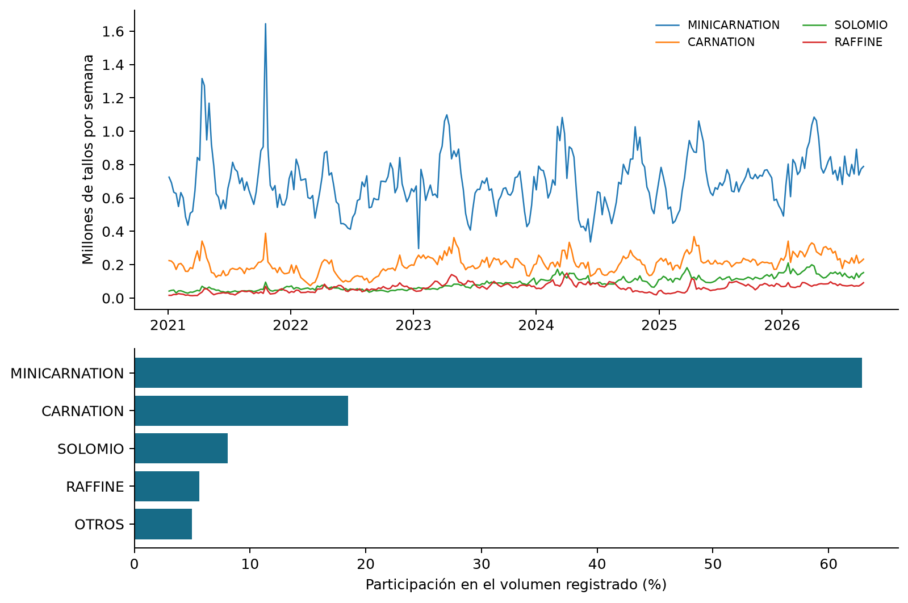

Los totales agrupados por año del lunes semanal pasan de 48,70 millones en 2022 a 61,27 millones en 2025. El periodo de 2026 contiene 35 semanas reportadas y 47,62 millones de tallos, por lo que no debe compararse como si fuera otro año completo. Las diferencias anuales pueden combinar cambios de composición, cobertura y nivel productivo. La trayectoria observada describe la fuente; no permite atribuir por sí sola crecimiento a una práctica agrícola específica.

La variación entre series también es amplia: la mediana de producción semanal observada es 3.130 tallos, mientras que el percentil 90 supera 21.076. Esta heterogeneidad explica por qué se estudian modelos compartidos con identificación comercial y por qué el error debe leerse tanto en tallos como en proporción al volumen. El análisis disponible no identifica causalmente picos por festividades o eventos comerciales; incorporarlos exigiría un calendario validado y un contraste específico.

### 3.6. Dónde se separan la teoría y la producción registrada

El error se define como producción real menos teoría; un valor negativo significa que la teoría quedó por encima de lo registrado. El WAPE de abajo es descriptivo para casos completos y no debe equipararse al modelo: cambian período y población. [E4]

| Horizonte | Casos donde la curva representa todas las cohortes | Error medio real − teoría (tallos) | WAPE descriptivo |
| --- | --- | --- | --- |
| H1 | 9.030 | -2.667,70 | 42,07 % |
| H2 | 9.226 | -2.652,62 | 41,23 % |
| H3 | 9.291 | -2.573,83 | 40,17 % |
| H4 | 9.286 | -2.548,91 | 39,65 % |
| H5 | 9.218 | -2.502,81 | 38,79 % |

La diferencia orienta a corregir la referencia teórica donde puede calcularse y a utilizar producción reciente donde falte soporte. Contar producción observada en esas series es posible porque el panel se construye desde los registros reales; que exista esa semana para evaluar no garantiza que la curva empírica contenga todas las edades del inventario.

### 3.6.1. Por qué se probaron rezagos y tendencias

Antes de entrenar se midió si señales de producción conocidas al origen se asociaban con el error posterior de la teoría. Se calcula Spearman dentro de serie comercial y horizonte, para objetivos cerrados antes del 7 de julio de 2025 y al menos veinte pares; luego se toma la mediana entre series. [E4]

| Señal conocida al origen | Mediana H1 | Mediana H5 |
| --- | --- | --- |
| Producción de la semana anterior | 0,251 | -0,022 |
| Cambio entre las dos últimas semanas | 0,190 | 0,070 |
| Promedio de cuatro semanas | 0,123 | -0,032 |

La asociación mayor de la semana previa en H1 motivó probar memoria reciente. No indica cuánto mejorará el pronóstico ni establece causalidad. En 12 y 15 se comprueba su utilidad comparando predicciones en cortes temporales; las entradas diarias se agregan después como un bloque en 14. Las señales largas y conteos se comparan por bloques, porque el EDA no justifica individualmente cada variable.

### 3.7. Clima, error de volumen y desplazamiento del corte

La fuente climática contiene lecturas de GAITANA durante febrero–mayo de 2026; en esos meses predominan registros horarios (aproximadamente 24 al día), mientras que en otros periodos se observan cerca de 48 lecturas diarias. La auditoría adapta el umbral a la frecuencia observada: acepta el día con al menos 80 % de las lecturas esperadas y un rango de al menos 22 horas. Así se usan también los días con medición horaria completa. Temperatura, humedad y radiación quedan disponibles en esos meses; algunas ventanas de lluvia no se calculan cuando faltan registros o hay conflictos, y no se rellenan como lluvia cero. En la figura, rojo significa que una señal/ventana no cumple su regla de cálculo, no que falten datos climáticos de origen, variedades o producción. [E15]

El EDA usa objetivos cerrados antes del 7 de julio de 2025. Para error de volumen estudia (real − teoría)/media4 dentro de cada serie y horizonte, con al menos veinte pares donde la curva representa todas las edades de las cohortes. Las medianas de Spearman son pequeñas y hay diferencias entre series. Las variables meteorológicas son comunes a la finca; repetirlas en varias variedades no crea observaciones meteorológicas independientes. El clima de estación no equivale necesariamente al microclima de cada invernadero.

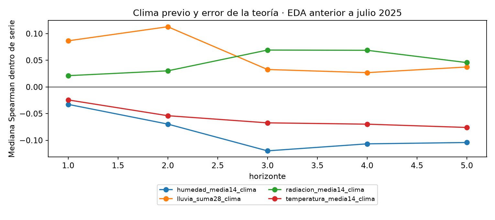

La conexión con los modelos se hace explícita en la nueva sección 1.1 de 18. Se examinan las seis variables semanales originales de 12, las nueve medias climáticas diarias añadidas en 14 y las once columnas ampliadas construidas en 18 para 19. Las primeras resumen semana anterior y cuatro semanas; las diarias, 3/5/7 días; las ampliadas incluyen media14, cambio de 7 frente a 28 días, lluvia y cobertura. No tienen idénticos umbrales de datos válidos, por lo que no se interpreta cualquier diferencia como efecto exclusivo de la longitud de ventana.

Se conserva una lectura por pares disponibles y otra con casos comunes a las 26 columnas, informando casos, orígenes y series. La segunda restringe la historia por datos climáticos no disponibles; no sustituye silenciosamente la primera. El análisis se limita a casos donde la curva representa todas las edades de las cohortes y no demuestra qué sucede en la ruta de producción reciente. La correlación no selecciona automáticamente variables: 12 compara el clima original, 14 añade producción y clima diarios conjuntamente y 19 contrasta clima básico frente a ampliado.

La comparación común de las 26 entradas conserva entre 63,48 % y 65,29 % de casos según horizonte. H1 mantiene 5.078 casos de 142 orígenes; 95 series cumplen el requisito de pares para resumir asociaciones. Las medianas H1 incluyen temperatura semanal previa 0,028, humedad media4 -0,058 y días con lluvia7 0,127. Son asociaciones exploratorias entre producción real y error de teoría, no una medida de efecto causal ni una selección de variables por sí solas.

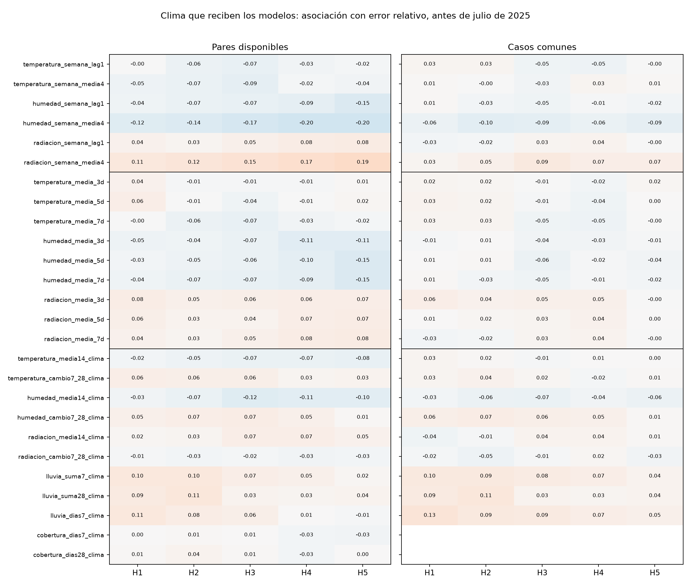

Para desplazamiento se requieren cinco horizontes con teoría y real completos. El centro de producción es la posición de semana (0–4) ponderada por tallos; centro real menos teórico positivo indica corte relativamente más tardío dentro de la ventana. No mide el corte fuera de esas cinco semanas ni prueba un retraso fisiológico: la composición de cohortes y las decisiones de corte también pueden influir. Se agregan series por origen y se separan al menos cinco semanas los orígenes analizados, evitando ventanas objetivo superpuestas.

| Señal previa | Ventanas | Spearman con desplazamiento | Intervalo exploratorio 95 % |
| --- | ---: | ---: | --- |
| temperatura_media14_clima | 40 | -0,149 | [-0,439; 0,217] |
| humedad_media14_clima | 40 | -0,100 | [-0,409; 0,263] |
| radiacion_media14_clima | 40 | 0,202 | [-0,095; 0,479] |
| lluvia_suma28_clima | 28 | -0,093 | [-0,484; 0,279] |

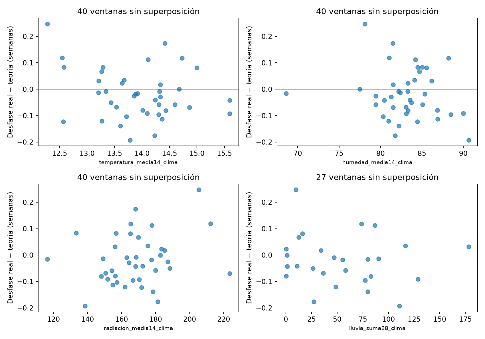

Los intervalos incluyen cero. El resultado no respalda una regla universal de adelanto o retraso por clima, pero tampoco descarta un aporte no lineal o específico por variedad. El remuestreo es exploratorio y no elimina confusión por temporada y manejo. La prueba siguiente evalúa si usar esas señales reduce error fuera del entrenamiento, con información estrictamente anterior a cada origen.

### 3.8. El calendario diario plantea una pregunta adicional

(La distribución del pronóstico entre días está en revisión y corresponde a siguientes pasos; las señales de corte diario usadas como entradas semanales sí forman parte del análisis principal.)

Al desagregar la producción aparecen 227.623 días-serie observados dentro de un calendario de 1.374.399 filas para 663 series. La suma de los cortes diarios coincide exactamente con el panel semanal por cada llave. Las filas restantes mantienen un valor faltante: construir un calendario no prueba que todas las series estuvieran activas durante todo el intervalo. [E6]

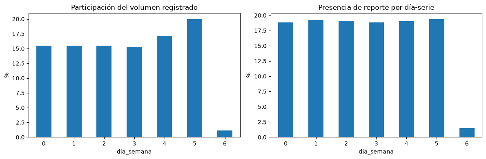

En el agregado de la finca, los sábados reúnen 65,54 millones de tallos reportados y los domingos 3,65 millones. Además, hay reporte dominical en sólo treinta fechas del periodo, frente a varios centenares para los demás días. El patrón muestra que un reparto uniforme de una séptima parte por día desconoce la distribución registrada. No permite concluir que la producción física del domingo sea siempre nula: calendario de corte y calendario de registro pueden diferir y requieren validación operativa.

El total semanal también puede ocultar cambios recientes. Dos series con un total parecido en la semana anterior pueden llegar al lunes con trayectorias distintas en los últimos tres o cinco días. De ahí surge la extensión con medias, sumas, tendencia y antigüedad del último corte. Las ventanas siguen días de calendario y se acompañan de conteos observados; no toman simplemente las últimas filas disponibles ignorando huecos.

### 3.9. Del hallazgo a la decisión metodológica

| Hallazgo del EDA | Decisión que orienta | Qué debe comprobar el modelo |
| --- | --- | --- |
| Los planos son fotografías y cambian entre versiones | Conservar origen, objetivo y versión | Si la historia de revisiones aporta fuera del ajuste inicial |
| La curva empírica no representa todas las edades de algunas cohortes | Delimitar cuándo aplica la referencia de curva y conservar la ruta basada en producción reciente | Precisión del sistema completo y del respaldo |
| La teoría presenta diferencias sistemáticas con lo registrado | Aprender una corrección | Mejora frente a referencias sobre casos comunes |
| El volumen se concentra y las series tienen escalas diferentes | Desglosar métricas por segmento | Que el agregado no oculte deterioros relevantes |
| La memoria reciente se asocia más con el error cercano | Añadir rezagos y tendencias de corte | Aporte por horizonte, sin asumir causalidad |
| El registro diario no sigue una distribución uniforme | Comparar perfiles y modelos diarios | Error diario y coherencia con la semana por separado |

El EDA dejó así una secuencia de decisiones, no una lista de variables elegidas por correlación: respetar el calendario y las identidades, conservar las revisiones de teoría, probar memoria productiva y contrastar el clima sin atribuirle causalidad. El siguiente capítulo convierte esas hipótesis en candidatos comparables y fija cómo se evaluarán antes de discutir sus resultados.

## 4. Diseño del sistema de pronóstico

### 4.1. Integración, calendario y disponibilidad

La unidad semanal es finca, producto, color, variedad y semana. La base de pronóstico agrega origen y horizonte: una semana objetivo puede aparecer varias veces porque fue anticipada en fechas distintas. Por eso sus cantidades no se suman como inventario producido. Las proyecciones ya calculadas se incorporan como insumo; los modelos de ajuste no vuelven a consultar plantas ni curvas para reconstruirlas. [E3]

H1 corresponde a la semana siguiente a la semana en curso cuando se emite el archivo; por ejemplo, el archivo 18–22 se envía el jueves de la semana 17 y H1 es la semana 18 y H5 a la que comienza cuatro semanas después. Sólo se usan semanas cerradas al entrenar. Las variables diarias se desplazan un día y las predicciones de los siete días de H1 se congelan al lunes, sin actualizarse con lo ocurrido dentro de esa semana. Se supone que los reportes pasados ya están disponibles; su latencia real debe confirmarse. AL1 aporta una referencia de disponibilidad supuesta para los planos, no una prueba de publicación.

Las homologaciones conservan la identidad comercial y no fuerzan coincidencias ambiguas. Los movimientos legítimos de producción se mantienen, los objetivos ausentes no se imputan y los parámetros de imputación de predictores se estiman con entrenamiento. Una prueba que modifica producción futura verifica que las variables anteriores al origen permanezcan iguales. Estos controles hacen revisable el significado de cada caso.

### 4.1.1. Cómo leer la base analítica consolidada

La base común tiene 621.195 filas y 47 columnas; incluye también casos sin objetivo observado o sin historia suficiente. No equivale al conjunto de entrenamiento ni al benchmark estricto vigente, actualizado a 16.325 comparaciones. Cada fila representa una combinación comercial y una semana objetivo vista desde un origen. El diccionario completo, con las 47 columnas agrupadas, está en el cuaderno `lectura.ipynb`; aquí resumimos sólo lo necesario para interpretar el ejemplo.

| Campo | Cómo leerlo en una fila |
| --- | --- |
| `finca`, `producto`, `color`, `variedad` | Identifican a quién corresponde el pronóstico; aquí, DINO amarillo de GAITANA. |
| `origen` | Fecha de corte desde la que se pronostica y hasta la cual llega la información disponible. |
| `semana_objetivo`, `horizonte` | Semana que se quiere estimar y qué tan adelante queda. En la comparación con archivos del ingeniero, la primera semana del nombre del archivo determina H1: el archivo 18–22 tiene H1 en semana 18; el renglón de semana 17 que se repite allí es de la semana en curso. |
| `teoria_modelo` | Referencia teórica utilizable si la curva representa las edades de todas las cohortes del plano. Vacío significa que esta ruta no aplica; no significa cero producción. |
| `media_4`, `observaciones_previas` | Resumen de producción real anterior al origen: media de cuatro semanas e historial reportado disponible. |
| `y` | Producción real de la semana objetivo. Se conoce al cerrar esa semana y se usa para evaluar; no está disponible al emitir el pronóstico. |

En el ejemplo, origen 3 de agosto de 2026 y H5 corresponden a la semana objetivo del 31 de agosto al 6 de septiembre. La última semana histórica empieza el 27 de julio y reporta 19.202 tallos; `media_4` es 22.250,75 y hay 213 semanas reportadas. El plano calcula 27.916,61 tallos para las edades representadas, pero dos de las 25 cohortes no tienen tasa en esa curva: por eso `teoria_modelo` queda vacío y el modelo usa su respaldo de producción reciente. La suma parcial no se toma como total teórico del plano ni señala pérdida de camas o producción. Al cerrar la semana, `y` registra 18.970 tallos reales. La fila es admisible para pronosticar, pero eso no implica que pertenezca a test.

La teoría previa tampoco es el horizonte anterior: es lo que un plano anterior calculaba para esa misma semana objetivo. En este ejemplo, el plano seleccionado del 13 de julio llega al objetivo en su horizonte teórico 7; los dos anteriores, en 8 y 9. Cada plano genera diez semanas teóricas, mientras el modelo evalúa H1–H5 desde su propio origen. Las versiones anteriores existían, pero sus curvas no representaban todas las cohortes; por eso sus teorías no se habilitaron como referencia. Un campo vacío no representa cero tallos.

### 4.1.2. Supuestos y límites de la base de pronóstico

Se mantienen separados origen, objetivo y horizonte. Una misma semana producida aparece en varios casos de pronóstico, por lo que sumar el objetivo sobre toda la base repetiría volumen. Las variables se calculan con fechas anteriores al origen; el objetivo observado no se imputa y la imputación de predictores usa sólo el entrenamiento. La prueba de perturbación del futuro comprueba el cálculo de las variables, pero no certifica que el archivo histórico hubiera estado publicado sin correcciones en aquel momento.

Los casos sin historia suficiente no entran en el aprendizaje. La ruta por teoría depende de las edades del plano; la ruta por producción reciente depende de su historia observada. Son condiciones diferentes y ninguna autoriza a interpretar una celda vacía como cero. La base de 621.195 filas descrita aquí corresponde a la edición analítica documentada; no se sustituye por los conteos posteriores del prototipo sin repetir y versionar la evaluación.

### 4.2. Metodología del pronóstico semanal

El flujo siguiente ordena las decisiones en el orden en que se hicieron. Cada bloque identifica el modelo o referencia, qué información se agregó y qué decisión metodológica habilitó el paso siguiente. La variante que queda como selección general y las pruebas posteriores por horizonte se mantienen diferenciadas.

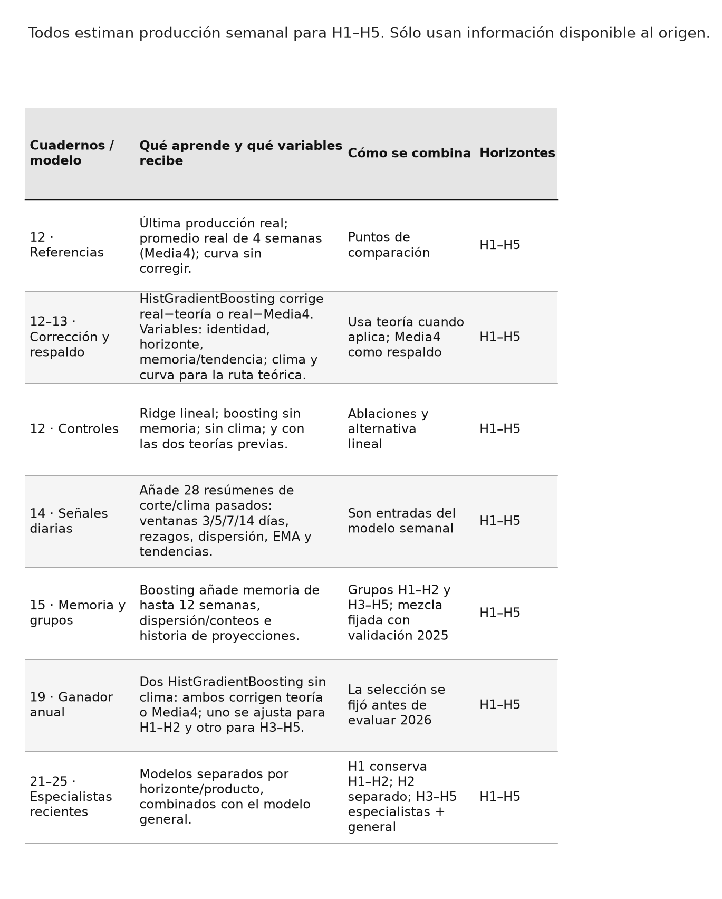

Cuando la curva representa todas las cohortes, el sistema aprende la diferencia entre producción real y esa referencia teórica. Cuando no, utiliza una corrección de la media de producción reciente de cuatro semanas. Así, la base conserva la observación real y el modelo tiene una ruta para producir un pronóstico admisible sin inventar un valor teórico para edades no representadas. Los modelos de boosting comparten información entre series e incorporan identificación comercial, horizonte, memoria semanal y los bloques de clima y teoría definidos en los notebooks. [E5]

La extensión incorpora 28 variables diarias: medias, sumas y conteos de corte en ventanas de 3, 5, 7 y 14 días; dispersión, rezagos, media exponencial, tendencias y días desde el último corte; y medias pasadas de temperatura, humedad y radiación. También se evalúa una corrección relativa. Una variante de pérdida absoluta se ensayó después de inspeccionar resultados y se identifica como exploratoria; además cambia la forma de combinar las rutas, por lo que su resultado no aísla únicamente el efecto de la función de pérdida.

Los candidatos semanales usan parámetros fijos de boosting: tasa de aprendizaje 0,08, 80 iteraciones, hasta 15 hojas, mínimo 40 observaciones por hoja, regularización L2 de 1 y semilla 42. El detalle reproducible permanece en los notebooks. El reentrenamiento mensual permite comparar los candidatos sobre los mismos orígenes de 2026, sin ajustar cada combinación hasta obtener un resultado favorable.

El algoritmo principal es HistGradientBoostingRegressor, implementado en scikit-learn. Cada árbol aprende condiciones sobre las entradas; los árboles se incorporan por etapas para reducir el error que queda. Puede representar relaciones no lineales e interacciones, por ejemplo respuestas distintas a una tendencia en horizontes cercanos y lejanos. La variante por histogramas agrupa valores numéricos para buscar divisiones eficientemente. Se compara con referencias simples y Ridge; no se justifica su elección únicamente por complejidad.

El objetivo aprendido es una corrección en tallos: real menos teoría, o real menos Media4 en el respaldo. La predicción final suma referencia y corrección estimada, con mínimo cero. Como ejemplo ilustrativo, una teoría de 28.000 y una corrección estimada de −3.500 producen un pronóstico de 24.500 tallos. El modelo aprende la corrección con resultados históricos, pero no conoce la producción objetivo futura al emitirla. Ridge estima esa corrección con una combinación lineal regularizada; boosting suma aportes de árboles. Ambos se evalúan fuera del entrenamiento.

### 4.2.1. Modelos semanales probados y por qué se compararon

La teoría de la curva es una referencia productiva, no el pronóstico final por sí sola. Se estima como punto de partida cuando representa las edades de todas las cohortes del plano. El modelo aprende la diferencia entre producción real y teoría; cuando la curva no representa todas las edades, aprende una corrección sobre Media4. Así se conservan dos rutas interpretables y cada caso usa la referencia que sí aplica.

HistGradientBoosting se probó porque sus árboles pueden aprender relaciones no lineales entre memoria, producto y horizonte. Ridge sirve de contraste lineal regularizado: en 12 se fija alpha = 100, con estandarización de entradas numéricas después de imputación por mediana e indicadores de faltante; las categorías usan one-hot. Estos pasos se ajustan sólo con train. No se realizó una búsqueda exhaustiva de alpha. Las referencias simples y las ablaciones muestran si el aprendizaje y cada bloque de variables aportan algo frente a reglas más sencillas. La secuencia completa es:

| Cuaderno / modelo | Qué hace | Entradas principales | Decisión o conclusión |
| --- | --- | --- | --- |
| 12 · `Ultimo_valor`, `Media4`, `Teoria_sin_ajuste` | Repite el último dato, promedia cuatro semanas o usa la curva sin corregir. | Una referencia cada vez. | Puntos de comparación sencillos para todos los H1–H5. |
| 12 · `Ajuste_media4_sin_planos` | Boosting estima real−Media4 y suma la corrección a Media4. | Identidad comercial, calendario, memoria real y clima disponible; no recibe teoría. | Respaldo para casos sin curva aplicable. |
| 12–13 · `Modelo_teorico` / `Sistema_teoria_con_respaldo` | Boosting estima real−teoría; si la curva no aplica, el sistema usa el ajuste de Media4. | Identidad, horizonte/calendario, rezagos y tendencias reales, clima y variables de curva en la ruta teórica. | Arquitectura de dos rutas; no promedia ambas referencias. |
| 12 · `Ridge_ajuste_teoria`, `Teorico_sin_memoria`, `Teorico_sin_clima` | Ridge prueba una corrección lineal; las otras dos variantes quitan memoria o clima. | Mismo problema con una diferencia controlada por variante. | Contrastes para medir no linealidad y aporte de cada bloque. |
| 12 · `Modelo_teorico_historia` | Añade revisiones de teorías anteriores para la misma semana objetivo. | Teoría actual, variables semanales y versiones previas. | Prueba si los cambios entre planos agregan señal. |
| 14 · Boosting semanal con señales de corte diario | Mantiene el objetivo semanal y añade 28 resúmenes de corte/clima recientes. | Ventanas 3/5/7/14 días, rezagos, conteos, dispersión, EMA y tendencias. | Prueba si una trayectoria diaria creciente o decreciente anticipa el total semanal. No es el modelo diario. |
| 15 · Boosting con memoria larga y grupos | Añade memoria de hasta 12 semanas, dispersión/conteos y prueba H1–H2 separado de H3–H5. | Producción histórica y, en una variante, teorías previas. | Motiva el uso de dos grupos de horizontes; pesos fijados con validación de 2025. |
| 19 · **Boosting sin clima, selección anual** | Dos grupos de HistGradientBoosting corrigen teoría o Media4: H1–H2 y H3–H5. | Memoria semanal/diaria y de 12 semanas, identidad/calendario y teoría cuando aplica; sin clima. | Ganador anual entre variantes propias, elegido antes de evaluar 2026. Detalle de variables y parámetros en 4.2.5. |
| 22–24 · Modelos separados por horizonte | Entrena un modelo por cada H1, H2, H3, H4 y H5; ajusta `max_iter` con validación temporal. | Variables semanales, memoria y teoría; clima sólo si hay cobertura suficiente. | Experimento distinto del ganador anual. La validación eligió 80 iteraciones en H1, H2 y H5, y 40 en H3 y H4. |
| 25 · Ensayo de modelos propios por producto | Conserva el grupo H1–H2 para H1 y el modelo H2 separado. En H3–H5, para Minicarnation y Carnation prueba un modelo propio de cada producto y horizonte junto con el modelo general de ese horizonte. Otros productos conservan el general. | Producción previa, calendario, teoría y proyecciones anteriores si aplican; el clima no estaba disponible en esta corrida. | Experimento reciente de 1.226 casos; no reemplaza la selección anual. La mezcla y sus parámetros se explican en 5.1.1. |

En el cuaderno 25, “especializado” es sólo una forma abreviada de decir “entrenado para un producto y horizonte específicos”. El ejemplo H3 de Minicarnation usa únicamente su historial de H3; no es otro tipo de algoritmo, sino HistGradientBoosting entrenado con un subconjunto más acotado. Después se combina —con un peso definido en validación anterior— con la predicción del modelo general de H3. El ingeniero y las semanas recientes no determinan ese peso.

### 4.2.2. Variables diarias que alimentan el pronóstico semanal

El experimento 13 enfrenta el sistema inicial al ingeniero; el 14 conserva boosting y añade 28 entradas, sin convertir todavía la tarea en pronóstico diario. Para un mismo total semanal, una trayectoria de corte creciente puede contener información distinta de una decreciente. Se prueba esa hipótesis, no se impone una corrección automática por tendencia.

| Nuevas entradas en 14 | Construcción y significado |
| --- | --- |
| corte_media, corte_suma y corte_dias, cada una en 3/5/7/14 días (12) | Nivel, volumen observado y cantidad de días con dato. Los faltantes no se sustituyen por cero. |
| corte_std_7d; corte_lag1d; corte_lag7d (3) | Dispersión de siete días, valor del día anterior y de siete días atrás. |
| corte_ema_5d (1) | Promedio exponencial con mayor peso reciente; conserva influencia de días anteriores, no trunca exactamente a cinco días. |
| corte_tendencia_3d/5d (2) | Media de los últimos 3/5 días menos media del bloque inmediatamente anterior de igual longitud. |
| dias_desde_corte (1) | Días desde el último valor reportado, incluso cero; no necesariamente desde el último corte positivo. |
| Temperatura/humedad/radiación media en 3/5/7 días (9) | Nueve resúmenes meteorológicos previos al origen. |

Las medias y sumas productivas admiten ventanas parciales y se acompañan de conteos. Todas excluyen el día del origen. La variante aditiva conserva las dos rutas; la alternativa relativa usa el mismo boosting para aprender log(1+real) menos log(1+Media4), invierte la transformación y limita a cero. Otra variante exploratoria cambia pérdida a error absoluto y usa una ruta conjunta sobre Media4, con teoría como predictor: no aísla exclusivamente el efecto de la pérdida.

### 4.2.3. Experimentos acotados después de corregir calidad

El experimento 15 documenta la corrección de calidad y los cambios de arquitectura. Su referencia anterior a calidad conserva el clima de aquella ejecución: tras actualizar la fuente, ese contraste ya no aísla sólo calidad. Dentro de los candidatos recalculados mantiene el clima común; luego separa modelos para H1–H2 y H3–H5, añade memoria de doce semanas, dispersión y conteos, y finalmente añade historia de proyecciones a las rutas teórica y de respaldo. Las medias de cuatro/ocho semanas y la referencia de un año ya existían y no se presentan como variables nuevas. Cada etapa conserva la anterior y añade un bloque. [E10]

La combinación sencilla usa pesos de 0, 0,25, 0,50, 0,75 o 1 sobre el modelo y una referencia de media4 o teoría con respaldo. Los pesos por grupo de horizontes se eligen mediante predicciones de noviembre–diciembre de 2025, con entrenamiento anterior a cada origen y objetivos cerrados antes de enero de 2026. Se mantienen fijos al evaluar 2026. El periodo 2026 continúa siendo desarrollo retrospectivo y no selecciona esos pesos.

### 4.2.4. Prueba acotada del clima y de la procedencia de curvas

El experimento 19 mantiene HistGradientBoostingRegressor, parámetros, memoria larga, separación H1–H2/H3–H5 y rutas teórica/respaldo. Compara retirar todo el clima, usar el clima básico actualizado, añadir señales de catorce/veintiocho días y lluvia, y cambiar la referencia a la curva atribuida a GAITANA manteniendo el mismo clima ampliado. La última comparación afecta tanto referencia como cobertura; se desglosa por rutas y se compara la teoría cruda sobre casos completos para ambas alternativas. [E16]

La selección utiliza el menor WAPE de noviembre–diciembre de 2025, con objetivos cerrados antes de enero de 2026. Se conserva al evaluar 2026. Los modelos se reentrenan mensualmente usando sólo semanas objetivo terminadas antes del corte; imputación y codificación se ajustan en train. Los predictores climáticos terminan antes del lunes de emisión. No se usa clima futuro observado ni pronóstico meteorológico externo. Las pruebas de perturbación del futuro comprueban que no cambien las variables pasadas.

Actualizar clima básico permite medir el efecto de completar la fuente manteniendo la arquitectura anterior. Añadir el bloque ampliado mide una pregunta distinta. La historia previa al arreglo de calidad de 15 se conserva como referencia, pero su contraste con modelos de clima nuevo ya no aísla sólo calidad de curvas. Ningún periodo examinado durante el desarrollo se presenta como prueba prospectiva intacta.

La validación anterior a 2026 produce esta comparación; no es el test frente al ingeniero:

| Método | Casos | MAE (tallos) | RMSE (tallos) | MAPE* | WAPE | Dentro ±8 %* | Sesgo (%) |
| --- | --- | --- | --- | --- | --- | --- | --- |
| Boosting sin clima | 3.548 | 2.045,72 | 3.466,31 | 47,04 % | 21,70 % | 19,02 % | 1,28 % |
| Clima básico | 3.548 | 2.065,49 | 3.520,15 | 46,60 % | 21,91 % | 19,76 % | 2,14 % |
| Clima ampliado y lluvia | 3.548 | 2.104,99 | 3.574,23 | 48,90 % | 22,33 % | 18,91 % | 3,88 % |
| Clima ampliado y curva atribuida a GAITANA | 3.548 | 2.223,17 | 3.819,90 | 50,12 % | 23,58 % | 18,60 % | 5,13 % |

Una diferencia pequeña entre candidatos en estos dos meses no acredita superioridad estable. Se conserva la elección para evitar escoger de nuevo mirando el resultado de 2026.

### 4.2.5. Modelo semanal seleccionado: arquitectura, variables y parámetros

El ganador anual es el **Boosting sin clima del cuaderno 19**. No se entrenó un parámetro distinto para cada H. Se ajusta un modelo para H1–H2 y otro para H3–H5; dentro de cada grupo se crean dos regresiones complementarias: una corrige la teoría en los casos donde la curva cubre todas las edades y otra corrige Media4 como respaldo. Cada fila toma sólo la ruta que le corresponde; no se promedian teoría y Media4.

La ruta de Media4 recibe producto, color, variedad, horizonte y calendario, nueve variables de memoria semanal y siete señales de memoria larga. El bloque diario inicial tiene 28 columnas: al retirar las nueve climáticas, la variante seleccionada conserva 19 señales diarias de producción. La ruta teórica recibe ese mismo bloque más `teoria_modelo`, `antiguedad_curva` y `desviacion_reciente_teoria`. Como se eligió la variante sin clima, no entran columnas meteorológicas al modelo final. La imputación numérica usa medianas calculadas en train y las categorías se codifican con indicadores; la cobertura decide la ruta, pero no se entrega al algoritmo como predictor.

Los dos grupos y las dos rutas comparten la misma configuración de HistGradientBoostingRegressor:

| Parámetro | Valor | Interpretación sencilla |
| --- | ---: | --- |
| Tasa de aprendizaje (`learning_rate`) | 0,08 | Cuánto aporta cada árbol nuevo. |
| Iteraciones máximas (`max_iter`) | 80 | Número de etapas de árboles. |
| Hojas máximas por árbol (`max_leaf_nodes`) | 15 | Complejidad permitida a cada árbol. |
| Mínimo por hoja (`min_samples_leaf`) | 40 | Evita reglas basadas en muy pocos casos. |
| Regularización L2 | 1,0 | Penaliza ajustes excesivamente grandes. |
| Parada temprana | No | Usa las 80 iteraciones definidas. |
| Semilla (`random_state`) | 42 | Hace reproducible la ejecución. |

Por tanto, aunque el sistema tenga varios ajustes por grupo y por ruta, **no tiene hiperparámetros distintos entre H1–H2 y H3–H5**. Los parámetros diferentes aparecen en el experimento posterior de modelos separados por horizonte (cuadernos 22–24), no en el ganador anual. Allí se eligieron 80 iteraciones para H1, H2 y H5 y 40 para H3 y H4; se mantuvieron 15 hojas y el resto de la configuración. Esa variante no sustituyó al ganador anual.

### 4.2.6. Secuencia temporal de entrenamiento, validación y evaluación

En 12 se fijan cortes el 7 de julio de 2025, 5 de enero y 4 de mayo de 2026, con ocho semanas de orígenes de evaluación por corte. Cada entrenamiento exige semana_objetivo + siete días menor o igual al corte: no basta con que el origen sea antiguo si su resultado aún no había cerrado. No hay división aleatoria. En 13–19 se reentrena al primer origen de cada mes, conservando los mismos parámetros y el pasado disponible.

Para pesos del 15 y selección del 19 se usan predicciones temporales de noviembre–diciembre de 2025, con objetivos terminados antes de enero de 2026. Luego se evalúa 2026 sin cambiar la elección por el ingeniero. Durante esa evaluación mensual pueden entrar al entrenamiento resultados de meses anteriores de 2026 que ya cerraron: es actualización temporal, no uso de los objetivos del mes que se está evaluando. Los errores train y test se comparan por el mismo ajuste; no se interpreta el train del último mes como si fuera el entrenamiento fijo de todo el año. Como esos periodos se revisaron durante desarrollo, aún se requiere una evaluación prospectiva nueva.

### 4.2.7. Decisiones y límites de los ajustes semanales

Se aprendió una corrección en tallos y se restringió la predicción final a valores no negativos. Los modelos comparten información entre series mediante identidad comercial; ello facilita aprender con historias desiguales, pero no certifica igual desempeño para variedades nuevas o de bajo volumen. Las ablaciones del 12 mantienen casos comunes; los contrastes de 14 añaden producción y clima diarios conjuntamente, y la referencia anterior a calidad del 15 también conserva otra versión climática. Por tanto, no todas las diferencias aíslan un único cambio.

El 19 se elige en noviembre–diciembre de 2025 y se actualiza mensualmente, con objetivos cerrados antes del corte. Los ensayos recientes 21–25 no son una réplica exacta: reentrenan por origen, usan memoria semanal y hasta seis variables de teoría/revisiones, no los mismos bloques diario y de memoria larga del 19, y limitan el ajuste a una muestra de hasta 5.000 registros pasados por grupo con semilla 42. El número de registros elegibles de sus controles no equivale necesariamente al número efectivamente usado al ajustar. Esta diferencia impide atribuir una mejora sólo a separar horizontes o productos.

En 24 se comparan 40 y 80 iteraciones con 15 hojas en noviembre de 2025; diciembre estima un factor de volumen por horizonte. En 25 se seleccionan parámetros y pesos de especialistas con noviembre. Son búsquedas acotadas, no una optimización exhaustiva. Las ventanas ya fueron examinadas durante desarrollo: hace falta un período nuevo para estimar generalización. [PENDIENTE: evaluación prospectiva de la configuración congelada y análisis de estabilidad de selección entre varias ventanas temporales.]

### 4.3. Comparación con el ingeniero

La evaluación principal exige misma finca, producto, color, variedad, origen, objetivo y horizonte, además de un archivo del ingeniero no posterior al origen bajo la regla nominal adoptada. Los emparejamientos recuperados por color, los archivos posteriores y los casos sin pareja se separan. El pronóstico del ingeniero se utiliza para evaluar; no alimenta los modelos candidatos. [E5]

Las métricas se recalculan desde las predicciones archivadas y los objetivos de cada panel, por caso antes de agregar por horizonte o segmento. Se informan MAE, RMSE, MAPE, WAPE/WMAPE, porcentaje dentro de ±8 % y sesgo porcentual, conservando sesgo medio y saldo neto en la auditoría; en esta versión todas las tablas de modelos usan el signo predicción menos real. El anexo técnico conserva también el saldo neto en tallos y la fuente de cada cálculo. El WMAPE referido en el Plan se reporta como WAPE con ponderación por volumen. Los indicadores marcados con asterisco (MAPE y dentro de ±8 %) se calculan sólo para reales positivos; sus conteos positivos y ceros se conservan por método en la auditoría, sin imputar un denominador. La banda ±8 % es la referencia inicial del Plan, todavía sujeta a validación empresarial, no un intervalo de incertidumbre. Los registros agregados train/test se toman de sus salidas guardadas y se identifican por corte, sin reentrenar. No se promedian los porcentajes de subgrupos para obtener el total. El remuestreo por semana objetivo se mantiene como exploratorio y no transforma los períodos revisados en una prueba prospectiva intacta.

### 4.3.1. Límite de la comparación con el ingeniero

La primera semana del nombre del archivo define H1; la semana en curso que pueda permanecer en la tabla no cambia ese horizonte. Los casos con archivo posterior al origen o identidad recuperada se separan del panel principal. Se compara la misma combinación comercial, origen nominal, semana objetivo y horizonte, evitando atribuir a un método un caso que el otro no tiene.

Ese emparejamiento no garantiza igualdad del momento de información: el ingeniero envía el jueves anterior y las variables de la simulación semanal utilizan el pasado disponible antes del lunes. Los días intermedios pueden favorecer al modelo. La ventaja observada justifica ensayar su uso, pero no demuestra superioridad con idéntico conjunto informativo ni el reemplazo inmediato del juicio experto. [PENDIENTE: repetir la comparación congelando insumos al jueves de emisión, o acordar una emisión común para ambos métodos y conservar sus marcas de tiempo.]

### 4.3.2. Qué parte de la salida analítica está implementada

La salida disponible presenta cantidades originales y ajustadas, contexto temporal, WAPE y sesgo históricos, y permite revisar error por producto, color y variedad. El prototipo conserva generación, ajuste y publicación separados, con trazabilidad de versiones. Esto permite consultar una sugerencia y revisarla, pero no certifica todavía una regla empresarial de decisión. [E21]

Los avisos de actualización de fuentes y los diagnósticos de error retrospectivo no son los semáforos de faltante, normalidad y sobrante previstos en OE3. Para esos semáforos hace falta acordar contra qué referencia comercial se clasifica la predicción y qué acciones corresponden. No se puede usar producción real futura para simular una alerta emitida antes del corte. El umbral ±8 % del Plan sirve aquí para evaluar predicciones ya observadas, no para atribuir una decisión operativa validada.

### 4.4. Metodología independiente del pronóstico diario

(En revisión: este bloque es un piloto independiente del modelo semanal.)

El objetivo diario es estimar los tallos reportados en cada día de H1. No se vuelve a pronosticar la semana completa en esta sección. Hay dos tareas: el modelo autónomo predice cada día sin recibir el total semanal actual; el reconciliado parte del total semanal ya pronosticado y aprende cómo distribuirlo en siete días. Sus WAPE responden preguntas distintas. El piloto SARIMA/SARIMAX es un contraste exploratorio de series temporales.

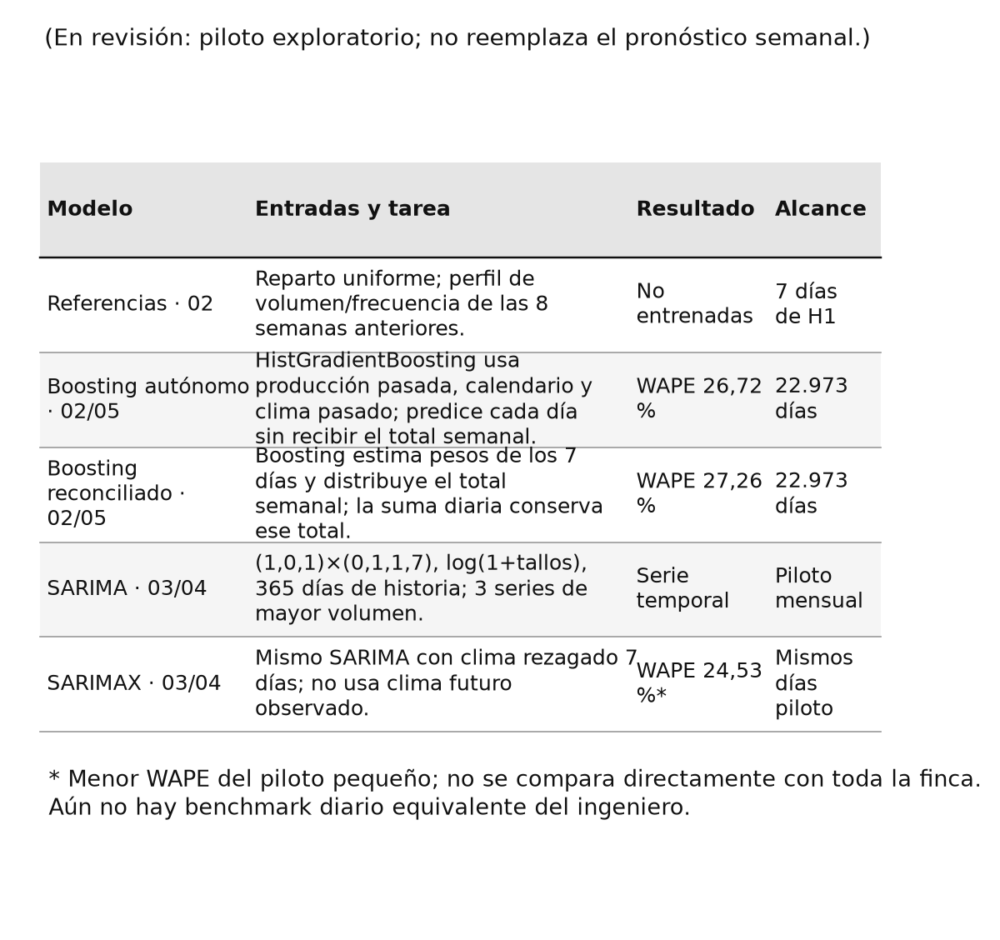

El modelo diario autónomo se reentrena por mes con hasta 104 semanas previas y semanas de entrenamiento cerradas. Usa HistGradientBoosting con 80 iteraciones, 15 hojas, tasa 0,08, mínimo 40 casos por hoja, L2 de 1 y semilla 42. Aprende la diferencia entre log(1 + tallos del día) y log(1 + Media4/7), con identidad, calendario del día y señales productivas/climáticas pasadas. Invierte esa transformación y restringe el resultado a no negativo; no recibe el pronóstico semanal actual. El reparto por boosting pondera ese volumen por la frecuencia de reporte suavizada de las ocho semanas previas, (reportes + 0,5)/(días + 1), y normaliza siete pesos; si su suma no es positiva, usa el perfil histórico. Las variantes reconciliadas calculan pesos no negativos para los siete días, los normalizan para que sumen uno y los multiplican por el pronóstico semanal. Se comparan reparto uniforme, perfil de volumen registrado en las ocho semanas previas y perfil de boosting ponderado por frecuencia histórica de reporte. Este último representa el volumen registrado esperado, no una afirmación de producción física cero en días ausentes. [E7]

La evaluación separa error diario, distribución relativa y conservación del total semanal. Se puntúan días con reporte y se informa la cantidad asignada a días sin registro como diagnóstico. El total semanal real se utiliza sólo al analizar posteriormente la forma de la distribución, nunca como entrada de un pronóstico supuestamente perfecto.

Como contraste de series de tiempo se prueban SARIMA (1,0,1)×(0,1,1,7) y SARIMAX con el mismo orden y clima rezagado siete días, sobre log(1+tallos), con 365 días de historia. Ese rezago permite conocer al lunes las variables climáticas de los siete días futuros sin usar clima futuro realizado. El piloto considera las tres series con mayor volumen de 2025 y al menos 120 días reportados, y el primer origen de cada mes de enero a agosto de 2026. Se audita convergencia y se comparan todos los métodos en los mismos días disponibles. [E8]

### 4.4.1. Supuestos y límites del piloto diario

Los repartos usan pesos no negativos normalizados sobre siete días y conservan el total semanal pronosticado; no corrigen por sí solos un error en ese total. La evaluación se restringe a días con reporte, de modo que no estima todavía el error de todos los días físicos de corte. La frecuencia de registro puede reflejar manejo administrativo. Comparar sólo semanas con siete reportes cambia la población y no permite decidir de antemano qué método emitir.

SARIMA/SARIMAX usan órdenes fijos y tres series seleccionadas por volumen previo; sólo los ajustes convergentes aportan predicciones, y el panel común se reduce a 135 días. La comparación climática usa exógenas rezagadas, no un pronóstico meteorológico. Su resultado no se extrapola a toda la finca ni se compara directamente con el panel diario de 22.973 casos.

### 4.4.2. Extensión LSTM: otra tarea diaria, todavía exploratoria

El cuaderno diario 06 ensaya una LSTM de dos capas de 48 unidades, dropout 0,15 y una salida con capa intermedia de 24 unidades. Recibe secuencias de 28 días, máscaras de observación, calendario cíclico e historia desplazada 364 días; el objetivo se transforma en log(1 + producción/escala), con escala mediana positiva calculada con los registros anteriores a julio de 2026, incluidos los de 2024 disponibles para esa normalización. La estandarización de entradas sí usa el subconjunto train. Se ajusta con Adam (tasa 0,001 y regularización 0,00001), MSE, lotes de 512, recorte de gradiente 1 y hasta 12 épocas, con paciencia de tres épocas. Los objetivos train abarcan desde enero de 2025 hasta antes de julio de 2026; validación, julio–agosto; test, septiembre. Si hay más de 25.000 ejemplos train, se muestrean 25.000 con semilla 42. [E20]

La ventana de entrada se actualiza antes de cada día objetivo con registros diarios reales: es un ensayo de un día adelante, no siete días emitidos simultáneamente al lunes. El modo climático exige al menos 80 % de disponibilidad y un atraso máximo de siete días; la salida archivada utiliza sin clima y conserva con clima como diagnóstico. Los faltantes entran con máscara y no se convierten en producción real cero al evaluar. No se reconcilia este ensayo con el total semanal.

La admisibilidad por cantidad de reportes se revisa sobre la historia completa construida, lo cual puede condicionar retrospectivamente qué series entran. [PENDIENTE: auditar esa selección usando sólo el período previo al corte, guardar predicciones train y validación en tallos y evaluar siete días desde un origen común antes de comparar la LSTM con el reparto semanal.]

## 5. Resultados: qué mejoró y dónde persisten las dificultades

### Recorrido de resultados antes de la selección vigente

Los resultados de experimentos iniciales que se muestran a continuación conservan el panel común utilizado en esas corridas (15.838 casos). Sirven para documentar cómo se compararon arquitecturas y qué decisiones motivaron; no son el benchmark anual vigente. La comparación actualizada con el ingeniero, que aplica la regla nominal del archivo semanal, utiliza 16.325 casos y aparece en 5.1.

Los resultados de 12 preguntan si puede corregirse una referencia con información pasada. En los mismos casos donde la curva representa las edades de todas las cohortes se comparan reglas sencillas, boosting y Ridge. Los nombres describen qué referencia y qué bloque recibe cada ajuste. [E5]

| Método | Casos | MAE (tallos) | RMSE (tallos) | MAPE* | WAPE | Dentro ±8 %* | Sesgo (%) |
| --- | --- | --- | --- | --- | --- | --- | --- |
| Boosting sobre Media4, sin teoría | 2.107 | 2.037,95 | 3.495,22 | 40,13 % | 20,69 % | 19,79 % | -3,75 % |
| Media4 | 2.107 | 2.316,39 | 4.190,48 | 36,90 % | 23,52 % | 18,27 % | -6,11 % |
| Boosting teórico con memoria y clima | 2.107 | 1.901,74 | 3.341,20 | 26,60 % | 19,31 % | 23,30 % | -8,04 % |
| Boosting teórico con revisiones | 2.107 | 1.892,13 | 3.324,07 | 26,37 % | 19,21 % | 22,69 % | -8,34 % |
| Ridge sobre teoría | 2.107 | 1.966,51 | 3.522,77 | 39,23 % | 19,97 % | 21,55 % | -11,19 % |
| Teoría sin ajuste | 2.107 | 2.829,12 | 5.273,33 | 39,55 % | 28,72 % | 20,36 % | 13,09 % |
| Boosting teórico sin clima | 2.107 | 1.867,06 | 3.289,43 | 26,46 % | 18,96 % | 22,83 % | -8,77 % |
| Boosting teórico sin memoria | 2.107 | 2.291,01 | 3.997,73 | 30,20 % | 23,26 % | 18,08 % | -12,02 % |
| Último valor real | 2.107 | 2.090,50 | 3.871,08 | 31,34 % | 21,22 % | 21,40 % | -4,15 % |

El sistema completo conserva una ruta de pronóstico para todos los casos admisibles. Cuando la curva no representa todas las edades, se usa la ruta basada en producción reciente. En 12 se evalúa el sistema completo por separado:

| Método | Casos | MAE (tallos) | RMSE (tallos) | MAPE* | WAPE | Dentro ±8 %* | Sesgo (%) |
| --- | --- | --- | --- | --- | --- | --- | --- |
| Boosting sobre Media4 | 14.108 | 2.246,79 | 4.103,53 | 56,17 % | 21,14 % | 20,60 % | -5,39 % |
| Teoría aplicable y respaldo | 14.108 | 2.226,44 | 4.084,33 | 54,15 % | 20,95 % | 21,12 % | -5,98 % |

El experimento 14 añadió señales de corte diario y clima diario a un boosting semanal. Como entran conjuntamente, la comparación no aísla el efecto de cada señal:

| Método | Casos | MAE (tallos) | RMSE (tallos) | MAPE* | WAPE | Dentro ±8 %* | Sesgo (%) |
| --- | --- | --- | --- | --- | --- | --- | --- |
| Corrección relativa diaria | 15.838 | 2.640,03 | 4.900,20 | 30,19 % | 20,58 % | 22,19 % | -8,76 % |
| Boosting con pérdida absoluta, exploratorio | 15.838 | 2.548,00 | 4.742,39 | 31,41 % | 19,86 % | 22,81 % | -7,22 % |
| Sistema anterior a señales diarias | 15.838 | 2.596,79 | 4.732,33 | 44,71 % | 20,24 % | 22,09 % | -5,30 % |
| Boosting con señales diarias | 15.838 | 2.555,65 | 4.629,63 | 45,19 % | 19,92 % | 22,15 % | -4,24 % |
| Ingeniero | 15.838 | 2.531,72 | 4.403,88 | 29,08 % | 19,74 % | 21,73 % | -9,75 % |

En 15 se agruparon horizontes, se añadió historia productiva larga y se probaron versiones anteriores de la teoría. Los pesos se fijaron con validación temporal previa a 2026:

| Método | Casos | MAE (tallos) | RMSE (tallos) | MAPE* | WAPE | Dentro ±8 %* | Sesgo (%) |
| --- | --- | --- | --- | --- | --- | --- | --- |
| Referencia antes de calidad y clima | 15.838 | 2.570,36 | 4.635,39 | 47,07 % | 20,04 % | 22,08 % | -3,88 % |
| Combinación fijada antes de 2026 | 15.838 | 2.499,90 | 4.551,95 | 44,90 % | 19,49 % | 22,89 % | -4,72 % |
| Memoria larga | 15.838 | 2.496,69 | 4.496,51 | 42,42 % | 19,46 % | 22,82 % | -3,80 % |
| Revisiones de teoría | 15.838 | 2.499,90 | 4.551,95 | 44,90 % | 19,49 % | 22,89 % | -4,72 % |
| Agrupado H1–H2 / H3–H5 | 15.838 | 2.507,01 | 4.533,67 | 42,99 % | 19,54 % | 22,69 % | -3,91 % |
| Sistema diario del 14 | 15.838 | 2.555,65 | 4.629,63 | 45,19 % | 19,92 % | 22,15 % | -4,24 % |
| Ingeniero | 15.838 | 2.531,72 | 4.403,88 | 29,08 % | 19,74 % | 21,73 % | -9,75 % |

«Sin memoria» significa que el modelo no recibe rezagos productivos, aunque sí aprende de casos históricos. Las proyecciones previas son versiones anteriores del plano para la misma semana objetivo. La referencia “Antes” conserva otra configuración y clima, por lo que no aísla el efecto de esta revisión. La selección final por validación temporal se informa aparte en 5.1.

### 5.1. Resultado del modelo semanal seleccionado frente al ingeniero

Esta es la comparación principal del **Boosting sin clima seleccionado en el cuaderno 19**: dos ajustes con la misma configuración, uno para H1–H2 y otro para H3–H5. La elección se fijó por validación temporal de noviembre–diciembre de 2025, antes de observar esta evaluación de 2026. Se comparan 16.325 pronósticos emparejados con la regla nominal de archivos: la primera semana del nombre determina H1. Por ejemplo, el archivo 18–22 se envía en la semana 17 y su H1 es la 18; la fila repetida de la semana 17 corresponde a la semana aún en curso.

La gráfica separa magnitud del error (WAPE) y dirección del error (sesgo). Los valores negativos de sesgo indican subestimación. Cada punto/segmento se calcula sobre el volumen agregado de su horizonte; no representa un error promedio por planta.

| Horizonte | Ajuste del sistema seleccionado | Casos | WAPE: modelo / ingeniero | Sesgo: modelo / ingeniero | Menor WAPE |
| --- | --- | ---: | ---: | ---: | --- |
| H1 | Grupo H1–H2 | 3.512 | 15,53 % / 16,93 % | -1,34 % / -7,54 % | Modelo |
| H2 | Grupo H1–H2 | 3.388 | 17,49 % / 19,16 % | -2,01 % / -7,97 % | Modelo |
| H3 | Grupo H3–H5 | 3.264 | 20,33 % / 20,26 % | -2,46 % / -9,38 % | Ingeniero |
| H4 | Grupo H3–H5 | 3.141 | 21,78 % / 20,97 % | -3,18 % / -11,52 % | Ingeniero |
| H5 | Grupo H3–H5 | 3.020 | 22,20 % / 21,60 % | -2,97 % / -13,09 % | Ingeniero |
| Total H1–H5 | Ambos grupos | 16.325 | 19,36 % / 19,71 % | -2,36 % / -9,81 % | Modelo |

El modelo gana en H1, H2 y el total; el ingeniero gana en H3–H5 por WAPE. El sesgo del modelo es menos negativo en todos los horizontes: subestima menos el volumen agregado, aunque eso no basta para ganar WAPE en H3–H5. Sesgo = 100 × suma(predicción − real) / suma(real). Los resultados son retrospectivos, no una prueba prospectiva independiente.

**Contraste anual completo de las variantes del 19.** Se recalcula sobre los 16.325 casos nominales corregidos, en lugar de reutilizar el Resumen anterior del Excel que conservaba 15.838. La elección sigue siendo la fijada con validación 2025; el menor error de una alternativa en 2026 no cambia esa selección.

| Método | Casos | MAE (tallos) | RMSE (tallos) | MAPE* | WAPE | Dentro ±8 %* | Sesgo (%) |
| --- | --- | --- | --- | --- | --- | --- | --- |
| Boosting sin clima | 16.325 | 2.487,57 | 4.440,90 | 45,80 % | 19,36 % | 23,11 % | -2,36 % |
| Clima básico | 16.325 | 2.499,92 | 4.487,67 | 42,38 % | 19,45 % | 22,83 % | -3,57 % |
| Clima ampliado y lluvia | 16.325 | 2.478,91 | 4.426,74 | 42,33 % | 19,29 % | 22,92 % | -2,98 % |
| Clima ampliado y curva atribuida a GAITANA | 16.325 | 2.495,57 | 4.457,57 | 42,95 % | 19,42 % | 22,85 % | -2,73 % |
| Ingeniero | 16.325 | 2.533,69 | 4.406,98 | 29,37 % | 19,71 % | 21,86 % | -9,81 % |

**Detalle técnico del seleccionado y del ingeniero, por horizonte.**

| Método | Casos | MAE (tallos) | RMSE (tallos) | MAPE* | WAPE | Dentro ±8 %* | Sesgo (%) |
| --- | --- | --- | --- | --- | --- | --- | --- |
| Modelo H1 | 3.512 | 1.970,59 | 3.515,90 | 30,48 % | 15,53 % | 27,36 % | -1,34 % |
| Ingeniero H1 | 3.512 | 2.149,11 | 3.713,84 | 26,02 % | 16,93 % | 24,26 % | -7,54 % |
| Modelo H2 | 3.388 | 2.238,25 | 4.008,77 | 36,02 % | 17,49 % | 25,21 % | -2,01 % |
| Ingeniero H2 | 3.388 | 2.451,94 | 4.242,02 | 29,41 % | 19,16 % | 22,17 % | -7,97 % |
| Modelo H3 | 3.264 | 2.604,79 | 4.648,42 | 53,03 % | 20,33 % | 22,79 % | -2,46 % |
| Ingeniero H3 | 3.264 | 2.595,59 | 4.449,56 | 30,40 % | 20,26 % | 21,08 % | -9,38 % |
| Modelo H4 | 3.141 | 2.824,76 | 4.991,89 | 54,51 % | 21,78 % | 20,06 % | -3,18 % |
| Ingeniero H4 | 3.141 | 2.719,79 | 4.697,37 | 30,88 % | 20,97 % | 20,89 % | -11,52 % |
| Modelo H5 | 3.020 | 2.891,07 | 4.993,29 | 57,74 % | 22,20 % | 19,30 % | -2,97 % |
| Ingeniero H5 | 3.020 | 2.812,18 | 4.940,70 | 30,53 % | 21,60 % | 20,56 % | -13,09 % |

### 5.1.1. Ensayo reciente: modelos propios por producto y horizonte

Este experimento no es el ganador anual. Compara 1.226 pronósticos de GAITANA en tres semanas objetivo recientes. El ingeniero se usa sólo para medir. En esta sección, “modelo propio por producto y horizonte” significa un modelo entrenado con el historial de un solo producto y un solo horizonte. Por ejemplo, el modelo propio de Minicarnation para H3 aprende de Minicarnation en H3; el modelo general de H3 aprende de los productos disponibles en ese horizonte. Ambos siguen siendo HistGradientBoosting. Se probaron modelos propios para Minicarnation y Carnation; los demás productos usan el modelo general.

| Horizonte/producto | Qué predice el candidato | Cómo se obtiene el valor final |
| --- | --- | --- |
| H1, todos los productos | Modelo general agrupado H1–H2 | Se conserva directamente. |
| H2, todos los productos | Modelo general separado H2 | Se conserva directamente. |
| H3–H5, productos distintos de Minicarnation y Carnation | Modelo general separado para cada horizonte | Se conserva directamente. |
| H3–H5, Minicarnation y Carnation | Un HistGradientBoosting por producto y horizonte, entrenado sólo con ese producto, más el modelo general separado del horizonte | `predicción final = (1 − peso) × general + peso × especializado`. El peso se eligió con validación previa de noviembre. |

Para Minicarnation y Carnation se eligieron pesos de 1,00 en H3, 1,00 en H4 y 0,75 en H5. Así, en H3 y H4 se usa por completo la predicción del modelo propio; en H5 se combinan 75 % de la predicción propia y 25 % de la general. Los pesos son iguales para ambos productos. No se utiliza la predicción del ingeniero para entrenar ni para determinar los pesos.

Los modelos especializados usan HistGradientBoostingRegressor. En la validación previa se eligieron 40 iteraciones para Minicarnation en H3–H5 y 80 iteraciones para Carnation en H3–H5; todos usan 15 hojas. Se mantienen tasa de aprendizaje 0,08, mínimo de 40 casos por hoja, regularización L2 de 1, sin parada temprana y semilla 42. El modelo general por horizonte usa 80 iteraciones en H1/H2/H5 y 40 en H3/H4, con 15 hojas y los mismos valores restantes. La selección de parámetros y pesos ocurrió en noviembre, separada de las tres semanas recientes de evaluación. En esa corrida el clima no estaba disponible en las entradas, así que estos modelos funcionaron sin clima.

| Horizonte | Candidato reciente | WAPE candidato / ingeniero | Sesgo candidato / ingeniero | Lectura |
| --- | --- | ---: | ---: | --- |
| H1 | General agrupado H1–H2 | 12,28 % / 15,23 % | +2,75 % / -7,79 % | Candidato gana WAPE; sobreestima ligeramente. |
| H2 | General separado H2 | 14,96 % / 14,98 % | -0,02 % / -5,80 % | Empate práctico en WAPE; sesgo del candidato casi neutro. |
| H3 | General + mezcla especializada para dos productos | 17,27 % / 16,51 % | -5,85 % / -7,99 % | Ingeniero gana WAPE. |
| H4 | General + mezcla especializada para dos productos | 18,89 % / 16,79 % | -3,96 % / -7,67 % | Ingeniero gana WAPE. |
| H5 | General + mezcla 75/25 para dos productos | 19,76 % / 16,95 % | -7,76 % / -7,86 % | Ingeniero gana WAPE. |
| Total | Ensamble por horizonte/producto | 17,53 % / 16,34 % | -4,22 % / -7,51 % | Ingeniero gana el total. |

El ensamble reduce el WAPE del candidato previo de 17,80 % a 17,53 %, pero todavía no supera al ingeniero en el total ni en H3–H5. La mejora reciente de H1 es clara; H2 es un empate práctico. Esta evaluación breve no desplaza al Boosting sin clima anual.

### 5.1.2. Qué cambió en las semanas recientes y qué no puede concluirse

La ventana reciente contiene tres semanas objetivo en total, pero su representación no es igual por horizonte. H1 se evalúa en una sola semana objetivo; no son tres réplicas de su mejora. Las fechas y cantidades efectivas son:

| Horizonte | Casos | Semanas objetivo representadas |
| --- | --- | --- |
| H1 | 103 | 07/09/2026 |
| H2 | 205 | 07/09/2026, 14/09/2026 |
| H3 | 306 | 07/09/2026, 14/09/2026, 21/09/2026 |
| H4 | 306 | 07/09/2026, 14/09/2026, 21/09/2026 |
| H5 | 306 | 07/09/2026, 14/09/2026, 21/09/2026 |

Se conserva el orden de trabajo. El 21 comprueba un modelo general sobre las nuevas semanas; el 22 compara agrupación y separación por horizonte; el 23 retira productos tanto del entrenamiento como del panel evaluado; el 24 incorpora selección de iteraciones y calibración de sesgo anteriores; el 25 especializa dos productos para H3–H5 y mezcla sólo predicciones propias. La tabla siguiente hace visible el resultado de cada paso, sin trasladar el panel de uno al otro.

**Cuaderno 21: comprobación reciente.**

| Método | Casos | MAE (tallos) | RMSE (tallos) | MAPE* | WAPE | Dentro ±8 %* | Sesgo (%) |
| --- | --- | --- | --- | --- | --- | --- | --- |
| Modelo general del ensayo 21 | 1.226 | 2.223,93 | 3.393,05 | 28,22 % | 17,54 % | 23,98 % | -5,07 % |
| Ingeniero | 1.226 | 2.072,07 | 3.179,67 | 24,54 % | 16,34 % | 22,76 % | -7,51 % |

**Cuaderno 22: separación de horizontes.**

| Método | Casos | MAE (tallos) | RMSE (tallos) | MAPE* | WAPE | Dentro ±8 %* | Sesgo (%) |
| --- | --- | --- | --- | --- | --- | --- | --- |
| Agrupado original del 22 | 1.226 | 2.314,54 | 3.653,15 | 29,16 % | 18,26 % | 23,49 % | -5,48 % |
| Ingeniero | 1.226 | 2.072,07 | 3.179,67 | 24,54 % | 16,34 % | 22,76 % | -7,51 % |
| Método | Casos | MAE (tallos) | RMSE (tallos) | MAPE* | WAPE | Dentro ±8 %* | Sesgo (%) |
| --- | --- | --- | --- | --- | --- | --- | --- |
| Cinco modelos separados del 22 | 1.226 | 2.263,99 | 3.488,69 | 28,93 % | 17,86 % | 23,33 % | -6,17 % |

**Cuaderno 23: experimento n−1.** El producto retirado también se excluye del test. No se está pronosticando un producto desconocido ni se demuestra mejora para miniclavel al dejar de evaluarlo. Sólo se compara si retirarlo del entrenamiento mejora los productos restantes, contra el general en esos mismos casos.

**Sin CARNATION · sólo se evalúan los productos que permanecen.**

| Método | Casos | MAE (tallos) | RMSE (tallos) | MAPE* | WAPE | Dentro ±8 %* | Sesgo (%) |
| --- | --- | --- | --- | --- | --- | --- | --- |
| General (mismos casos) | 765 | 2.621,04 | 4.200,45 | 31,89 % | 16,30 % | 26,41 % | -1,75 % |
| N−1 | 765 | 2.431,07 | 3.862,88 | 30,38 % | 15,12 % | 27,19 % | -1,49 % |
| Ingeniero | 765 | 2.399,89 | 3.714,38 | 25,76 % | 14,92 % | 24,84 % | -7,34 % |

**Sin MINICARNATION · sólo se evalúan los productos que permanecen.**

| Método | Casos | MAE (tallos) | RMSE (tallos) | MAPE* | WAPE | Dentro ±8 %* | Sesgo (%) |
| --- | --- | --- | --- | --- | --- | --- | --- |
| General (mismos casos) | 866 | 1.665,24 | 2.427,42 | 34,75 % | 22,49 % | 19,86 % | -11,26 % |
| N−1 | 866 | 1.689,44 | 2.444,81 | 35,35 % | 22,82 % | 17,09 % | -14,52 % |
| Ingeniero | 866 | 1.587,35 | 2.290,16 | 29,12 % | 21,44 % | 16,74 % | -11,64 % |

**Sin ambos · sólo se evalúan los productos que permanecen.**

| Método | Casos | MAE (tallos) | RMSE (tallos) | MAPE* | WAPE | Dentro ±8 %* | Sesgo (%) |
| --- | --- | --- | --- | --- | --- | --- | --- |
| General (mismos casos) | 405 | 1.505,10 | 2.351,08 | 46,27 % | 19,22 % | 21,23 % | -2,69 % |
| N−1 | 405 | 1.560,63 | 2.512,26 | 42,60 % | 19,93 % | 19,75 % | -9,13 % |
| Ingeniero | 405 | 1.654,81 | 2.582,56 | 36,63 % | 21,13 % | 13,83 % | -15,22 % |

**Cuaderno 24: tuning y calibración.**

| Método | Casos | MAE (tallos) | RMSE (tallos) | MAPE* | WAPE | Dentro ±8 %* | Sesgo (%) |
| --- | --- | --- | --- | --- | --- | --- | --- |
| Agrupado, tuning noviembre | 1.226 | 2.314,54 | 3.653,15 | 29,16 % | 18,26 % | 23,49 % | -5,48 % |
| Separados, tuning noviembre | 1.226 | 2.263,99 | 3.488,69 | 28,93 % | 17,86 % | 23,33 % | -6,17 % |
| Separados y calibración diciembre | 1.226 | 2.396,22 | 3.700,08 | 29,54 % | 18,90 % | 21,13 % | -9,00 % |
| H1 agrupado y H2–H5 separados | 1.226 | 2.257,18 | 3.506,33 | 28,82 % | 17,80 % | 23,82 % | -6,26 % |
| H1 agrupado y H2–H5 calibrados | 1.226 | 2.399,32 | 3.727,98 | 29,45 % | 18,93 % | 21,04 % | -8,91 % |
| Ingeniero | 1.226 | 2.072,07 | 3.179,67 | 24,54 % | 16,34 % | 22,76 % | -7,51 % |

**Cuaderno 25: especialización y mezcla final.**

| Método | Casos | MAE (tallos) | RMSE (tallos) | MAPE* | WAPE | Dentro ±8 %* | Sesgo (%) |
| --- | --- | --- | --- | --- | --- | --- | --- |
| General agrupado | 1.226 | 2.314,54 | 3.653,15 | 29,16 % | 18,26 % | 23,49 % | -5,48 % |
| General separado por H | 1.226 | 2.263,99 | 3.488,69 | 28,93 % | 17,86 % | 23,33 % | -6,17 % |
| H1 agrupado y H2–H5 separados | 1.226 | 2.257,18 | 3.506,33 | 28,82 % | 17,80 % | 23,82 % | -6,26 % |
| Especializado sin mezcla | 1.226 | 2.229,50 | 3.491,77 | 28,36 % | 17,59 % | 24,14 % | -4,12 % |
| Ensamble de modelos propios | 1.226 | 2.222,56 | 3.478,37 | 28,35 % | 17,53 % | 24,23 % | -4,22 % |
| Ingeniero | 1.226 | 2.072,07 | 3.179,67 | 24,54 % | 16,34 % | 22,76 % | -7,51 % |

**Cuaderno 25 por horizonte, con todas las métricas.**

| Método | Casos | MAE (tallos) | RMSE (tallos) | MAPE* | WAPE | Dentro ±8 %* | Sesgo (%) |
| --- | --- | --- | --- | --- | --- | --- | --- |
| Modelo H1 | 103 | 1.506,95 | 2.586,25 | 18,02 % | 12,28 % | 33,01 % | 2,75 % |
| Ingeniero H1 | 103 | 1.869,28 | 3.086,53 | 22,94 % | 15,23 % | 24,27 % | -7,79 % |
| Modelo H2 | 205 | 1.827,54 | 2.893,71 | 23,58 % | 14,96 % | 28,78 % | -0,02 % |
| Ingeniero H2 | 205 | 1.830,54 | 2.850,97 | 23,22 % | 14,98 % | 25,85 % | -5,80 % |
| Modelo H3 | 306 | 2.215,55 | 3.526,51 | 27,40 % | 17,27 % | 25,49 % | -5,85 % |
| Ingeniero H3 | 306 | 2.118,03 | 3.210,26 | 24,71 % | 16,51 % | 21,90 % | -7,99 % |
| Modelo H4 | 306 | 2.423,06 | 3.792,34 | 30,85 % | 18,89 % | 22,88 % | -3,96 % |
| Ingeniero H4 | 306 | 2.154,05 | 3.263,41 | 25,08 % | 16,79 % | 21,90 % | -7,67 % |
| Modelo H5 | 306 | 2.534,60 | 3.714,29 | 33,49 % | 19,76 % | 18,30 % | -7,76 % |
| Ingeniero H5 | 306 | 2.174,21 | 3.301,47 | 25,26 % | 16,95 % | 21,90 % | -7,86 % |

La calibración multiplicativa aprendida en diciembre no mejoró el conjunto reciente; la mezcla de especialistas redujo modestamente el error del candidato previo, pero no superó al ingeniero en H3–H5 ni en el total. Cambian entrenamiento, variables y semanas representadas frente al ensayo anual. Son resultados de desarrollo, con pocos objetivos recientes; no se presenta su diferencia como una mejora estable ni como una prueba prospectiva independiente.

### 5.2. Precisión diaria y coherencia semanal con el clima actualizado

(En revisión: desarrollo preliminar y siguientes pasos.)

El componente diario conserva sus modelos y usa los nuevos totales semanales. El autónomo pronostica cada día con producción reciente, calendario y clima pasado; el reconciliado distribuye el total semanal mediante pesos de boosting. El perfil histórico y el reparto uniforme son referencias. Se emiten siete días desde el lunes sin usar reportes de esa semana. [E17]

| Método | Casos | MAE (tallos) | RMSE (tallos) | MAPE* | WAPE | Dentro ±8 %* | Sesgo (%) |
| --- | --- | --- | --- | --- | --- | --- | --- |
| Autónomo anterior al clima | 22.973 | 543,76 | 976,62 | 40,22 % | 26,76 % | 16,20 % | -7,23 % |
| Boosting reconciliado, selección semanal | 22.973 | 553,80 | 990,63 | 44,77 % | 27,26 % | 15,61 % | -6,03 % |
| Boosting autónomo | 22.973 | 542,84 | 974,87 | 40,23 % | 26,72 % | 16,18 % | -7,11 % |
| Boosting reconciliado, memoria semanal | 22.973 | 556,82 | 998,79 | 44,88 % | 27,41 % | 15,68 % | -6,27 % |
| Perfil histórico, selección semanal | 22.973 | 562,31 | 1.000,48 | 45,65 % | 27,68 % | 15,44 % | -5,60 % |
| Perfil histórico, memoria semanal | 22.973 | 565,17 | 1.007,91 | 45,80 % | 27,82 % | 15,81 % | -5,85 % |
| Reconciliado anterior al clima | 22.973 | 557,78 | 1.000,79 | 45,07 % | 27,45 % | 15,76 % | -6,21 % |
| Uniforme, selección semanal | 22.973 | 585,22 | 1.084,36 | 41,01 % | 28,80 % | 14,53 % | -16,92 % |
| Uniforme, memoria semanal | 22.973 | 589,21 | 1.095,12 | 41,17 % | 29,00 % | 14,31 % | -17,09 % |

Antes de esta revisión, el reconciliado con la selección semanal tenía WAPE 27,27 %; tras reconstruir curvas y modelos, 27,26 %. El autónomo obtiene 26,72 %. La comparación se realiza sobre días reportados; un día sin registro no se convierte en cero. Todos los repartos coherentes conservan su total semanal.

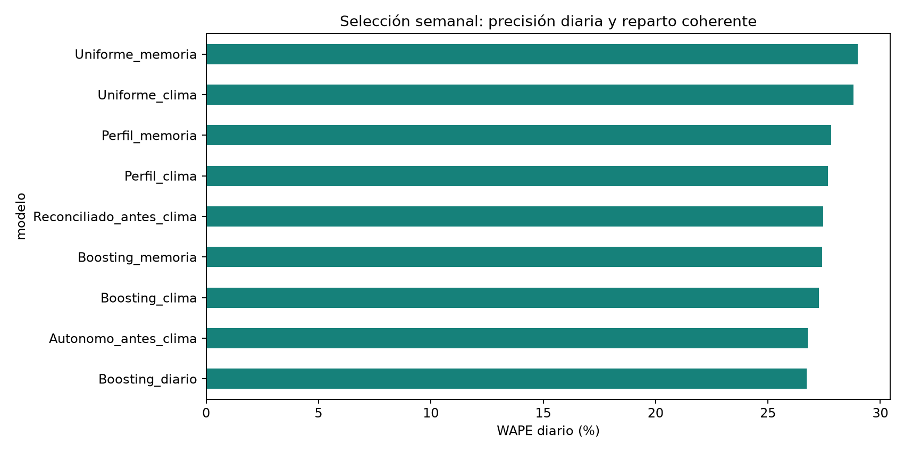

La sensibilidad a semanas con siete reportes se conserva en Semanas_completas del Excel de diario 05. Su composición difiere del panel general y no puede usarse su completitud futura para elegir método al emitir. No existe aquí un benchmark diario del ingeniero ni un umbral operativo validado.

### 5.3. Piloto SARIMA/SARIMAX

(En revisión: desarrollo preliminar y siguientes pasos.)

Se mantienen las tres series elegidas por volumen de 2025, los órdenes SARIMA (1,0,1)×(0,1,1,7), clima rezagado siete días en SARIMAX y auditoría de convergencia. El clima se actualiza, no se cambian los órdenes buscando mejorar 2026. El nuevo total sólo modifica la reconciliación. La tabla utiliza días comunes a todos los métodos; no se compara directamente con el WAPE diario de toda la finca. [E8, E17]

| Método | Casos | MAE (tallos) | RMSE (tallos) | MAPE* | WAPE | Dentro ±8 %* | Sesgo (%) |
| --- | --- | --- | --- | --- | --- | --- | --- |
| Boosting reconciliado | 135 | 2.457,22 | 3.337,65 | 26,77 % | 27,18 % | 18,52 % | -11,75 % |
| Boosting autónomo | 135 | 2.791,97 | 3.694,31 | 30,98 % | 30,88 % | 14,81 % | -12,53 % |
| Perfil histórico | 135 | 2.445,79 | 3.342,50 | 26,33 % | 27,05 % | 22,22 % | -11,96 % |
| SARIMA | 135 | 2.252,11 | 3.060,92 | 26,58 % | 24,91 % | 22,22 % | -2,61 % |
| SARIMAX | 135 | 2.217,70 | 3.048,75 | 26,00 % | 24,53 % | 20,74 % | -2,98 % |
| SARIMAX reconciliado | 135 | 2.704,76 | 3.719,85 | 27,46 % | 29,92 % | 14,81 % | -21,96 % |
| SARIMA reconciliado | 135 | 2.689,74 | 3.691,10 | 27,32 % | 29,75 % | 17,04 % | -21,85 % |
| Semana anterior | 135 | 2.839,95 | 3.912,71 | 32,89 % | 31,41 % | 13,33 % | -2,87 % |
| Uniforme | 135 | 2.680,33 | 3.738,56 | 27,10 % | 29,65 % | 16,30 % | -22,32 % |

### 5.3.1. Resultado de la LSTM diaria: mantener la comparación en su escala

(En revisión: prueba de un día adelante, distinta del reparto semanal.)

Cada referencia se informa primero en su soporte disponible. No se rellenan sus pronósticos ausentes para aumentar artificialmente el tamaño del test.

| Método | Casos | MAE (tallos) | RMSE (tallos) | MAPE* | WAPE | Dentro ±8 %* | Sesgo (%) |
| --- | --- | --- | --- | --- | --- | --- | --- |
| LSTM sin clima / modo automático | 2.409 | 567,49 | 978,38 | 41,81 % | 27,17 % | 15,77 % | -2,57 % |
| LSTM con clima, diagnóstico | 2.409 | 625,25 | 1.143,99 | 39,54 % | 29,93 % | 14,94 % | -13,64 % |
| Último valor disponible | 2.067 | 824,15 | 1.418,18 | 53,10 % | 38,27 % | 15,48 % | -2,87 % |
| Media de siete días observados | 2.408 | 578,95 | 1.007,82 | 41,78 % | 27,71 % | 15,57 % | -1,32 % |
| Mismo día, 364 días atrás | 2.187 | 963,06 | 1.495,19 | 68,07 % | 42,90 % | 8,82 % | -13,66 % |

Para compararlas en idénticos días se conserva también la intersección de todos los métodos:

| Método | Casos | MAE (tallos) | RMSE (tallos) | MAPE* | WAPE | Dentro ±8 %* | Sesgo (%) |
| --- | --- | --- | --- | --- | --- | --- | --- |
| LSTM sin clima / modo automático | 1.888 | 596,14 | 999,19 | 41,61 % | 25,88 % | 16,47 % | -4,42 % |
| LSTM con clima, diagnóstico | 1.888 | 680,37 | 1.226,75 | 39,49 % | 29,54 % | 15,41 % | -16,27 % |
| Último valor disponible | 1.888 | 878,98 | 1.478,33 | 53,13 % | 38,16 % | 14,72 % | -3,11 % |
| Media de siete días observados | 1.888 | 615,97 | 1.043,38 | 41,69 % | 26,74 % | 15,57 % | -3,12 % |
| Mismo día, 364 días atrás | 1.888 | 972,33 | 1.518,41 | 66,93 % | 42,22 % | 8,85 % | -13,25 % |

En los 1.888 días comunes, la LSTM sin clima obtiene WAPE de 25,88 %, MAE de 596,14 y RMSE de 999,19 tallos, frente a 26,74 % de WAPE de la media de siete días. La mejora en este ensayo es acotada a esa tarea de un día adelante.

Estos resultados no se incorporan al ranking de los modelos que emiten siete días desde el lunes. La LSTM recibe información diaria más reciente y se evalúa en otras fechas y series. El archivo no conserva predicciones train y validación en la escala final de tallos; el valor de MSE transformado usado para parar no sustituye MAE/RMSE/WAPE en tallos. [PENDIENTE: archivar esas predicciones y sus métricas, y reconciliar un pronóstico de siete pasos con el total semanal en una evaluación temporal nueva.]

### 5.4. Interpretación de variables del modelo seleccionado

El notebook 16 vuelve a calcular el ajuste del 3 de agosto y permuta bloques de entradas para observar cuánto cambia el WAPE. Esto no es SHAP, no es un porcentaje de producción y no mide un efecto causal. El cambio por permutación puede ser grande con pocos casos o variables relacionadas; se presenta con el tamaño del grupo. [E12]

Como la selección semanal fijada es Sin_clima, esa alternativa no recibe variables meteorológicas. La importancia climática no es cero: se evalúa por los contrastes de modelos de 19.

| Grupo de horizonte / ruta | Bloque con mayor cambio | Casos evaluados | Cambio WAPE (pp) |
| --- | --- | --- | --- |
| H1_H2 / Respaldo | Producción semanal reciente | 857 | 82,43 |
| H1_H2 / Teoria_completa | Teoría y desvío | 79 | 69,76 |
| H3_H5 / Respaldo | Producción semanal reciente | 577 | 80,50 |
| H3_H5 / Teoria_completa | Teoría y desvío | 47 | 40,60 |

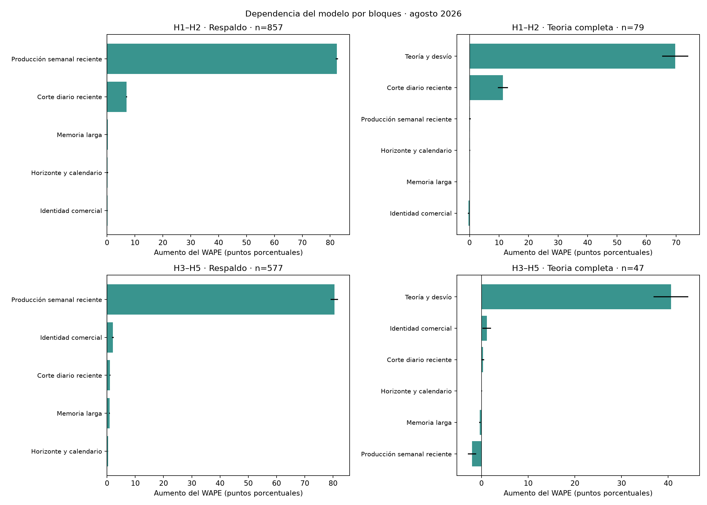

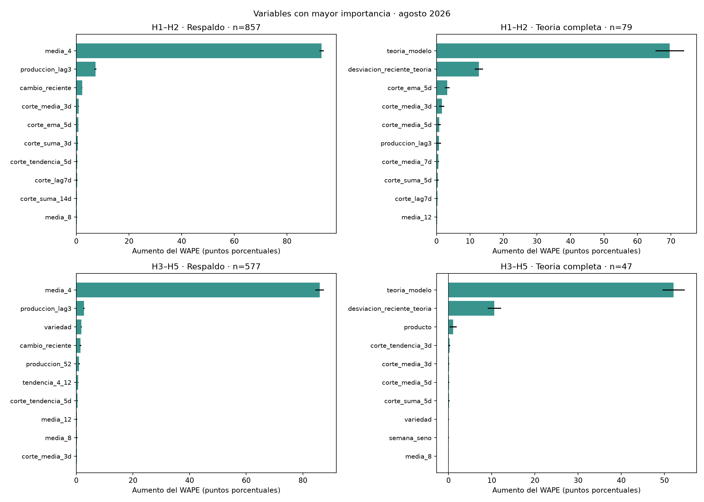

Las entradas con información redundante pueden sustituirse entre sí y la permutación puede crear combinaciones poco habituales. El grupo donde la curva representa todas las cohortes es menor que el universo completo; sus resultados se leen con cautela y no se usan para cambiar la selección retrospectivamente.

### 5.5. Entrenamiento y evaluación del mismo ajuste

El inventario 17 conserva los distintos cortes. Aquí se compara train con test del corte del 3 de agosto de 2026 para las mismas configuraciones; el test mensual incluye todos sus casos evaluables, no sólo los emparejados con el ingeniero; también se informa cuántos casos contiene cada partición. El ingeniero es una referencia evaluada, no un modelo entrenado en el proyecto. [E13, E16, E17]

| Método / partición | Casos | MAE (tallos) | RMSE (tallos) | WAPE | Sesgo medio (tallos) | Sesgo (%) |
| --- | --- | --- | --- | --- | --- | --- |
| Sin_clima · train | 140.994 | 2.234,24 | 3.976,98 | 22,41 % | -39,60 | -0,40 % |
| Sin_clima · test | 1.758 | 1.675,31 | 2.965,71 | 15,44 % | 104,51 | 0,96 % |
| Clima_basico · train | 140.994 | 2.189,61 | 3.889,70 | 21,96 % | -33,70 | -0,34 % |
| Clima_basico · test | 1.758 | 1.654,64 | 2.906,12 | 15,25 % | 88,24 | 0,81 % |
| Clima_ampliado · train | 140.994 | 2.178,16 | 3.858,34 | 21,85 % | -31,83 | -0,32 % |
| Clima_ampliado · test | 1.758 | 1.664,45 | 2.902,53 | 15,34 % | 178,65 | 1,65 % |
| Curva_Gaitana_clima · train | 140.994 | 2.223,49 | 3.951,23 | 22,30 % | -31,49 | -0,32 % |
| Curva_Gaitana_clima · test | 1.758 | 1.678,97 | 2.912,35 | 15,47 % | 176,81 | 1,63 % |

| Método / partición | Casos | MAE (tallos) | RMSE (tallos) | WAPE | Sesgo medio (tallos) | Sesgo (%) |
| --- | --- | --- | --- | --- | --- | --- |
| Boosting_diario · train | 70.448 | 458,86 | 812,28 | 25,90 % | -105,32 | -5,94 % |
| Uniforme_clima · train | 70.448 | 508,11 | 916,32 | 28,68 % | -263,32 | -14,86 % |
| Perfil_clima · train | 70.448 | 485,22 | 838,60 | 27,39 % | -53,50 | -3,02 % |
| Boosting_clima · train | 70.448 | 470,51 | 811,74 | 26,56 % | -67,25 | -3,80 % |
| Boosting_diario · test | 3.192 | 528,10 | 1.010,17 | 26,65 % | -175,82 | -8,87 % |
| Uniforme_clima · test | 3.192 | 614,12 | 1.222,50 | 30,99 % | -390,12 | -19,68 % |
| Perfil_clima · test | 3.192 | 541,70 | 972,10 | 27,33 % | -120,47 | -6,08 % |
| Boosting_clima · test | 3.192 | 539,87 | 992,09 | 27,24 % | -136,70 | -6,90 % |

El ingeniero no tiene un train de nuestro algoritmo. SARIMA/SARIMAX dentro de muestra excluyen la inicialización del filtro y no equivalen a pronósticos emitidos día a día. Una diferencia entre train histórico y un mes de test también refleja composición y dificultad del periodo; no prueba por sí sola fuga ni ausencia de sobreajuste.

[PENDIENTE: completar MAPE y porcentaje dentro de ±8 % de los agregados de entrenamiento y de cada corte de evaluación donde no se archivaron predicciones individuales suficientes; no se reconstruyen esos indicadores a partir de MAE/RMSE ni se sustituyen por el test. Las tablas de evaluación con predicciones individuales sí incorporan ambos indicadores.]

### 5.6. De dónde proviene el error: del producto a las semanas críticas

El diagnóstico se reconstruye con los mismos 16.325 casos nominales del seleccionado anual. La versión anterior del texto mantenía algunos segmentos con 15.838; aquí las cantidades y porcentajes se sincronizan. El aporte en puntos del WAPE divide el error absoluto del grupo por el volumen real de todo el panel, calculando el error por caso antes de agrupar. No se cambia el modelo a partir de este examen. [E18]

**H1 · productos.**

| Grupo | Casos | WAPE modelo | WAPE ingeniero | Aporte modelo (pp) | Aporte ingeniero (pp) | Sesgo modelo | Sesgo ingeniero |
| --- | --- | --- | --- | --- | --- | --- | --- |
| MINICARNATION | 1.008 | 14,19 % | 14,36 % | 8,58 | 8,68 | -1,89 % | -6,79 % |
| CARNATION | 1.295 | 18,82 % | 20,04 % | 3,48 | 3,70 | -1,24 % | -7,86 % |
| SOLOMIO | 408 | 14,88 % | 18,64 % | 1,68 | 2,10 | 0,23 % | -9,50 % |
| RAFFINE | 209 | 16,08 % | 25,55 % | 0,97 | 1,54 | -1,02 % | -9,86 % |
| STAR | 36 | 16,64 % | 18,75 % | 0,17 | 0,19 | -0,51 % | -16,50 % |
| BARBATUS | 170 | 25,30 % | 28,92 % | 0,15 | 0,17 | 3,88 % | -0,95 % |
| TRACHELIUM | 35 | 34,67 % | 41,45 % | 0,10 | 0,12 | -4,27 % | -24,17 % |
| VERONICA | 68 | 22,37 % | 26,75 % | 0,09 | 0,11 | 1,68 % | -8,87 % |
| VERONICA SPRAY | 68 | 22,76 % | 23,67 % | 0,09 | 0,09 | 3,21 % | -3,94 % |
| GREEN BALL | 34 | 13,48 % | 16,09 % | 0,08 | 0,10 | 2,66 % | -1,91 % |
| STATICE | 110 | 27,23 % | 29,79 % | 0,07 | 0,08 | 0,57 % | -2,78 % |
| AMAZON | 34 | 29,13 % | 22,27 % | 0,05 | 0,04 | 6,79 % | 0,53 % |
| ACHILLEA | 37 | 380,92 % | 99,26 % | 0,01 | 0,00 | 350,26 % | -89,63 % |

**H1 · cinco colores con mayor aporte del modelo.**

| Grupo | Casos | WAPE modelo | WAPE ingeniero | Aporte modelo (pp) | Aporte ingeniero (pp) | Sesgo modelo | Sesgo ingeniero |
| --- | --- | --- | --- | --- | --- | --- | --- |
| MINICARNATION / HOT PINK | 68 | 14,76 % | 14,90 % | 1,07 | 1,08 | -4,82 % | -6,47 % |
| MINICARNATION / ORANGE | 78 | 17,24 % | 18,42 % | 1,07 | 1,14 | -5,88 % | -12,62 % |
| MINICARNATION / LIGHT PINK | 102 | 16,17 % | 15,20 % | 1,02 | 0,96 | 0,30 % | 0,20 % |
| MINICARNATION / WHITE | 102 | 14,82 % | 16,28 % | 0,78 | 0,85 | 0,87 % | -9,30 % |
| MINICARNATION / RED | 68 | 12,96 % | 13,08 % | 0,78 | 0,78 | -1,64 % | -4,91 % |

**H1 · cinco variedades con mayor aporte del modelo.**

| Grupo | Casos | WAPE modelo | WAPE ingeniero | Aporte modelo (pp) | Aporte ingeniero (pp) | Sesgo modelo | Sesgo ingeniero |
| --- | --- | --- | --- | --- | --- | --- | --- |
| MINICARNATION / ORANGE / UCHUVA | 34 | 17,86 % | 17,16 % | 0,93 | 0,90 | -6,47 % | -12,01 % |
| MINICARNATION / HOT PINK / LORENZO | 34 | 16,28 % | 16,16 % | 0,67 | 0,67 | -6,64 % | -6,96 % |
| MINICARNATION / LIGHT PINK / ACADEMY | 34 | 18,74 % | 17,05 % | 0,61 | 0,56 | 0,38 % | 7,77 % |
| MINICARNATION / YELLOW / CAESAR | 34 | 13,57 % | 14,20 % | 0,50 | 0,53 | -3,16 % | -10,05 % |
| MINICARNATION / LAVENDER / NENUFAR | 34 | 13,23 % | 14,76 % | 0,49 | 0,55 | -2,49 % | -13,07 % |

**H1–H5 · productos.**

| Grupo | Casos | WAPE modelo | WAPE ingeniero | Aporte modelo (pp) | Aporte ingeniero (pp) | Sesgo modelo | Sesgo ingeniero |
| --- | --- | --- | --- | --- | --- | --- | --- |
| MINICARNATION | 4.710 | 17,49 % | 17,66 % | 10,63 | 10,73 | -4,37 % | -9,07 % |
| CARNATION | 6.007 | 23,34 % | 22,63 % | 4,29 | 4,16 | -1,04 % | -9,37 % |
| SOLOMIO | 1.920 | 18,13 % | 18,40 % | 2,03 | 2,06 | 2,43 % | -11,71 % |
| RAFFINE | 975 | 23,27 % | 29,50 % | 1,41 | 1,78 | -0,23 % | -14,41 % |
| BARBATUS | 800 | 33,58 % | 28,31 % | 0,20 | 0,17 | 8,54 % | -2,70 % |
| STAR | 163 | 18,26 % | 20,43 % | 0,18 | 0,20 | 1,97 % | -19,13 % |
| TRACHELIUM | 155 | 43,23 % | 48,20 % | 0,13 | 0,14 | -3,59 % | -30,25 % |
| VERONICA | 320 | 28,33 % | 34,82 % | 0,12 | 0,14 | 3,95 % | -19,08 % |
| VERONICA SPRAY | 320 | 30,36 % | 26,66 % | 0,12 | 0,10 | 6,25 % | -8,27 % |
| GREEN BALL | 160 | 18,86 % | 18,52 % | 0,11 | 0,11 | 9,91 % | 2,67 % |
| STATICE | 480 | 34,52 % | 35,78 % | 0,08 | 0,09 | 7,80 % | -5,54 % |
| AMAZON | 160 | 32,85 % | 22,04 % | 0,06 | 0,04 | 13,50 % | 0,44 % |
| ACHILLEA | 155 | 821,83 % | 99,81 % | 0,02 | 0,00 | 806,45 % | -97,36 % |

**H1–H5 · cinco colores con mayor aporte del modelo.**

| Grupo | Casos | WAPE modelo | WAPE ingeniero | Aporte modelo (pp) | Aporte ingeniero (pp) | Sesgo modelo | Sesgo ingeniero |
| --- | --- | --- | --- | --- | --- | --- | --- |
| MINICARNATION / HOT PINK | 320 | 18,73 % | 16,12 % | 1,36 | 1,17 | -11,34 % | -6,92 % |
| MINICARNATION / LIGHT PINK | 480 | 21,59 % | 20,27 % | 1,35 | 1,27 | 2,68 % | -1,03 % |
| MINICARNATION / ORANGE | 360 | 17,41 % | 21,78 % | 1,08 | 1,36 | -9,74 % | -16,05 % |
| MINICARNATION / WHITE | 480 | 20,05 % | 20,94 % | 1,06 | 1,11 | 1,20 % | -12,67 % |
| MINICARNATION / RED | 320 | 17,61 % | 14,30 % | 1,04 | 0,85 | -2,89 % | -6,46 % |

**H1–H5 · cinco variedades con mayor aporte del modelo.**

| Grupo | Casos | WAPE modelo | WAPE ingeniero | Aporte modelo (pp) | Aporte ingeniero (pp) | Sesgo modelo | Sesgo ingeniero |
| --- | --- | --- | --- | --- | --- | --- | --- |
| MINICARNATION / ORANGE / UCHUVA | 160 | 17,78 % | 20,41 % | 0,94 | 1,08 | -10,69 % | -15,38 % |
| MINICARNATION / HOT PINK / LORENZO | 160 | 19,64 % | 16,10 % | 0,81 | 0,67 | -14,92 % | -4,23 % |
| MINICARNATION / LIGHT PINK / ACADEMY | 160 | 21,81 % | 19,82 % | 0,70 | 0,64 | -0,29 % | 12,45 % |
| MINICARNATION / YELLOW / CAESAR | 160 | 18,14 % | 19,94 % | 0,69 | 0,75 | -7,94 % | -15,96 % |
| MINICARNATION / PURPLE / EPSILON | 160 | 19,95 % | 11,94 % | 0,66 | 0,40 | -10,21 % | -6,53 % |

El volumen de miniclavel hace que concentre buena parte del error absoluto; eso no significa que tenga el mayor WAPE relativo. Clavel presenta dificultades especialmente en anticipaciones largas. Los focos UCHUVA, EPSILON y ACADEMY se conservan como episodios para revisar con operaciones, sin atribuirles causas agronómicas no comprobadas.

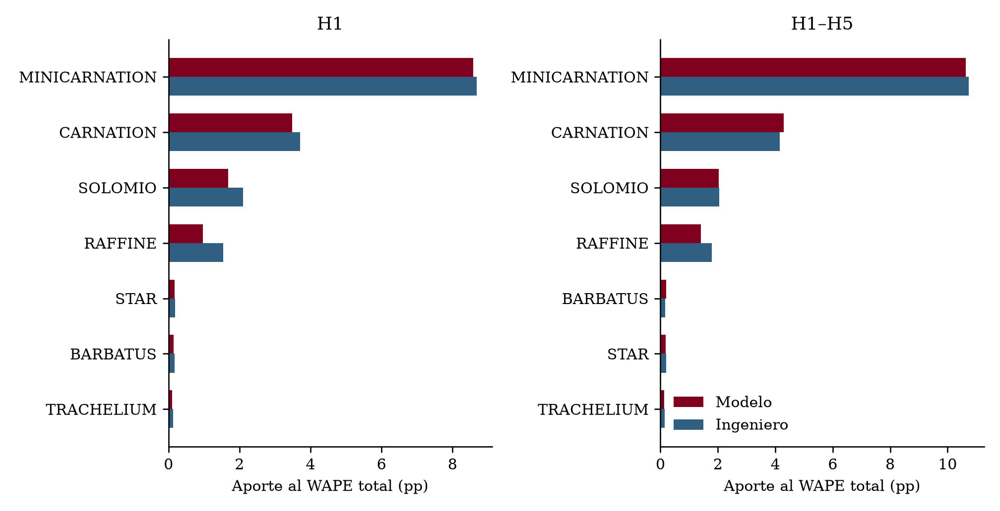

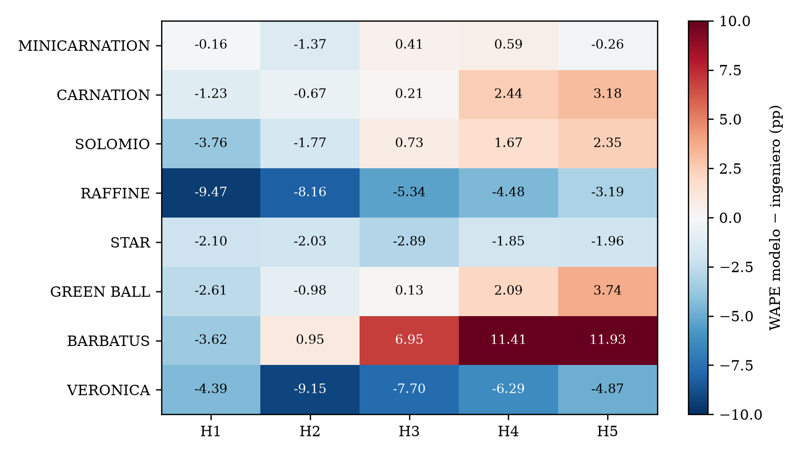

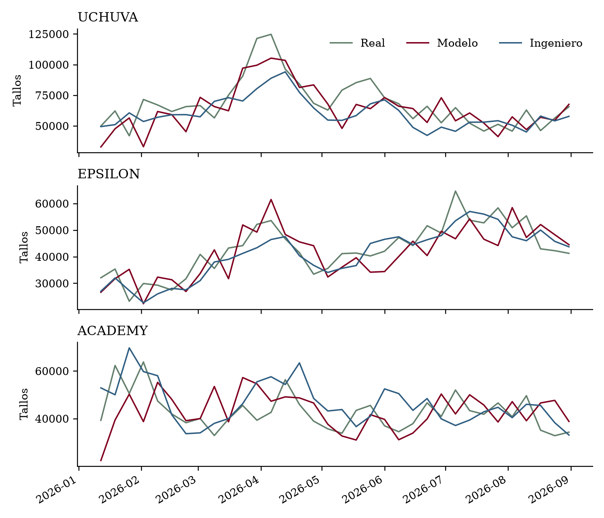

El detalle se calcula después de observar el test: orienta hipótesis, no valida un modelo especializado ni permite corregir el pronóstico usando su error ya conocido. Las trayectorias sólo muestran observaciones emparejadas; un espacio no acredita ausencia de producción. La concentración por variedad también depende del volumen y del calendario de registro. [PENDIENTE: contrastar los episodios con siembras, manejo, corte y despacho, y probar cualquier cambio en semanas nuevas.]

Esta desagregación cierra el recorrido técnico: ya no basta con saber que el total mejora; ahora puede identificarse en qué anticipaciones y segmentos persisten los errores. La discusión siguiente traduce esa evidencia en posibilidades para la organización, manteniendo sus límites.

## 6. Discusión: qué cambia para La Gaitana y bajo qué condiciones

El resultado principal es una cadena trazable que convierte inventarios y rendimientos piloto en referencias teóricas, las contrasta con producción reciente y emite una corrección semanal. La mejora no surge de considerar la curva una verdad agronómica: surge de tratarla como una referencia empírica y mantener una ruta productiva cuando no puede representar todo el plano. Para la empresa, esto facilita revisar por qué un pronóstico usa teoría o historia y rastrear qué archivo y combinación comercial lo originaron.

### 6.1. Implicaciones para la planeación y la revisión del estimado

La selección anual mejora el WAPE y reduce la subestimación neta frente al ingeniero en H1–H2; allí tiene sentido comenzar una revisión asistida de disponibilidad cercana por producto, color y variedad. En H3–H5 el ingeniero conserva menor WAPE, de modo que la evidencia no respalda reemplazar su estimado en todos los horizontes. Un sesgo menor puede evitar una subestimación persistente del total, pero no elimina los errores locales ni garantiza cumplimiento por variedad.

El diagnóstico por producto permite concentrar la revisión en los grupos que más tallos de error aportan, en vez de priorizar únicamente porcentajes extremos de bajo volumen. La especialización por producto es una hipótesis razonable para las anticipaciones largas, pero el experimento reciente sólo mejora modestamente un candidato propio y no supera al ingeniero en conjunto. No se justifican promesas de ahorro, ventas adicionales, reducción de compras o mejora de servicio: esos efectos no se midieron.

### 6.2. Qué se aprendió del clima y de la resolución diaria

No conservar clima en el seleccionado significa que, bajo estas variables y la validación utilizada, no fue necesario para elegir el mejor candidato previo a 2026. No demuestra que temperatura, radiación o lluvia carezcan de efectos en el cultivo. La medición de estación, los umbrales de disponibilidad, la memoria productiva que puede resumir efectos previos y la ventana temporal limitan esa interpretación.

El componente diario aporta una pregunta diferente: cómo se distribuye el volumen a lo largo de la semana. Un reparto aprendido conserva el total semanal y mejora la referencia uniforme en los días reportados, pero hereda errores del pronóstico semanal. El autónomo puede tener menor error diario sin conservar ese total. La LSTM de un día adelante utiliza otra disponibilidad de información; no constituye aún una mejora validada del proceso semanal a diario.

### 6.3. Transferencia operativa sin confundirla con nueva evidencia predictiva

El prototipo posterior separa recepción, limpieza, generación, ajuste y publicación; conserva versiones y permite comparar WAPE, sesgo y segmentos de error. Esta organización ofrece una vía de uso y auditoría, no una medición de adopción empresarial. El adaptador del 19 reprodujo 584 casos de un origen con diferencia máxima cero; la comprobación es parcial, no certifica toda la historia ni una emisión del jueves. [E21]

La organización deberá fijar quién publica, con qué insumos y con qué criterio se acepta un ajuste. Una evaluación prospectiva debe conservar el pronóstico original y el ajustado antes de conocer los cortes reales. [PENDIENTE: acordar el piloto empresarial, registrar disponibilidad al jueves y medir servicio, ajustes y costos con responsables de operación.]

Estos límites no se agregan sólo al cierre: las secciones anteriores muestran qué decisiones los originan en fuentes, curvas, calendario, aprendizaje, benchmark y resolución diaria. Las conclusiones responden a los objetivos dentro de ese alcance, y la continuidad se propone para las comprobaciones que todavía faltan.

## 7. Conclusiones vinculadas con los objetivos del Plan de proyecto

### 7.1. Respuesta al objetivo general: desarrollo logrado y alcance aún parcial

Se desarrolló y comparó retrospectivamente un sistema semanal por combinación comercial para GAITANA, junto con pilotos diarios. El seleccionado es HistGradientBoosting sin clima del cuaderno 19, con grupos H1–H2/H3–H5 y corrección de teoría o Media4. En 16.325 casos obtuvo WAPE de 19,36 % frente a 19,71 % del ingeniero y sesgo de −2,36 % frente a −9,81 %. Estos resultados responden al componente predictivo del objetivo general; no acreditan todavía todo su alcance de producción exportable diaria/semanal ni una reducción de incertidumbre medida en ventas, compras o poscosecha. Para La Gaitana, aportan una propuesta trazable para revisar disponibilidad cercana, condicionada a confirmar la variable exportable, igualar el momento informativo y evaluar el uso real.

### 7.2. Respuesta a OE1: proceso de estimación y base histórica

Se caracterizaron inventario de plantas, rendimiento piloto, movimientos reales, clima y versiones del estimado; se homologaron identidades y ciclos sin eliminar movimientos legítimos. La edición analítica conserva 621.195 filas y 47 columnas, y la auditoría de cortes de 2026 logró correspondencia única en 32.986 de 33.039 observaciones piloto (99,84 %). Se reconstruyeron rendimientos por planta y edad con 78 semanas previas y diez semanas de proyección por plano, y se alinearon planos 29–33 sobre objetivos comunes. La caracterización y consolidación están documentadas; las nuevas bases operativas no se confunden con esa edición analítica.

Para la organización, esta base permite reconstruir un estimado, localizar excepciones y distinguir revisiones del inventario de cambios reales en el corte. No certifica por sí sola la exactitud agronómica. Siguen pendientes la equivalencia reportado/exportable, las fechas históricas de publicación y la validación de edades improductivas; las edades no representadas no se completan automáticamente con cero.

### 7.3. Respuesta a OE2: modelos comparados y rendimiento técnico

Se compararon referencias simples, Ridge, variantes de boosting, SARIMA/SARIMAX y una LSTM exploratoria. Las tablas recalculan MAE, RMSE, MAPE, WAPE/WMAPE, sesgo y proporción dentro de ±8 % donde existen predicciones individuales. En los agregados de entrenamiento que no conservan esos casos, MAPE y la proporción se dejan pendientes, sin trasladarles resultados del test. La banda es una referencia inicial del Plan, no un nivel de servicio aprobado por la empresa.

El seleccionado anual mejora H1 (15,53 % frente a 16,93 %) y H2 (17,49 % frente a 19,16 %); el ingeniero conserva menor WAPE en H3–H5. Retirar memoria elevó el WAPE de 19,31 % a 23,26 % en los 2.107 casos del contraste inicial. Sin clima ganó la selección previa a 2026 (21,70 % frente a 21,91 % con clima básico); ello respalda su uso bajo este diseño, no la ausencia de efectos climáticos en la fisiología.

El ensayo reciente del 25 redujo el WAPE de un candidato propio de 17,80 % a 17,53 %, pero el ingeniero obtuvo 16,34 %. H1 favoreció al candidato (12,28 % frente a 15,23 %), sobre una sola semana objetivo; H2 fue empate práctico (14,96 % frente a 14,98 %). En el diario, el reparto aprendido obtuvo 27,26 % frente a 28,80 % del uniforme en 22.973 días reportados; el autónomo obtuvo 26,72 %, sin garantizar coherencia semanal. SARIMAX usa sólo 135 días comunes y la LSTM es de un día adelante. El objetivo de comparar modelos tiene evidencia, pero la solución diaria consolidada continúa en revisión.

Para La Gaitana, estas comparaciones sustentan priorizar la revisión de H1–H2 y concentrar mejoras en H3–H5 y en los segmentos de mayor error en tallos. No justifican escoger un modelo sólo por un promedio global ni reemplazar el criterio experto para toda anticipación.

### 7.4. Respuesta a OE3: salida analítica y señales para decidir

El prototipo ofrece consulta histórica, comparación por semana/producto/color/variedad, generación, ajuste y publicación versionada. El diagnóstico permite localizar dónde se concentra el error y conservar la sugerencia original al revisar un estimado. Esto cubre una parte de la salida analítica planteada en OE3 y ofrece soporte para la revisión operativa.

No se acredita todavía un semáforo empresarial validado de faltante, normalidad o sobrante por variedad-color. Los indicadores retrospectivos de error y los avisos de actualización de fuentes no equivalen a esas señales: para anticiparlas se requiere una referencia comercial o de disponibilidad acordada y umbrales confirmados. OE3 queda parcialmente desarrollado. Su implicación para compras, ventas y poscosecha es una posibilidad por probar, no un efecto demostrado. [PENDIENTE: definir y validar con la empresa la referencia y los umbrales de faltante/normalidad/sobrante, con responsables y acciones por señal.]

### 7.5. Respuesta a OE4: validación operativa e impacto

Se realizó comparación retrospectiva con el ingeniero y comprobación técnica parcial del adaptador, pero no una validación prospectiva completa en un entorno operativo. El cruce nominal no iguala automáticamente la información del jueves del ingeniero con la del lunes del modelo. Tampoco se midieron reducción de desviaciones tras adopción, costos, cumplimiento, compras evitadas ni resultados de ventas o poscosecha. OE4 permanece pendiente en su componente organizacional.

La evidencia permite diseñar el piloto, no declarar éxito empresarial. La siguiente decisión es congelar el modelo y el calendario de insumos, conservar predicciones originales y ajustadas antes de conocer el corte y acordar qué resultado operativo contará como mejora. El diagnóstico por producto ayuda a enfocar esa prueba sin reinterpretar el test observado como validación nueva.

### 7.6. Continuidad y condiciones para el uso empresarial

La prioridad es un momento de emisión común con el ingeniero y un período posterior a la selección de modelos. Las mejoras de H3–H5 deberán elegirse con validación anterior y verificarse en otras semanas; el diagnóstico de este test no se reutiliza como prueba de una corrección. En paralelo, se requiere validar unidades climáticas, procedencia piloto, edades improductivas y significado de días sin registro. El alcance sigue restringido a GAITANA; no se generaliza a ARABELLA.

Los pendientes académicos, agronómicos y operativos se reúnen en el anexo C. No se presentan como resultados cumplidos ni la adopción ni el beneficio económico, y la comparación diaria conserva su condición exploratoria.

## Referencias de la evidencia y pendientes editoriales

Las referencias E1–E22 permiten ubicar la evidencia interna que sostiene las cifras y decisiones de este borrador. No sustituyen la bibliografía académica. La revisión de literatura del anteproyecto debe integrarse con lectura y citas verificadas de sus fuentes; aquí no se convierten nombres de artículos de la estructura original en afirmaciones bibliográficas no comprobadas.

| Referencia | Evidencia reproducible | Uso en el documento |
| --- | --- | --- |
| E1 | Proyecciones Teoricas Propias/Proyecciones_teoricas.ipynb | EDA de pilotos, camas, ciclos, inventario y curvas |
| E2 | Proyecciones Teoricas Propias/Proyecciones_teoricas_todos_los_anios.ipynb | Historia 2021–2026, cobertura y cinco planos |
| E3 | Analisis/10_base_analitica_proyecciones.ipynb | Conservación e integración semanal |
| E4 | Analisis/11_EDA_proyecciones.ipynb | Composición, cobertura, error y asociaciones |
| E5 | Analisis/12, 13 y 14 | Modelos, benchmark experto y tendencias diarias |
| E6 | Modelo_de_series_diario/01_base_diaria_EDA.ipynb | Calendario diario, conciliación y EDA |
| E7 | Modelo_de_series_diario/02_distribucion_semanal_a_diaria.ipynb | Distribución y evaluación diaria |
| E8 | Modelo_de_series_diario/03_SARIMA_SARIMAX_y_boosting.ipynb | Piloto temporal y convergencia |
| E9 | Proyecciones Teoricas Propias/00_catalogo_variedades y Auditoria_calidad_curvas.ipynb | Catálogo central y recuperación antes/después |
| E10 | Analisis/15_calidad_y_mejora_por_horizonte.ipynb | Diagnóstico del error, experimentos y pesos anteriores a 2026 |
| E11 | Modelo_de_series_diario/04_diario_con_memoria_semanal.ipynb | Efecto del nuevo total semanal, cobertura y sensibilidad diaria |
| E12 | Analisis/16_interpretacion_modelo_semanal.ipynb | Importancia por permutación y reproducción del ajuste |
| E13 | Analisis/17_inventario_modelos_train_test.ipynb | Inventario y errores de entrenamiento/evaluación por corte |
| E14 | Proyecciones Teoricas Propias/01_procedencia_pilotos_y_curvas_gaitana.ipynb | Procedencia inferida y sensibilidad de curvas |
| E15 | Analisis/18_EDA_clima_y_desfase.ipynb | Cobertura, lluvia, error de volumen y desplazamiento |
| E16 | Analisis/19_modelos_clima_y_curvas_gaitana.ipynb | Comparación temporal y elección previa a 2026 |
| E17 | Modelo_de_series_diario/05_diario_clima_actualizado.ipynb | Reparto del candidato y train/test compuesto |
| E18 | Analisis/20_EDA_origen_error_modelo_ingeniero.ipynb | Descomposición del WAPE y sesgo por producto, color, variedad y semanas |
| E19 | Analisis/21–25 | Semanas recientes, horizontes separados, experimento n−1 y especialistas H3–H5 |
| E20 | Modelo_de_series_diario/06_RNN_profunda_produccion_diaria.ipynb | Ensayo LSTM de un día adelante, validación y límites de comparación |
| E21 | plataforma_gaitana/backend/app/model19.py y evidencia_regresion_modelo19.json | Adaptador y regresión parcial de 584 casos; no es evaluación prospectiva |
| E22 | Plan de Proyecto/Plan de proyecto_final.docx, secciones 2.1–2.2 y 5.4–5.5 | Objetivos originales, métricas previstas, banda inicial ±8 % y señales operativas |

[PENDIENTE: integrar y verificar la bibliografía académica del anteproyecto y sus citas en formato APA; las referencias E1–E21 son evidencia interna, no sustituyen esa revisión.]

### Correspondencia con la estructura anterior

La introducción conserva problema, objetivos y alcance. Los capítulos 2 y 3 desarrollan el entendimiento de fuentes y el EDA que antes figuraban como contenido previsto. El capítulo 4 concentra el método y el 5 sus resultados; el 6 integra la discusión que faltaba entre cifras y conclusiones. El capítulo 7 reúne conclusiones y límites. Se abandona la correspondencia rígida de todos los subtítulos entre metodología y resultados para dar continuidad a la explicación. Esta reorganización es una propuesta editorial para revisar con el asesor, no un cambio de resultados.

La literatura verificada, la revisión agronómica, la decisión sobre PCA/MCA/PDN y la validación empresarial siguen pendientes. Sus títulos no se mantienen como capítulos extensos vacíos. La documentación detallada de llaves, parámetros y tablas por segmento permanece en los notebooks y puede constituir anexos según las exigencias de entrega. Este documento es un borrador desarrollado del trabajo empírico, no una tesis lista para radicar.

## Anexo A. Diccionario de la base analítica común

Se agrupan las 47 columnas para facilitar la lectura. Es la base del notebook 10; las variables ampliadas se documentan en la metodología y no se confunden con este archivo. NaN, NaT y valores ausentes no significan cero.

| Columna(s) | Significado |
|---|---|
| finca, producto, color, variedad | Identifican la serie comercial: finca, producto, color y variedad cuya producción semanal se estudia. |
| origen | Lunes desde el que se emite el pronóstico; separa el pasado disponible del futuro por estimar. |
| horizonte | Horizonte del MODELO semanal: H1 es la semana del origen y H5 empieza cuatro semanas después. El modelo evalúa H1–H5, pero las proyecciones TEÓRICAS de cada plano abarcan 10 semanas y se cuentan desde la semana siguiente a fecha_plano. Son numeraciones distintas porque parten de fechas distintas. |
| semana_objetivo | Lunes de la semana que se pronostica; la semana abarca de lunes a domingo. |
| ultima_semana_utilizada | Lunes de la última semana de producción histórica utilizada, anterior al origen. |
| y | Producción real reportada de la semana objetivo, en tallos. Es la respuesta que se intenta predecir, no una variable que se pueda conocer anticipadamente. |
| produccion_lag1, produccion_lag2, produccion_lag3 | Producción real, en tallos, de una, dos y tres semanas calendario antes del origen, respectivamente. |
| media_4, media_8 | Promedio semanal de tallos durante las cuatro u ocho semanas anteriores al origen; requiere las cuatro u ocho observaciones. |
| desv_4 | Desviación estándar de las cuatro semanas previas, en tallos: resume cuánto varió la producción reciente. |
| tendencia_4_8 | media_4 menos media_8, en tallos. Un valor negativo indica un nivel reciente inferior al promedio de ocho semanas. |
| cambio_reciente | produccion_lag1 menos produccion_lag2, en tallos: cambio entre las dos últimas semanas. |
| observaciones_previas | Número de semanas históricas con producción reportada antes del origen; no tienen que ser consecutivas. |
| temperatura_semana_lag1, humedad_semana_lag1, radiacion_semana_lag1 | Promedio climático de la semana anterior al origen, construido con los promedios diarios válidos. Una semana requiere al menos cinco días válidos. Conservan las unidades de la fuente depurada. |
| temperatura_semana_media4, humedad_semana_media4, radiacion_semana_media4 | Promedio de los cuatro valores semanales anteriores de cada variable climática; requiere las cuatro semanas. El clima corresponde a la finca, no a una medición por variedad. |
| fecha_estacional | Fecha de la semana objetivo menos 52 semanas (364 días). |
| produccion_52 | Producción real de la misma serie comercial en fecha_estacional, en tallos; referencia estacional del año anterior. |
| semana_seno, semana_coseno | Dos números que ubican la semana objetivo en un calendario circular: seno indica posición horizontal y coseno posición vertical (imaginando una aguja que parte de arriba y gira como un reloj). Se calculan a partir del número de semana del año; no son tallos ni porcentajes de producción. Para la semana 36 del ejemplo de DINO valen −0,935 y −0,355. Debajo de esta tabla se muestra el cálculo completo, paso a paso. |
| union_finca, union_producto, union_color, union_variedad | Nombres normalizados para unir la producción con las proyecciones. No son identificadores oficiales ni cultivos adicionales. |
| plano | Archivo o versión del plano del que procede la proyección seleccionada para ese origen. |
| fecha_plano | Fecha nominal de esa versión del plano. |
| disponible | Fecha supuesta de disponibilidad usada por el proceso para permitir utilizar ese plano. No certifica su publicación histórica real. |
| teoria | Suma teórica de las cohortes con una edad representada en la curva para la semana objetivo, unida por finca, producto, color, variedad y fecha objetivo. No acumula H1–H5. En DINO, H5 del modelo emitido el 3 de agosto coincide con el horizonte teórico 7 del plano del 13 de julio: `teoria` conserva 27.916,61 tallos como suma parcial. No se interpreta como total de todas las cohortes ni como pronóstico final. |
| cohortes | Número de grupos de plantas con la misma finca, producto, color, variedad, clave de curva y fecha de siembra dentro del plano. Un grupo puede reunir varias camas; no equivale a una cama física ni cuenta tallos. |
| sin_cobertura | Nombre técnico de la cantidad de cohortes cuya edad objetivo no está representada en la curva aplicada. Es una condición de uso de la curva, no el conteo de producción perdida o de camas mal unidas. |
| curva_completa | Indicador técnico: verdadero cuando la curva representa las edades de todas las cohortes y el total puede usarse como referencia directa del modelo. |
| teoria_modelo | Valor de `teoria` habilitado como referencia directa si la curva representa todas las cohortes; queda vacío si solo se dispone de suma parcial. No es la predicción final. En DINO queda vacío para activar la ruta de producción reciente; la producción real sí permanece. |
| teoria_previa_1, teoria_previa_2 | Valores de una y dos versiones anteriores del plano para la misma semana objetivo y serie comercial. El 1 y el 2 cuentan versiones hacia atrás, no H1 y H2. Pueden existir incluso en H5 del modelo porque cada plano produce diez semanas teóricas. En DINO corresponden a los horizontes teóricos 8 y 9. No se habilitan si la curva no representa todas las cohortes de esa versión; también pueden faltar si el plano anterior no alcanza la semana objetivo. |
| revision_teoria | Cambio en tallos entre una referencia de curva utilizable del plano seleccionado y `teoria_previa_1`, siempre para la misma semana objetivo. Positivo: la nueva versión proyecta más; negativo: menos. Si alguna referencia directa no se puede usar, queda vacío. No compara H5 contra H1. |
| antiguedad_curva | Tiempo en semanas entre origen y fecha_plano: indica qué tan antiguo es el plano seleccionado al emitir el pronóstico. No es la edad de las plantas. En DINO: del 13 de julio al 3 de agosto = 3 semanas. |
| desviacion_reciente_teoria | media_4 menos teoria_modelo, en tallos. Compara el promedio real de las cuatro semanas anteriores al origen con la teoría de la semana objetivo. No es un error de pronóstico porque compara períodos distintos. En DINO está vacío porque teoria_modelo está vacío. |
| admisible_modelo | Indica si la fila tiene `media_4` y al menos 26 semanas históricas con producción reportada. No exige que la curva represente todas las cohortes: en ese caso puede usarse la ruta de respaldo. Tampoco exige que `y` ya se conozca ni indica train o test. |
| motivo_cobertura | Nombre técnico del estado de aplicación de la curva: `curva_completa` indica que todas las cohortes tienen edad representada; `cohortes_sin_curva` indica que alguna no la tiene; `sin_snapshot_disponible` significa que no hay plano elegible; `sin_pareja_comercial_u_objetivo` significa que no coincide la serie o semana. En DINO se refiere a edades 9 y 16; no significa que falten registros de producción ni toda la curva de la variedad. |

Semana seno y coseno son dos coordenadas del calendario anual: seno(2π × semana ISO / 52) y coseno(2π × semana ISO / 52). Mantienen cerca las semanas 52 y 1; en la semana 36 valen aproximadamente −0,935 y −0,355. No son porcentajes de producción ni indican una caída. El ciclo fijo de 52 semanas aproxima los años con semana ISO 53.

## Anexo B. Trazabilidad técnica de las métricas de esta edición

Las tablas de modelos de esta edición se derivan de las predicciones guardadas, conservando su panel y sus fechas. `Revision_v7/auditoria_metricas_v7.csv` contiene MAE, RMSE, MAPE, WAPE/WMAPE, porcentaje dentro de ±8 %, sesgo medio, saldo neto en tallos, sesgo porcentual, tamaño, conteos de reales positivos/cero y rango temporal de cada comparación. Los indicadores sin predicciones individuales suficientes permanecen sin valor y se declaran pendientes. `Revision_v7/fuentes_y_verificaciones.json` identifica archivos y huellas SHA-256. Las diferencias con tablas de versiones anteriores sólo se actualizan donde se documenta el panel nominal corregido; los experimentos de 15.838 casos se mantienen como historia metodológica.

Los archivos intermedios de reglas que combinaban una salida del ingeniero y un modelo no se usan como evidencia del candidato autónomo final del cuaderno 25. Sus nombres se distinguen de `25_predicciones_candidato_sin_ingeniero.parquet`; los pesos vigentes se verifican en los CSV de tuning de modelos propios, no en `25_pesos_mezcla_h3_h5.csv`, que corresponde a otro ensayo.

No se reestimaron hiperparámetros ni se entrenó un modelo nuevo para esta revisión. Los vacíos de entrenamiento/validación no archivados en escala de tallos se señalan como pendientes en vez de asignarles resultados del test.

## Anexo C. Pendientes identificados para cierre académico y operativo

| ID | Información o validación pendiente |
| --- | --- |
| P01 | [PENDIENTE: confirmar con la empresa la equivalencia entre tallos reportados y exportables, y documentar el calendario de publicación/corrección de cada fuente.] |
| P02 | [PENDIENTE: validación agronómica de edades improductivas y sensibilidad a ventana, ponderación por plantas y tratamiento de extremos.] |
| P03 | [PENDIENTE: evaluación prospectiva de la configuración congelada y análisis de estabilidad de selección entre varias ventanas temporales.] |
| P04 | [PENDIENTE: repetir la comparación congelando insumos al jueves de emisión, o acordar una emisión común para ambos métodos y conservar sus marcas de tiempo.] |
| P05 | [PENDIENTE: auditar esa selección usando sólo el período previo al corte, guardar predicciones train y validación en tallos y evaluar siete días desde un origen común antes de comparar la LSTM con el reparto semanal.] |
| P06 | [PENDIENTE: archivar esas predicciones y sus métricas, y reconciliar un pronóstico de siete pasos con el total semanal en una evaluación temporal nueva.] |
| P07 | [PENDIENTE: completar MAPE y porcentaje dentro de ±8 % de los agregados de entrenamiento y de cada corte de evaluación donde no se archivaron predicciones individuales suficientes; no se reconstruyen esos indicadores a partir de MAE/RMSE ni se sustituyen por el test. Las tablas de evaluación con predicciones individuales sí incorporan ambos indicadores.] |
| P08 | [PENDIENTE: contrastar los episodios con siembras, manejo, corte y despacho, y probar cualquier cambio en semanas nuevas.] |
| P09 | [PENDIENTE: acordar el piloto empresarial, registrar disponibilidad al jueves y medir servicio, ajustes y costos con responsables de operación.] |
| P10 | [PENDIENTE: definir y validar con la empresa la referencia y los umbrales de faltante/normalidad/sobrante, con responsables y acciones por señal.] |
| P11 | [PENDIENTE: integrar y verificar la bibliografía académica del anteproyecto y sus citas en formato APA; las referencias E1–E21 son evidencia interna, no sustituyen esa revisión.] |
| P12 | [PENDIENTE: Confirmar la pertinencia de PCA/MCA/PDN con el asesor; no se presentan como etapas ejecutadas.] |
| P13 | [PENDIENTE: Archivar métricas train/validación en tallos de los candidatos recientes 21–25 antes de interpretar sobreajuste; sus salidas actuales no conservan todas esas predicciones.] |
| P14 | [PENDIENTE: Completar bibliografía, referencias cruzadas, portada institucional y revisión final de formato antes de radicar.] |
