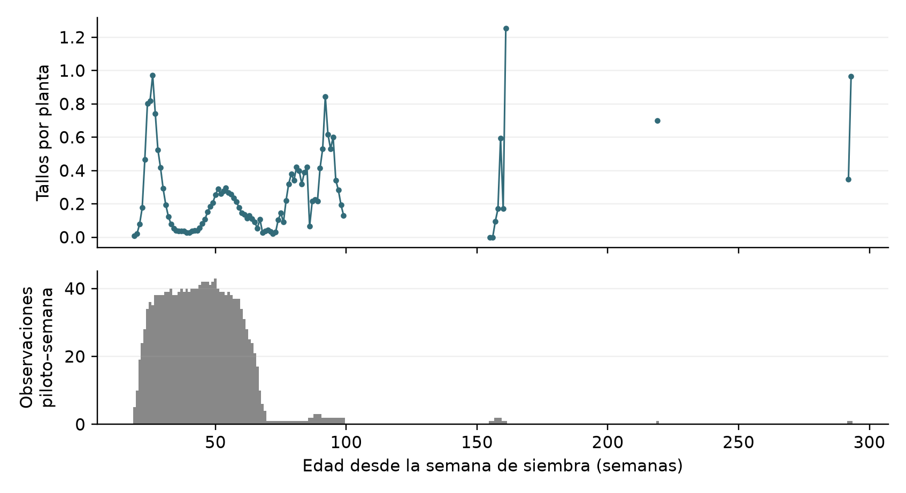
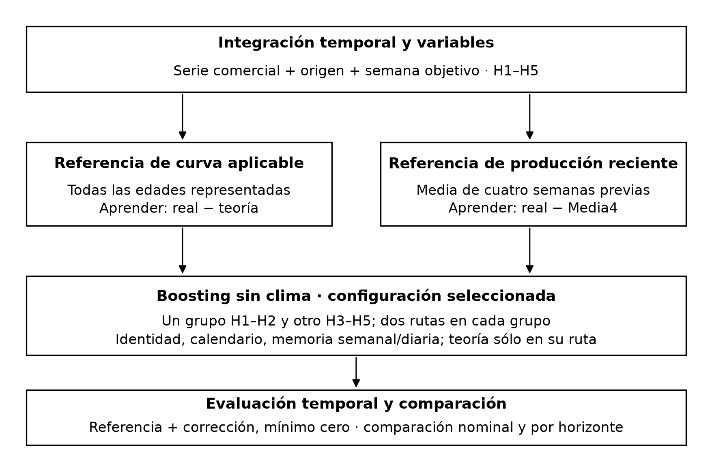
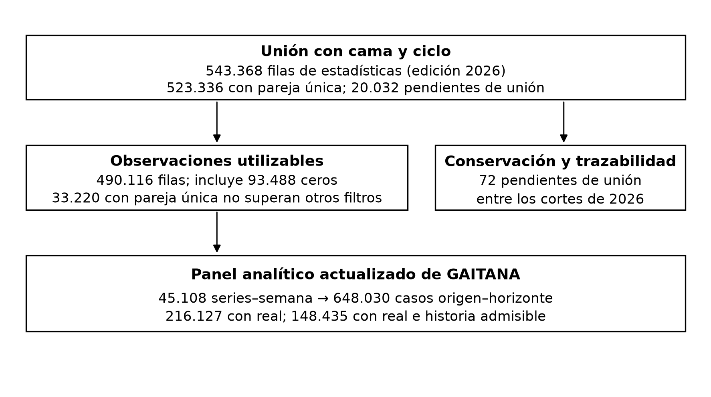
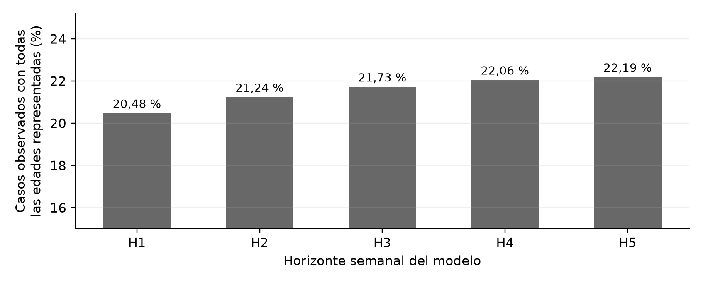
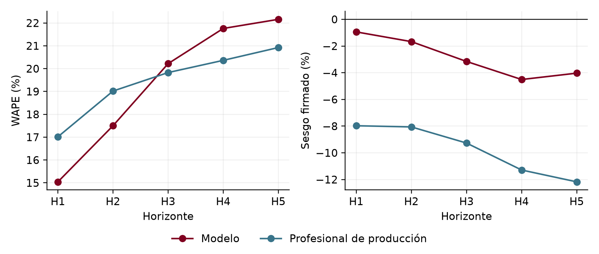
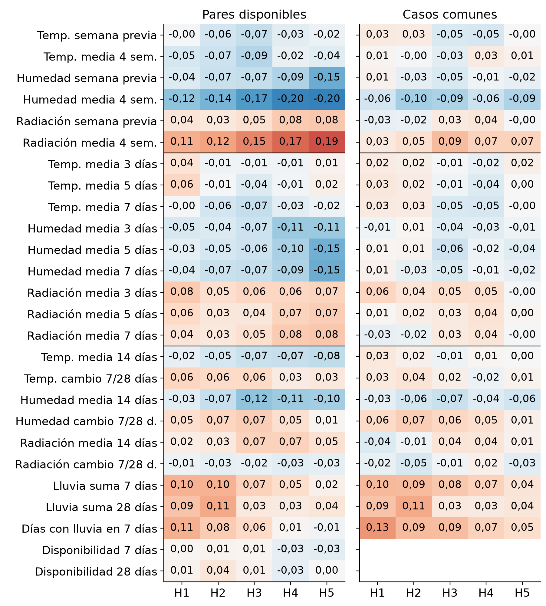

# Análisis de pronósticos semanales y diarios de corte de productos en La Gaitana Farms

Elián Durán · Julián Osorio · Anderson Gonzalez

Asesor: Rafael Amaya Gomez

Universidad de los Andes

Facultad de Ingeniería Industrial

Maestría en Inteligencia Analítica para la Toma de Decisiones

Noviembre de 2026

<!-- PORTADA_FIN -->

## Resumen

La Gaitana Farms es una empresa floricultora cuyos registros incluyen clavel, miniclavel y otros productos de flor de corte. La operación necesita anticipar cuántos tallos estarán disponibles para coordinar ventas, compras y poscosecha. En este estudio, un tallo es la unidad de cantidad reportada y el corte es la actividad de cosecha que origina esos registros. El pronóstico de referencia lo elabora el profesional responsable de estimar la producción, combinando información del cultivo y conocimiento experto. Se propone complementarlo mediante la integración de inventarios de plantas, rendimientos de camas piloto, producción registrada y clima histórico, y la comparación temporal de métodos de pronóstico.

El análisis reconstruye curvas empíricas de rendimiento por variedad y edad y utiliza la producción reciente cuando no es posible calcular una referencia teórica total. El método semanal seleccionado aprende correcciones de esas referencias y diferencia las dos primeras semanas de las tres siguientes. En la evaluación retrospectiva ampliada de 2026, sobre 20.283 casos comparables de GAITANA, obtiene un error porcentual absoluto ponderado de 19,27 %, frente a 19,40 % del profesional de producción. En la primera semana de pronóstico los valores son 15,04 % y 17,02 %, y los sesgos firmados son −0,94 % y −7,97 %, respectivamente. La ventaja no se extiende a todos los horizontes: el referente experto registra menor error en las semanas tercera a quinta y en el agregado de la extensión más reciente. Los ejercicios diarios muestran potencial para distribuir el total semanal, pero conservan carácter exploratorio. El aporte es una propuesta reproducible para apoyar la revisión del estimado; no se acredita todavía beneficio económico ni equivalencia entre tallos reportados y producción exportable. La disponibilidad histórica de las fuentes limita la interpretación prospectiva de los resultados.

**Palabras clave:** flor de corte; curvas empíricas de rendimiento; pronóstico semanal; boosting de gradiente; SARIMA; SARIMAX; reconciliación diaria.

<!-- CONTENIDO -->

## 1. Introducción

### 1.1. Contexto operativo y problema de decisión

La Gaitana Farms produce flores de corte. En la información utilizada aparecen clavel —Carnation—, miniclavel —Minicarnation—, Solomio, Raffine y otros productos. Los registros distinguen finca, producto, color y variedad, una desagregación necesaria para estimar disponibilidad comercial: un excedente de un color o variedad no necesariamente resuelve la falta de otro. El estudio se concentra en GAITANA; la presencia de ARABELLA en las fuentes no implica que sus resultados estén validados con el mismo modelo.

El proceso relevante comienza con plantas instaladas en camas de cultivo, continúa con su desarrollo y los cortes registrados, y termina en decisiones de disponibilidad y coordinación de poscosecha. Los planos de siembra describen las existencias y sus fechas de establecimiento; las estadísticas de camas piloto permiten observar el rendimiento a distintas edades. La producción real registra los tallos cortados reportados en el sistema. Estas fuentes tienen frecuencias, niveles de detalle y funciones diferentes; integrarlas requiere respetar tanto el calendario como la identidad del cultivo.

El pronóstico utilizado como referencia es elaborado por el profesional encargado de la estimación de producción, denominado en adelante **responsable de producción**. Según el flujo documentado del proyecto, revisa las existencias del cultivo, las curvas por variedad, el comportamiento reciente y su conocimiento de la operación. Su estimación contiene un componente empírico y de juicio experto, cuyo criterio no se reduce a una fórmula observable en los archivos. El proyecto busca aportar un contraste cuantitativo y una sugerencia revisable, conservando ese conocimiento como parte del proceso de decisión.

Los estimados se envían el jueves de la semana anterior al inicio del periodo anunciado. Una edición denominada 18–22 tiene su primera semana de pronóstico en la semana 18, aunque incluya todavía una columna de la semana 17 en curso. Esa columna no redefine la primera semana. Una recuperación desde una edición posterior, cuando falta la edición nominal anterior, se identifica como tal y no se confunde con una emisión nominalmente comparable. La distinción importa porque comparar fechas objetivo sin conservar cuándo fueron anticipadas altera la evaluación.

Anticipar el corte es útil para revisar compromisos comerciales, posibles compras complementarias y la planeación de poscosecha. Sin embargo, mejorar una métrica retrospectiva no demuestra que ya se hayan reducido costos o faltantes. La pregunta de negocio es **en qué medida una propuesta analítica puede complementar el estimado semanal del responsable de producción y qué evidencia permite explorar su distribución diaria, sin perder la interpretación agronómica ni utilizar información futura**.

Responderla exige establecer si los rendimientos piloto representan las edades del inventario, si su proyección necesita correcciones y qué aportan la producción reciente y el clima. También requiere comparar referencias sencillas, una corrección lineal y métodos de aprendizaje no lineal. Para el componente diario se examinan perfiles históricos, modelos SARIMA y SARIMAX y una red recurrente exploratoria. Los modelos de series temporales se implementaron en el piloto diario; no se presentan como candidatos semanales que no fueron ejecutados. Su detalle se desarrolla en la metodología.

### 1.2. Objetivos y alcance efectivo

**Objetivo general.** Analizar y comparar métodos de pronóstico semanal y diario del corte reportado por producto, color y variedad en GAITANA, integrando información histórica y operativa para construir una propuesta reproducible de apoyo a la estimación de producción de La Gaitana Farms.

**Objetivo específico 1.** Caracterizar el proceso de estimación y consolidar las fuentes de producción, planos, camas piloto, estadísticas y clima, identificando sus llaves, dimensiones y restricciones temporales.

**Objetivo específico 2.** Construir e interpretar curvas empíricas de rendimiento y proyecciones teóricas por edad, y establecer cuándo pueden utilizarse como referencia del pronóstico semanal y cuándo corresponde utilizar producción reciente.

**Objetivo específico 3.** Comparar los métodos semanales implementados con el pronóstico del responsable de producción mediante evaluación temporal y métricas por horizonte y segmento, examinando el aporte de memoria productiva, clima y especialización de modelos.

**Objetivo específico 4.** Evaluar de manera exploratoria alternativas de pronóstico diario autónomo y de distribución del total semanal, y delimitar las condiciones de uso de una salida analítica revisable por la organización.

La formulación precisa el alcance comprobable del estudio respecto a la aspiración inicial de estimar producción exportable y validar impacto empresarial. No da esas aspiraciones por cumplidas. **Producción exportable** designa la que satisface los criterios comerciales de exportación; **no exportable**, la que no los satisface. Los **tallos reportados** son la cantidad registrada en la fuente de corte, utilizada aquí como variable objetivo. El estimado de referencia se identifica en su formato como exportable, pero no existe una conciliación confirmada que permita tratar ambos conceptos como equivalentes. La comparación mide concordancia contra el corte reportado y conserva esa limitación de unidad comercial.

GAITANA y GAITANA PPTO son etiquetas distintas y no se suman como si describieran el mismo universo observado. Tampoco se reasignan registros de finca desconocida a GAITANA. La evaluación principal utiliza series de GAITANA con historia suficiente. Las demás fincas permanecen en las fuentes conservadas y requieren una evaluación propia antes de extenderles las conclusiones.

Se utilizan cinco horizontes semanales. **H1** es la primera semana objetivo de la edición y **H2, H3, H4 y H5** son las cuatro semanas consecutivas siguientes, de lunes a domingo. En los cálculos, el origen es el lunes de H1. Este índice permite ordenar las filas; no certifica que el modelo y el responsable de producción hayan contado con exactamente la misma información el jueves anterior. El componente diario estudia los siete días de H1 y, en un ensayo diferente, el pronóstico de un día adelante.

La revisión académica conserva la última evaluación ejecutada, con corte del 28 de octubre de 2026 y producción fuente hasta el 27 de octubre. El año 2026 evaluado comprende las semanas ISO 1–43, no un año calendario completo. La semana ISO 1 comienza el 29 de diciembre de 2025. Las fechas de observación y las versiones archivadas pueden verificarse; las fechas históricas completas de publicación y corrección no están acreditadas para todas las fuentes. Por ello, el alcance es retrospectivo y sus supuestos se explicitan antes de interpretar los resultados.

## 2. Radiografía de los datos: fuentes, características y caso actual

### 2.1. Términos operativos y unidades de análisis

Tabla 1. Términos operativos utilizados en el estudio {#tab_glosario}

| Término | Significado en este trabajo |
| --- | --- |
| Cama | Unidad física de cultivo identificada dentro de un invernadero. |
| Cama piloto | Cama o referencia seguida para registrar plantas, ciclo y cortes usados en estadísticas de rendimiento. |
| Ciclo de cultivo | Periodo de una siembra identificada, que permite distinguir usos sucesivos de una cama. |
| Plano de siembra | Registro de existencias, ubicación, plantas, variedad y siembra en una fecha de referencia. |
| Cohorte | Grupo de plantas con la misma identidad comercial y fecha de siembra dentro de un plano; puede reunir varias camas. |
| Corte y tallos cortados | Actividad de cosecha y cantidad de tallos que queda registrada; no identifica por sí sola su clasificación exportable. |
| Rendimiento | Cociente entre tallos de un corte piloto y plantas de la observación, expresado en tallos por planta. |
| Curva de rendimiento | Resumen empírico de rendimientos por variedad y edad semanal del cultivo. |

El plano representa existencias en una fecha, no altas acumulables. Si una cama con 1.000 plantas aparece en dos planos consecutivos, se observa dos veces el mismo inventario; no se concluye que hubo dos siembras ni se suman 2.000 plantas. Para proyectar un objetivo se utiliza una versión elegible del inventario. Al comparar versiones se alinean las mismas semanas objetivo para estudiar revisiones, sin acumular sus totales como producción nueva.

La unidad observada de producción semanal es finca–producto–color–variedad–semana. La unidad de pronóstico añade origen y horizonte. Una semana real puede, por tanto, formar parte de varios casos porque se anticipó desde fechas diferentes. Los denominadores de evaluación cuentan **casos de pronóstico**, no plantas, camas ni volumen físico único acumulado.

### 2.2. Fuentes y dimensiones verificadas

Tabla 2. Dimensiones de las fuentes depuradas utilizadas {#tab_fuentes}

| Fuente | Filas / variables | Periodo observado u objetivo | Nivel y características |
| --- | --- | --- | --- |
| Producción reportada | 6.550.639 / 24 | 2021-01-04 a 2026-10-27 | Movimiento de corte. Finca, fecha, producto, color, variedad, grado, lote y tallos. |
| Planos de siembra | 3.356.921 / 32 | 2021-01-04 a 2026-10-12 | Fila de inventario por versión. Ubicación, identidad comercial, plantas, área, siembra y edad. |
| Estadísticas piloto consolidadas | 562.987 / 30 | 2012-12-31 a 2026-09-21 | Observación piloto–semana. Cama, ciclo, fechas, plantas, tallos y rendimiento; historia entre ediciones. |
| Clima | 194.558 / 22 | 2021-01-01 a 2026-10-23 | Medición de finca e instante. Temperatura, humedad, radiación y lluvia; frecuencia y validez auditadas. |
| Estimados del responsable | 181.301 / 32 | 2023-01-02 a 2026-11-09 | Serie–edición–semana objetivo. Cantidades estimadas, origen y horizonte nominal, procedencia y marcas de envío. |

Nota. Los periodos son de contenido, no fechas de publicación. Las fuentes incluyen más de una finca; la inferencia principal se limita a GAITANA. Fuente: extracción verificada del 28/10/2026.

Las cantidades de @tab_fuentes corresponden a las tablas depuradas y versionadas de la extracción utilizada, no a la suma de filas de todos los libros originales. La producción se conserva al nivel de movimiento, sin eliminar cortes legítimos por tener cantidades repetidas. Los originales se archivan por separado y las tablas limpias mantienen procedencia. Las estadísticas consolidadas entre ediciones y la vista de estadísticas de la edición 2026 son universos diferentes: esta última incluye historia que vuelve a aparecer en libros posteriores, por lo que no deben sumarse sus filas entre años.

Una edición identificada como 2026 puede contener cortes anteriores a 2026. El año de edición informa qué versión del libro se utilizó; la fecha de corte identifica cuándo se observó el rendimiento. La historia piloto disponible empieza en 2012, pero la curva aplicada a un plano sólo utiliza la ventana histórica especificada en el método. Tener historia antigua en el libro no habilita a usarla indiscriminadamente.

Las llaves se construyen después de homologar nombres comerciales, espacios y mayúsculas, conservando los códigos y nombres originales. Para las estadísticas piloto se utiliza la edición o libro, referencia de cama, variedad homologada y ciclo de siembra; cuando existe se prioriza la fecha de siembra, y en su defecto año y semana compatibles. Los planos identifican ubicación mediante finca, invernadero y cama, y separan las cohortes por fecha de siembra e identidad comercial. La producción se agrega por serie y fecha; el clima se integra por finca y fecha, no como si existiera una estación por variedad. Las proyecciones se vinculan por serie, versión elegible y semana objetivo. Los estimados de referencia añaden origen nominal y horizonte para asegurar una comparación equivalente.

Los nombres ambiguos no se resuelven por similitud aproximada. Una variedad ausente en estadísticas se recupera sólo cuando la referencia completa dentro del mismo libro identifica una única combinación compatible. Las coincidencias equivalentes se consolidan sin duplicar cortes. La integridad de las uniones se comprueba antes de construir rendimientos; no puede deducirse de que una suma final resulte numéricamente plausible.

### 2.3. Curvas empíricas y significado de la referencia teórica

Las estadísticas piloto vinculan tallos cortados con las plantas de una cama y su edad. Cada observación utilizable permite calcular tallos por planta; al reunir observaciones de la misma variedad y edad se construye una curva empírica de rendimiento. Esta curva describe los pilotos disponibles, no una ley biológica demostrada para todas las camas. Para trasladarla a un plano se requiere conocer las plantas y edades de sus cohortes y aceptar un supuesto de representatividad que aún debe contrastarse agronómicamente.

 {#fig_curva}

La @fig_curva muestra Solomio–Ard blanco en la referencia del plano del 12 de octubre de 2026. A edad 50 semanas, el rendimiento de la curva es 0,2542 tallos por planta, con 43 observaciones piloto–semana. Es un punto real de la curva construida; no es el rendimiento de todas las camas ni el valor de una planta individual. En edades poco observadas, especialmente los puntos aislados tardíos, la incertidumbre de representatividad es mayor. Los huecos no se conectan como si se hubiera observado toda la trayectoria.

La proyección teórica multiplica las plantas de cada cohorte por el rendimiento de su variedad a la edad que tendrá en la semana objetivo y suma los aportes. Si una edad requerida no está representada, ese aporte es desconocido y la suma de los demás es parcial. Esto no implica ausencia de producción real ni una falla del cruce piloto–estadística. La metodología conserva el caso y permite otra referencia cuando existe historia productiva suficiente.

Un corte cero registrado, válido y asociado a plantas positivas aporta un rendimiento cero al cálculo, igual que cualquier otra observación. Una edad sin observaciones no aporta evidencia de cero; un valor desconocido por falta de identificación o fecha tampoco. La decisión de conservar los ceros y no completar los otros estados evita confundir ausencia de cosecha registrada con ausencia de información. Sólo una regla agronómica confirmada permitiría asignar cero a edades no observadas.

## 3. Metodología

### 3.1. Fases del estudio y lógica del pronóstico

El procedimiento comprende cinco fases conectadas: integrar y depurar las fuentes; construir curvas y proyecciones; generar variables y comparar métodos semanales; evaluar temporalmente contra el responsable de producción; y explorar el componente diario y su utilización analítica. La @fig_semanal resume la lógica central antes de describir el algoritmo: cada caso utiliza una referencia aplicable, aprende su corrección con el pasado y se evalúa contra el corte observado. La existencia de una ruta alternativa es una decisión metodológica, no una imputación de producción real.

 {#fig_semanal}

El aprendizaje semanal corrige la referencia teórica cuando todas las cohortes tienen rendimiento por edad. En los demás casos admisibles corrige la media de las cuatro semanas previas —Media4—. No promedia ambas rutas ni convierte la suma teórica parcial en un total. La arquitectura seleccionada separa H1–H2 de H3–H5 porque la información cercana y la lejana plantean dificultades distintas; dentro de cada grupo mantiene una regresión para cada ruta.

### 3.2. Integración y pretratamiento

El pretratamiento normaliza identidades, verifica llaves y fechas, distingue ciclos y consolida historia repetida entre ediciones. Las condiciones de entrada a rendimientos exigen correspondencia única, plantas positivas, corte no negativo y fecha y edad válidas, además de los controles de repetición aplicables. La @fig_pretratamiento presenta los conteos verificados. Sus bloques distinguen filas piloto de casos de pronóstico; la flecha hacia la base no representa una igualdad de esos denominadores.

 {#fig_pretratamiento}

Tabla 3. Correspondencia de estadísticas con cama y ciclo en la edición 2026 {#tab_estados}

| Estado | Historia de la edición | Cortes fechados en 2026 | Interpretación |
| --- | --- | --- | --- |
| Única | 523.336 | 46.085 | Una sola cama y ciclo compatibles; su uso requiere superar los filtros restantes. |
| Ambigua | 4.730 | 72 | Más de una pareja compatible; no se elige una por conveniencia. |
| Conflicto_ciclo | 3.383 | 0 | Candidatos incompatibles con la siembra o ciclo informado. |
| Llave_incompleta | 10.893 | 0 | Faltan componentes para identificar la correspondencia. |
| Sin_pareja | 1.026 | 0 | No se encuentra una referencia compatible en el libro de pilotos. |

Nota. Los denominadores son 543.368 y 46.157 filas, respectivamente. La edición incluye cortes de otros años. Fuente: auditoría de correspondencias de la extracción utilizada.

En @tab_estados, «Única» significa que se identificó una pareja compatible; no certifica que la fila supere todos los filtros posteriores. «Ambigua» conserva varias parejas posibles; «Conflicto_ciclo» indica incompatibilidad de siembra entre candidatos; «Llave_incompleta» carece de componentes necesarios para decidir; y «Sin_pareja» no encuentra candidato compatible. Estos últimos estados quedan trazables y no aportan rendimientos hasta resolverlos. No se elige arbitrariamente una cama para aumentar la cantidad utilizable.

La base analítica conserva todos los casos construidos, aunque algunos no tengan todavía producción objetivo observada o historia suficiente. El aprendizaje requiere Media4 disponible y al menos 26 semanas históricas reportadas. Los objetivos ausentes no se imputan. Para predictores numéricos se estiman medianas dentro de cada entrenamiento; las categorías se codifican también dentro de ese conjunto. Las pruebas de perturbación de datos futuros comprueban que no cambien las variables pasadas. Es un control de transformación, no una acreditación de publicación histórica.

Los planos elegibles se seleccionan según la regla de disponibilidad nominal archivada. Las proyecciones se generan previamente y se incorporan como insumo; los modelos semanales no reconstruyen curvas durante la inferencia. Las fechas, cantidades y procedencia de los movimientos se conservan. El detalle de lectura de una fila y el diccionario de las 47 columnas se incluyen en el anexo A.

### 3.3. Construcción de curvas, referencias y variables

Para cada fecha de plano se utilizan las 78 semanas anteriores de cortes piloto utilizables. En cada variedad–edad se calcula el promedio de los cocientes tallos/plantas, limitando extremos con el criterio de 1,5 rangos intercuartílicos cuando hay al menos cuatro observaciones. Con menor soporte no se aplica ese ajuste. Se conserva el dato original; no se extrapolan edades ni se normaliza la curva para que sume uno. El promedio da igual peso a cada observación y difiere de dividir el total de tallos por la suma de plantas expuestas, que pondera por tamaño.

La edad se calcula entre los lunes de la semana de siembra y de la semana objetivo. El plano fija el inventario disponible; no reemplaza la fecha de siembra al calcular edad. Una cohorte de 10 semanas tendrá 15 cinco semanas después, independientemente del número de versiones del plano en que aparezca. Las proyecciones de cada plano abarcan diez semanas desde la siguiente a su fecha; esa numeración no es la de H1–H5 del modelo, que se cuenta desde su propio origen.

Se construyen curvas compartidas porque la fuente piloto no identifica de manera completa su finca. Como sensibilidad se atribuyen a GAITANA sólo los pilotos que coinciden inequívocamente en ubicación, identidad y siembra con sus planos. No se asignan los casos desconocidos a ARABELLA por descarte. Cambiar a esa curva altera tanto las observaciones incluidas como las edades representadas; por tanto, su comparación no aísla una supuesta superioridad universal de curvas propias frente a compartidas.

Tabla 4. Bloques de predictores y función en el modelo semanal {#tab_variables}

| Bloque | Contenido y construcción | Configuración seleccionada |
| --- | --- | --- |
| Identidad y calendario | Producto, color y variedad; horizonte y seno/coseno de semana objetivo. | Ambas rutas; la finca principal está delimitada a GAITANA. |
| Memoria semanal (9) | Tres rezagos, Media4, media8, dispersión4, tendencia4−8, cambio reciente y producción a 364 días. | Ambas rutas. |
| Corte diario (19) | Media, suma y conteos en 3/5/7/14 días; dispersión7, rezagos1/7, media exponencial5, tendencias3/5 y días desde reporte. | Ambas rutas; excluye el día de origen. |
| Memoria larga (7) | Media12, dispersión8/12, conteos4/8/12 y tendencia4−12. | Ambas rutas. |
| Referencia teórica (3) | Teoría habilitada, antigüedad del plano y Media4 menos teoría. | Sólo ruta teórica. |
| Clima | Seis resúmenes semanales y nueve diarios; sensibilidad ampliada añade 14/28 días, lluvia y disponibilidad. | Contrastado; excluido del seleccionado. |
| Revisiones de teoría | Dos versiones anteriores para el mismo objetivo y su cambio. | Contrastadas; no entran al seleccionado. |

Las variables de @tab_variables se calculan antes del lunes de origen y se mantienen constantes durante el pronóstico semanal. Las medias y sumas diarias admiten ventanas parciales acompañadas de conteos; los días sin reporte no se convierten en corte cero. Las referencias de 364 días y el calendario circular aproximan la estacionalidad anual. Las versiones previas de teoría representan el mismo objetivo desde planos anteriores, no los horizontes H1 y H2 del registro actual.

El clima se examina como posible señal del error o desplazamiento del corte, no como causa identificada. La auditoría diaria adapta la frecuencia esperada a las lecturas observadas, exige al menos 80 % de lecturas y 22 horas de amplitud; algunos resúmenes semanales requieren cinco días válidos. Las ventanas ampliadas conservan sus propios umbrales. En febrero–mayo de 2026 se aprovechan las mediciones horarias completas; una ventana no calculable de lluvia no significa ausencia de toda la fuente climática ni se sustituye por lluvia cero. Las variantes climáticas utilizan exclusivamente pasado, no clima futuro realizado.

La ventana de 78 semanas, el peso igual de observaciones y el tratamiento de extremos son reglas implementadas, no óptimos agronómicos demostrados. La representatividad de los pilotos frente al manejo, época y ambiente de cada cama permanece como supuesto. Las variables aportan hipótesis cuya utilidad se contrasta predictivamente; su asociación exploratoria no basta para seleccionarlas.

### 3.4. Métodos semanales y decisiones de selección

Se comienza con último valor, Media4 y teoría sin corrección para establecer referencias verificables. Ridge contrasta una corrección lineal regularizada; boosting permite aproximar relaciones no lineales entre producción previa, identidad comercial y horizonte. Boosting agrega árboles sucesivamente para reducir la pérdida residual [1]. La implementación por histogramas empleada es HistGradientBoostingRegressor [2]; su papel es aprender una corrección en tallos, no volver a estimar las plantas del plano.

Si B es la referencia aplicable y f(X) la corrección aprendida, el pronóstico es máximo(0, B + f(X)). En la ruta teórica se aprende real − teoría; en la otra, real − Media4. Por ejemplo ilustrativo, una referencia de 28.000 tallos y una corrección de −3.500 producen 24.500 tallos. La corrección se aprende con objetivos históricos conocidos, sin entregar al algoritmo el objetivo que debe pronosticar ni el estimado del responsable de producción.

Tabla 5. Familias y variantes implementadas para el pronóstico semanal {#tab_modelos}

| Papel | Método | Decisión evaluada |
| --- | --- | --- |
| Referencias | Último valor, Media4, teoría sin ajuste | Medir el aporte frente a reglas simples. |
| Contraste lineal | Ridge sobre corrección teórica | Comparar una corrección lineal regularizada. |
| Modelo base de aprendizaje | Boosting sobre teoría o Media4 | Aprender real menos referencia, en dos rutas. |
| Ablaciones | Boosting sin memoria o sin clima | Contrastar cada bloque sobre casos comunes. |
| Extensiones | Resúmenes diarios, memoria larga, revisiones teóricas | Examinar señales más recientes y distintas ventanas. |
| Sensibilidades | Corrección relativa, pérdida absoluta y combinación de referencias | Contrastar escala, pérdida y mezcla; no todos aíslan un único cambio. |
| Selección principal | Boosting sin clima, grupos H1–H2/H3–H5 | Dos grupos con una ruta de teoría y otra de Media4 en cada uno. |
| Sensibilidad de fuentes | Clima básico, ampliado y curva atribuida a GAITANA | Mantener arquitectura para estudiar clima y procedencia. |
| Experimentos recientes | Un ajuste por horizonte; n−1; propios de producto–horizonte | Examinar especialización y combinación sin predictores del referente. |

Las ablaciones retiran memoria o clima manteniendo el problema y los casos comunes. Después se incorporan resúmenes diarios y memoria de hasta doce semanas; otras variantes añaden revisiones de teoría. Se comparan grupos de horizontes y combinaciones con pesos de 0, 0,25, 0,50, 0,75 o 1, elegidos en validación anterior a 2026. La variante de pérdida absoluta y corrección relativa se conserva como exploración: modifica más de un elemento y no permite atribuir toda diferencia a una única función de pérdida.

La comparación climática mantiene arquitectura y contrasta sin clima, clima básico, clima ampliado y la curva atribuida a GAITANA con clima ampliado. El criterio de selección es menor WAPE en noviembre–diciembre de 2025, con objetivos terminados antes de enero de 2026. La configuración elegida fue **boosting sin clima, agrupado H1–H2/H3–H5 y con dos rutas de referencia**. Las revisiones de teoría fueron evaluadas, pero no son entradas de esta configuración final. Tampoco son predictores los estimados del responsable de producción.

Los ensayos posteriores entrenan por horizonte, separan clavel o miniclavel del resto —esquema n−1— o combinan modelos generales y propios de producto–horizonte. Un modelo propio es el mismo algoritmo ajustado a un subconjunto, no una nueva familia. Estos ensayos reentrenan por origen, usan memoria semanal y hasta seis variables de teoría y revisiones, y limitan el ajuste a una muestra de hasta 5.000 registros pasados por grupo, con semilla 42. No reproducen exactamente los bloques diario y de memoria larga de la configuración principal; por ello, sus diferencias no se atribuyen sólo a separar horizontes o productos. Los parámetros se seleccionan en noviembre de 2025 y algunos factores de volumen se calibran en diciembre; el ajuste reciente no vuelve a elegirlos mirando el resultado del responsable de producción. Estos experimentos no sustituyen automáticamente la selección general ni se mezclan sus paneles al informar una mejora.

Tabla 6. Configuraciones de los métodos de aprendizaje y pilotos {#tab_parametros}

| Método | Parámetros implementados | Alcance del ajuste |
| --- | --- | --- |
| Boosting semanal seleccionado | Tasa 0,08; 80 iteraciones; 15 hojas; mínimo 40 por hoja; L2 = 1; pérdida cuadrática; sin parada temprana; semilla 42. | Mismos valores en ambos grupos y rutas. |
| Ridge | Alpha = 100; mediana e indicador de faltante; estandarización numérica; categorías one-hot. | Contraste fijo; sin búsqueda exhaustiva de alpha. |
| Ajustes por horizonte | 80 iteraciones en H1/H2/H5; 40 en H3/H4; 15 hojas; restantes parámetros del boosting principal. | Selección en noviembre de 2025. |
| Modelos de producto H3–H5 | Miniclavel: 40 iteraciones; clavel: 80; 15 hojas y restantes valores principales. | Subconjuntos propios y pesos seleccionados en noviembre. |
| Combinación propia/general | Peso del modelo propio: 1 en H3 y H4; 0,75 en H5. Peso general: complemento a 1. | Sólo clavel/miniclavel. H1 conserva el agrupado y H2 el ajuste H2; otros productos usan el general de su horizonte. |
| Boosting diario autónomo | 80 iteraciones; 15 hojas; tasa 0,08; mínimo 40; L2 = 1; semilla 42. | Corrección logarítmica; hasta 104 semanas previas; actualización mensual. |
| SARIMA / SARIMAX | (1,0,1)×(0,1,1,7); log(1+tallos); 365 días previos; SARIMAX con clima rezagado 7 días. | Órdenes fijos; tres series; sólo ajustes convergentes. |
| LSTM | Dos capas de 48 unidades; dropout 0,15; capa intermedia 24; Adam 0,001, regularización 0,00001; MSE; lote 512; gradiente máximo 1. | 28 días de entrada; hasta 12 épocas, paciencia 3; máximo 25.000 ejemplos train muestreados con semilla 42. |

La @tab_parametros concentra los parámetros reproducibles. En el modelo semanal seleccionado, los dos grupos de horizontes y sus rutas usan la misma configuración: cambia el conjunto aprendido, no los hiperparámetros. Se exige soporte suficiente para ajustar la ruta teórica; si no alcanza el mínimo implementado de 40 casos de entrenamiento se conserva la alternativa de producción reciente. La selección fue acotada, sin optimización exhaustiva ni garantía de estabilidad ante otras ventanas.

### 3.5. Entrenamiento, validación y comparación temporal

Se utiliza evaluación por orígenes sucesivos, coherente con el carácter temporal del problema [3]. Cada ajuste admite únicamente objetivos cuya semana terminó antes o al corte de entrenamiento: semana objetivo + siete días ≤ corte. La imputación y codificación se estiman sólo en ese entrenamiento, siguiendo la separación entre ajuste y evaluación [4]. Un origen antiguo no basta si su objetivo todavía no había terminado.

Tabla 7. Funciones de los periodos y controles de disponibilidad {#tab_particiones}

| Conjunto / protocolo | Periodo | Uso y restricción |
| --- | --- | --- |
| Desarrollo y entrenamiento | Historia desde 2021; entrenamiento anterior a cada corte. | Sólo semanas objetivo terminadas. Transformaciones ajustadas en train. |
| Validación de selección | Noviembre–diciembre de 2025; objetivos cerrados antes de 01/01/2026. | Elección de variante y pesos; no equivale al test de 2026. |
| Prueba retrospectiva ampliada | Año ISO 2026, semanas objetivo 1–43, lunes 29/12/2025 a 19/10/2026. | Configuración fija; ajuste al primer origen de cada mes con resultados ya cerrados. |
| Extensión reciente | Objetivos desde 07/09/2026 (S37) hasta 19/10/2026 (S43). | Mensual y congelado al 03/08 en casos nominales comunes. H1 llega a S42 comparable. |
| Pilotos diarios | Reparto/boosting: orígenes enero–agosto de 2026; LSTM: test septiembre. | Tareas y paneles separados; no son la evaluación semanal ampliada. |

La validación de selección corresponde a noviembre–diciembre de 2025. La prueba ampliada conserva la configuración elegida y utiliza objetivos del año ISO 2026 cerrados antes del corte de evaluación. Se reentrena al primer origen de cada mes con las semanas ya cerradas. Una semana evaluada puede incorporarse al entrenamiento de un ajuste posterior; no fue conocida por el ajuste que la pronosticó. No hay reparto aleatorio 80/20 ni porcentaje global obtenido al sumar entrenamientos repetidos.

En el último ajuste, del 5 de octubre, el entrenamiento reúne 146.191 casos con objetivos del 5 de julio de 2021 al 28 de septiembre de 2026. La evaluación de ese ajuste contiene 685 casos de orígenes del 5 al 19 de octubre. El 99,53 %/0,47 % describe sólo esa partición por cantidad de casos; no indica que la prueba acumulada de 2026 sea únicamente ese 0,47 %. La evaluación ampliada contiene 43 semanas objetivo y 23.765 casos del modelo; 20.283 tienen pareja nominal del responsable de producción. En H1, la comparación nominal dispone de 41 semanas, aunque el conjunto entre horizontes alcance 43.

Se conserva además un ajuste congelado al 3 de agosto de 2026 para contrastar la actualización mensual en las semanas posteriores a la semana 36. Ambos métodos se comparan sobre los mismos casos con referente nominal. La extensión se define por **semana objetivo desde la 37**, no por fecha de origen; así no se omiten predicciones lejanas que anticiparon esos objetivos desde agosto. Los resultados semanales originales y los nuevos constituyen paneles distintos y no se agregan sus cifras como si provinieran de una sola extracción.

El error firmado se calcula siempre como pronóstico − real; el sesgo porcentual divide su suma por el real total. El WAPE divide la suma de errores absolutos individuales por ese mismo volumen, sin cancelar errores al agregar productos. MAE y RMSE se estiman en tallos; MAPE y proporción dentro de ±8 % utilizan reales positivos. No se reconstruyen estas dos últimas métricas desde promedios agregados. La banda de ±8 % es la referencia inicial del proyecto, no un nivel de servicio aprobado por la empresa. Se evalúan los casos con real conocido; un objetivo ausente no se trata como cero.

Los periodos de 2026 fueron revisados durante el desarrollo, aunque en esta ampliación no se retocaron parámetros. La evaluación es retrospectiva y no equivale a una prueba prospectiva intacta. Además, las variables del modelo se cortan antes del lunes objetivo, mientras el referente se envía el jueves anterior. Falta reconstruir para ambos exactamente los insumos disponibles al jueves. La ordenación temporal evita usar objetivos futuros en entrenamiento, pero no resuelve por sí sola las correcciones retrospectivas ni esa asimetría informativa. Los resultados deben interpretarse bajo esta restricción.

### 3.6. Componente diario

(El pronóstico diario continúa en revisión; sus resultados son exploratorios y orientan pasos siguientes.)

El componente diario distingue tres tareas en @tab_diario_metodo. El modelo autónomo estima cantidades sin recibir el total semanal pronosticado. El reconciliado calcula siete pesos no negativos que suman uno y los multiplica por dicho total. La LSTM es un ensayo de un día adelante, actualizado con el pasado disponible de cada día, no siete predicciones congeladas al lunes. Sus métricas no responden a la misma pregunta.

Tabla 8. Procedimientos diarios y diferencias de tarea {#tab_diario_metodo}

| Procedimiento | Entradas y operación | Evaluación |
| --- | --- | --- |
| Autónomo | Boosting estima el día con producción y clima pasados, identidad y calendario. No recibe el total semanal actual. | Días reportados; cantidades diarias sin coherencia semanal impuesta. |
| Reconciliado | Total semanal pronosticado × siete pesos: uniforme, perfil histórico o perfil aprendido. | Mismos días; suma de siete pronósticos igual al total de partida. |
| SARIMA / SARIMAX | Dependencia temporal y ciclo semanal; exógenas rezagadas en SARIMAX. | Tres series, primer origen de cada mes; casos comunes y convergencia. |
| LSTM de un día adelante | Secuencia de 28 días, máscara, calendario e historia a 364 días; actualiza el pasado para cada día. | Septiembre; comparación propia y panel común, sin reconciliación. |

El boosting autónomo aprende en escala logarítmica la corrección respecto a Media4/7, con identidad, calendario y señales previas; se invierte la transformación y se limita a cero. Los perfiles reconciliados distribuyen el total mediante reparto uniforme, volumen histórico de ocho semanas o volumen aprendido ponderado por frecuencia de reporte suavizada, (reportes + 0,5)/(días + 1). Los pesos se normalizan entre siete días; ante suma no positiva se utiliza el perfil histórico. La ausencia de reporte no se interpreta como cero físico del cultivo.

SARIMA y SARIMAX se aplican sobre log(1 + tallos), con 365 días de historia y orden fijo (1,0,1)×(0,1,1,7). En la parte no estacional, p = 1 incorpora un término autorregresivo, d = 0 no diferencia ordinariamente y q = 1 incorpora un término de media móvil de los errores. En la parte estacional, P = 0 no añade autorregresión estacional, D = 1 diferencia a siete días y Q = 1 añade un término de media móvil estacional; la periodicidad s = 7 representa el ciclo semanal del registro diario [3]. SARIMAX agrega clima rezagado siete días, conocido al emitir, sin pronóstico meteorológico externo. Se retienen ajustes convergentes y días comparables en tres series de alto volumen elegidas con 2025; el panel común queda en 135 días.

La red LSTM, de la familia de redes recurrentes con memoria [5], recibe secuencias de 28 días, máscaras de observación, calendario e historia desplazada 364 días. Se entrenó con objetivos de enero de 2025 a junio de 2026; julio–agosto se destinan a validación y septiembre a prueba. Su escala mediana positiva se calcula con historia anterior a julio, incluida historia de 2024, y las entradas se estandarizan con train. La selección de series por cantidad de reportes debe auditarse usando sólo el pasado del corte. No se reconcilió la red con el total semanal y sus resultados no certifican el reparto operativo de H1.

### 3.7. Salida analítica y actualización operativa

Se implementó un prototipo que conserva originales fuera de SQL, datos limpios versionados, carga trazable y una propuesta que puede revisarse por producto, color y variedad. Generar, ajustar y publicar son acciones distintas; una simulación no reemplaza automáticamente la versión vigente. El checklist registra revisión y reabre las combinaciones afectadas por cambios. Las pruebas de conservación y de coincidencia con el cálculo analítico comprueban integración del software, no impacto empresarial.

El reentrenamiento mensual se distingue de la actualización de indicadores: corregir una fuente o incorporar real permite recalcular desempeño, sin autorizar una nueva arquitectura. La operación propuesta conserva corte, versión de datos, modelo y métricas por emisión; la promoción de una variante exige evaluación y aprobación. La separación entre datos, entrenamiento y servicio facilita su control [6]. No se implementa aprendizaje automático después de cada tallo ni se presenta el prototipo como un sistema corporativo ya adoptado.

## 4. Resultados y discusión

### 4.1. Integración y alcance empírico de las referencias

El pretratamiento de la edición 2026 contiene 543.368 filas de estadísticas, de las cuales 523.336 tienen pareja única y 490.116 superan los filtros de utilización. Los 93.488 cortes cero conservados forman parte de esas observaciones. Entre los cortes efectivamente fechados en 2026, 46.085 de 46.157 filas tienen pareja única —99,84 %— y 72 permanecen ambiguas. El porcentaje describe correspondencia entre registros de ese subconjunto, no rendimiento predictivo ni representatividad de las edades.

El panel semanal de GAITANA contiene 45.108 combinaciones observadas de serie y semana y conserva 338.568.100 tallos reportados de su universo. La base ampliada tiene 648.030 filas y 47 columnas; 216.127 casos tienen objetivo observado y 148.435, además, cumplen los requisitos de historia. Las últimas cifras no se suman: son conjuntos anidados, no diferentes cantidades de flores. La fuente incluye movimientos de la semana en curso, que no se evalúan como una semana ya terminada.

 {#fig_soporte}

En @fig_soporte, 46.528 de los 216.127 casos observados permiten calcular la referencia teórica total —21,53 %—. El resto conserva su producción real; la condición se refiere a las edades de las cohortes y a la alineación del plano con la serie y objetivo. El denominador no son plantas ni tallos. La escala comienza en 15 %, por lo que la comparación de alturas debe leerse con el eje indicado. El 99,84 % de correspondencias piloto y esta proporción son medidas diferentes.

La utilidad de la separación es evitar dos errores: descartar producción real porque una curva no permite sumar todo el inventario, o presentar una suma parcial como total. En un caso ilustrativo con dos cohortes, la curva puede contener la edad de una y no de otra aunque ambas camas estén correctamente identificadas. El modelo mantiene el caso si cuenta con historia admisible y utiliza Media4. Falta validar agronómicamente cuándo una edad no observada podría considerarse improductiva; no se impuso ese supuesto para aumentar el uso de teoría.

### 4.2. Hallazgos exploratorios que orientaron el método

La composición por producto concentra 62,73 % del volumen semanal en miniclavel y 18,58 % en clavel. Esto justifica revisar el aporte de cada segmento al error, pues una mejora global puede depender de pocas familias comerciales. No se interpreta un año parcial como crecimiento frente a un año completo, ni se atribuyen cambios a festividades o manejo sin un contraste específico.

Antes del corte de desarrollo de julio de 2025, la mediana entre series de la asociación de Spearman entre producción semanal previa y error real − teoría fue 0,251 en H1 y -0,022 en H5. Se exigieron al menos veinte pares por serie y horizonte. La diferencia motivó probar rezagos y tendencias, pero no estima su beneficio predictivo ni justifica individualmente todas las variables. La evidencia sobre memoria se contrasta después retirando ese bloque del modelo.

El análisis climático no encontró una regla universal de desplazamiento. En ventanas de cinco semanas sin superposición, las asociaciones exploratorias entre clima previo y centro relativo del corte presentaron intervalos que incluyen cero. El calendario, el manejo y la composición pueden intervenir. Por ello se contrastaron bloques climáticos mediante pronóstico, sin afirmar que el clima carezca de efectos fisiológicos. El anexo B conserva el gráfico de asociaciones de las variables efectivamente evaluadas y delimita su muestra, en lugar de extender el cuerpo con matrices redundantes.

### 4.3. Comparación y selección de métodos semanales

Tabla 9. Referencias, correcciones y ablaciones en el panel inicial común {#tab_iniciales}

| Método | Casos | MAE¹ | RMSE¹ | MAPE² (%) | WAPE (%) | ±8 %² (%) | Sesgo (%) |
| --- | --- | --- | --- | --- | --- | --- | --- |
| Boosting sobre Media4 | 2.107 | 2.037,95 | 3.495,22 | 40,13 | 20,69 | 19,79 | -3,75 |
| Media4 | 2.107 | 2.316,39 | 4.190,48 | 36,90 | 23,52 | 18,27 | -6,11 |
| Boosting teórico con memoria | 2.107 | 1.901,74 | 3.341,20 | 26,60 | 19,31 | 23,30 | -8,04 |
| Boosting teórico con revisiones | 2.107 | 1.892,13 | 3.324,07 | 26,37 | 19,21 | 22,69 | -8,34 |
| Ridge sobre teoría | 2.107 | 1.966,51 | 3.522,77 | 39,23 | 19,97 | 21,55 | -11,19 |
| Teoría sin ajuste | 2.107 | 2.829,12 | 5.273,33 | 39,55 | 28,72 | 20,36 | 13,09 |
| Boosting teórico sin clima | 2.107 | 1.867,06 | 3.289,43 | 26,46 | 18,96 | 22,83 | -8,77 |
| Boosting teórico sin memoria | 2.107 | 2.291,01 | 3.997,73 | 30,20 | 23,26 | 18,08 | -12,02 |
| Último valor real | 2.107 | 2.090,50 | 3.871,08 | 31,34 | 21,22 | 21,40 | -4,15 |

Nota. ¹ Tallos por caso. ² Sólo reales positivos. Sesgo = pronóstico − real. Fuente: cálculos sobre predicciones archivadas del estudio.

La @tab_iniciales mantiene 2.107 casos comunes para aislar los contrastes iniciales. La corrección teórica con memoria mejora respecto a Media4, la teoría cruda y la variante sin memoria; Ridge aporta un contraste lineal y la versión con revisiones muestra una diferencia acotada. No se traslada el error de esta muestra al panel ampliado: cambian fechas, disponibilidad de teoría y composición. El resultado respalda aprender correcciones y probar memoria, no una superioridad en todas las variedades.

Tabla 10. Selección previa a 2026: variantes de clima y procedencia {#tab_seleccion}

| Método | Casos | MAE¹ | RMSE¹ | MAPE² (%) | WAPE (%) | ±8 %² (%) | Sesgo (%) |
| --- | --- | --- | --- | --- | --- | --- | --- |
| Boosting sin clima | 3.548 | 2.045,72 | 3.466,31 | 47,04 | 21,70 | 19,02 | 1,28 |
| Clima básico | 3.548 | 2.065,49 | 3.520,15 | 46,60 | 21,91 | 19,76 | 2,14 |
| Clima ampliado y lluvia | 3.548 | 2.104,99 | 3.574,23 | 48,90 | 22,33 | 18,91 | 3,88 |
| Clima ampliado y curva atribuida a GAITANA | 3.548 | 2.223,17 | 3.819,90 | 50,12 | 23,58 | 18,60 | 5,13 |

Nota. ¹ Tallos por caso. ² Sólo reales positivos. Sesgo = pronóstico − real. Fuente: cálculos sobre predicciones archivadas del estudio.

La @tab_seleccion contiene la validación de 2025 usada para escoger entre variantes climáticas. Sin clima obtuvo el menor WAPE y se conservó al evaluar 2026. La diferencia frente al clima básico es pequeña y la curva atribuida a GAITANA cambia a la vez la referencia y su soporte. No se concluye que el clima sea irrelevante ni que compartir curvas sea siempre mejor; bajo este diseño no se justificó añadir esos bloques al candidato principal.

Tabla 11. Evaluación ampliada de 2026 por horizonte, configuración seleccionada {#tab_horizontes}

| Horizonte | Casos comunes | WAPE modelo / referente (%) | Sesgo modelo / referente (%) |
| --- | --- | --- | --- |
| H1 | 4.230 | 15,04 / 17,02 | -0,94 / -7,97 |
| H2 | 4.201 | 17,50 / 19,02 | -1,67 / -8,06 |
| H3 | 4.075 | 20,22 / 19,83 | -3,15 / -9,27 |
| H4 | 3.950 | 21,76 / 20,36 | -4,51 / -11,29 |
| H5 | 3.827 | 22,16 / 20,93 | -4,03 / -12,17 |
| Conjunto | 20.283 | 19,27 / 19,40 | -2,83 / -9,70 |

Nota. El referente es el responsable de producción. Sesgo = pronóstico − real; mismos casos por fila. Fuente: predicciones de la evaluación ampliada.

 {#fig_comparacion}

La @tab_horizontes y @fig_comparacion muestran el resultado principal con los mismos casos por método. En H1 el modelo reduce WAPE de 17,02 % a 15,04 %, una diferencia de 1,97 puntos porcentuales, y acerca el sesgo a cero. En H2 conserva ventaja. En H3–H5 el responsable de producción tiene menor WAPE, aunque el modelo subestima menos en términos netos. El balance conjunto de 19,27 % frente a 19,40 % es favorable por 0,13 puntos y no implica superioridad uniforme.

Tabla 12. Métricas conjuntas de la evaluación ampliada de 2026 {#tab_global}

| Método | Casos | MAE¹ | RMSE¹ | MAPE² (%) | WAPE (%) | ±8 %² (%) | Sesgo (%) |
| --- | --- | --- | --- | --- | --- | --- | --- |
| Modelo semanal seleccionado | 20.283 | 2.497,83 | 4.382,25 | 42,83 | 19,27 | 23,07 | -2,83 |
| Responsable de producción | 20.283 | 2.514,33 | 4.306,34 | 28,53 | 19,40 | 21,86 | -9,70 |

Nota. ¹ Tallos por caso. ² Sólo reales positivos. Sesgo = pronóstico − real. Fuente: cálculos sobre predicciones archivadas del estudio.

La @tab_global completa el contraste técnico. El modelo registra menor MAE y mayor proporción dentro de ±8 %, mientras el referente tiene menor RMSE y MAPE. La conclusión depende del criterio y la escala, no sólo de un ganador agregado. El sesgo neto del modelo es −7.437.753 tallos frente a −25.510.918 del referente, calculado sobre casos de pronóstico repetidos por horizonte; estas sumas no representan faltantes físicos únicos de todo el año. La posible utilidad se concentra en revisar mejor las primeras semanas, sujetas a la equivalencia de información y unidad aún pendiente.

Tabla 13. Entrenamiento y prueba del mismo ajuste de octubre {#tab_train}

| Método | Casos | MAE¹ | RMSE¹ | MAPE² (%) | WAPE (%) | ±8 %² (%) | Sesgo (%) |
| --- | --- | --- | --- | --- | --- | --- | --- |
| Entrenamiento · 05/10 | 146.191 | 2.228,79 | 3.976,44 | 57,48 | 22,24 | 19,69 | -0,43 |
| Prueba · 05/10 | 685 | 2.036,66 | 3.548,44 | 29,10 | 15,87 | 29,20 | 3,88 |

Nota. ¹ Tallos por caso. ² Sólo reales positivos. Sesgo = pronóstico − real. Fuente: cálculos sobre predicciones archivadas del estudio.

La @tab_train contrasta entrenamiento y evaluación del mismo ajuste de octubre. No se compara el entrenamiento de ese mes con un test arbitrario de otra configuración. La diferencia también refleja composición y dificultad del periodo; por sí sola no prueba ausencia de sobreajuste. La evidencia de generalización está limitada por el carácter retrospectivo de la selección y las fuentes, por lo que se requiere una evaluación prospectiva congelada.

### 4.4. Extensión reciente, especialización y segmentos de error

Tabla 14. Extensión desde la semana 37: mismo modelo y comparación nominal {#tab_extension}

| Horizonte | Casos comunes | WAPE modelo / referente (%) | Sesgo modelo / referente (%) |
| --- | --- | --- | --- |
| H1 | 606 | 12,10 / 17,07 | -0,21 / -11,18 |
| H2 | 701 | 16,83 / 17,40 | -1,75 / -10,82 |
| H3 | 699 | 19,35 / 17,74 | -5,64 / -10,94 |
| H4 | 697 | 19,93 / 17,99 | -6,66 / -11,08 |
| H5 | 696 | 21,49 / 18,01 | -8,91 / -11,25 |
| Conjunto | 3.399 | 18,10 / 17,66 | -4,76 / -11,05 |

Nota. El referente es el responsable de producción. Sesgo = pronóstico − real; mismos casos por fila. Fuente: predicciones de la evaluación ampliada.

En @tab_extension se evalúan únicamente objetivos desde la semana 37. H1 conserva una mejora: 12,10 % frente a 17,07 %, con sesgo −0,21 % frente a −11,18 %. H2 también mejora, pero H3–H5 deterioran el balance global: 18,10 % frente a 17,66 %. H1 tiene seis semanas nominalmente comparables en esta extensión, mientras otros horizontes reúnen siete; no se inventan estimados ausentes para igualar los tamaños.

En los mismos 3.399 casos, el ajuste congelado registra WAPE de 18,17 % y el actualizado mensualmente 18,10 %. La diferencia de 0,07 puntos es pequeña y no demuestra estabilidad en emisiones futuras. El modelo mensual reduce el error absoluto pero no mejora todos los indicadores: su sesgo −4,76 % queda algo más lejos de cero que el −4,59 % del congelado. Actualizar entrenamiento no garantiza superar al referente ni mejorar simultáneamente toda métrica.

Los ensayos de modelos por horizonte, n−1 y propios de producto se informan en el anexo C con sus paneles originales. La combinación de modelos propios obtuvo 17,53 % frente a 17,80 % de otra combinación autónoma, pero el referente logró 16,34 % en esos 1.226 casos. Son comparaciones recientes y acotadas, no un reemplazo demostrado del modelo principal. La mejora local motivó continuar examinando H3–H5; no autoriza a escoger retrospectivamente un ganador distinto para cada semana.

Tabla 15. Productos con mayor aporte al WAPE en la evaluación ampliada {#tab_productos}

| Producto | Casos | WAPE modelo / referente (%) | Aporte modelo / referente (pp) |
| --- | --- | --- | --- |
| MINICARNATION | 5.894 | 17,26 / 17,23 | 10,43 / 10,41 |
| CARNATION | 7.524 | 23,73 / 21,89 | 4,49 / 4,15 |
| SOLOMIO | 2.330 | 17,96 / 19,14 | 2,02 / 2,15 |
| RAFFINE | 1.180 | 22,71 / 29,59 | 1,34 / 1,75 |

Nota. Aporte = error absoluto del producto dividido por real de todo el panel; se calcula antes de agregar. Fuente: reconstrucción sobre los 20.283 casos nominales.

La @tab_productos descompone el panel ampliado. Miniclavel aporta 10,43 puntos de los 19,27 de WAPE del modelo por su volumen, aunque su WAPE sea parecido al del referente; clavel presenta una diferencia desfavorable mayor. Raffine favorece al modelo. El diagnóstico permite priorizar revisión agronómica y pruebas posteriores por producto y horizonte, sin confundir un porcentaje alto en un segmento pequeño con la mayor contribución al error global. Las causas concretas requieren contrastar siembras, manejo, corte y registro, no sólo observar correlaciones.

### 4.5. Resultados diarios y límites de comparación

(El componente diario continúa en revisión; estos resultados no constituyen una solución diaria operativa validada.)

Tabla 16. Pronóstico diario: casos comunes de enero–septiembre de 2026 {#tab_diario}

| Método | Casos | MAE¹ | RMSE¹ | MAPE² (%) | WAPE (%) | ±8 %² (%) | Sesgo (%) |
| --- | --- | --- | --- | --- | --- | --- | --- |
| Boosting reconciliado | 22.973 | 553,80 | 990,63 | 44,77 | 27,26 | 15,61 | -6,03 |
| Boosting autónomo | 22.973 | 542,84 | 974,87 | 40,23 | 26,72 | 16,18 | -7,11 |
| Perfil histórico reconciliado | 22.973 | 562,31 | 1.000,48 | 45,65 | 27,68 | 15,44 | -5,60 |
| Uniforme reconciliado | 22.973 | 585,22 | 1.084,36 | 41,01 | 28,80 | 14,53 | -16,92 |

Nota. ¹ Tallos por caso. ² Sólo reales positivos. Sesgo = pronóstico − real. Fuente: cálculos sobre predicciones archivadas del estudio.

En los 22.973 días reportados comunes de @tab_diario, el reparto reconciliado aprendido reduce el WAPE del uniforme de 28,80 % a 27,26 % y conserva el total semanal del que parte. El autónomo obtiene 26,72 %, pero no garantiza esa coherencia. No se compara esa diferencia como si ambos recibieran el mismo insumo: uno usa el total semanal y el otro no. El resultado depende de los errores de dicho total y del patrón de reporte; no demuestra que los días ausentes tengan producción física cero.

Tabla 17. Piloto diario de series temporales: 135 días comunes {#tab_sarima}

| Método | Casos | MAE¹ | RMSE¹ | MAPE² (%) | WAPE (%) | ±8 %² (%) | Sesgo (%) |
| --- | --- | --- | --- | --- | --- | --- | --- |
| Boosting reconciliado | 135 | 2.457,22 | 3.337,65 | 26,77 | 27,18 | 18,52 | -11,75 |
| Boosting autónomo | 135 | 2.791,97 | 3.694,31 | 30,98 | 30,88 | 14,81 | -12,53 |
| Perfil histórico | 135 | 2.445,79 | 3.342,50 | 26,33 | 27,05 | 22,22 | -11,96 |
| SARIMA | 135 | 2.252,11 | 3.060,92 | 26,58 | 24,91 | 22,22 | -2,61 |
| SARIMAX | 135 | 2.217,70 | 3.048,75 | 26,00 | 24,53 | 20,74 | -2,98 |
| SARIMAX reconciliado | 135 | 2.704,76 | 3.719,85 | 27,46 | 29,92 | 14,81 | -21,96 |
| SARIMA reconciliado | 135 | 2.689,74 | 3.691,10 | 27,32 | 29,75 | 17,04 | -21,85 |
| Semana anterior | 135 | 2.839,95 | 3.912,71 | 32,89 | 31,41 | 13,33 | -2,87 |
| Uniforme | 135 | 2.680,33 | 3.738,56 | 27,10 | 29,65 | 16,30 | -22,32 |

Nota. ¹ Tallos por caso. ² Sólo reales positivos. Sesgo = pronóstico − real. Fuente: cálculos sobre predicciones archivadas del estudio.

En @tab_sarima, SARIMAX obtiene 24,53 % y SARIMA 24,91 % en 135 días comunes. Es una diferencia exploratoria en tres series, no evidencia de superioridad para toda la finca. La reconciliación de esos métodos aumenta el error y la subestimación en este piloto; imponer un total semanal puede perjudicar una trayectoria diaria si ambos componentes son incompatibles. Los ajustes no convergentes y la exigencia de casos comunes restringen la muestra.

Tabla 18. Ensayo de un día adelante: septiembre de 2026, soporte propio {#tab_lstm}

| Método | Casos | MAE¹ | RMSE¹ | MAPE² (%) | WAPE (%) | ±8 %² (%) | Sesgo (%) |
| --- | --- | --- | --- | --- | --- | --- | --- |
| LSTM sin clima / modo automático | 2.409 | 567,49 | 978,38 | 41,81 | 27,17 | 15,77 | -2,57 |
| Último valor disponible | 2.067 | 824,15 | 1.418,18 | 53,10 | 38,27 | 15,48 | -2,87 |
| Media de siete días observados | 2.408 | 578,95 | 1.007,82 | 41,78 | 27,71 | 15,57 | -1,32 |

Nota. ¹ Tallos por caso. ² Sólo reales positivos. Sesgo = pronóstico − real. Fuente: cálculos sobre predicciones archivadas del estudio.

La @tab_lstm corresponde a un día adelante en septiembre, no a una semana emitida conjuntamente. Sin clima, la LSTM obtiene 27,17 %, frente a 27,71 % de la media de siete días observados en su soporte; el panel estricto de comparación entre todos los métodos, incluido clima, se reduce a 1.888 casos y se conserva en el anexo C. La muestra, las fechas y la tarea difieren de las del reparto semanal. La falta de predicciones archivadas de entrenamiento y validación en tallos, y la selección retrospectiva de series, impiden una conclusión firme de generalización. No se recomienda reemplazar el esquema semanal con este piloto.

### 4.6. Implicaciones organizacionales y condiciones de uso

El principal aporte operativo es una sugerencia cuantitativa interpretable y revisable, especialmente útil para contrastar el estimado de las primeras dos semanas. Conservar el valor original, el ajuste del responsable y la versión publicada permite estudiar posteriormente cuándo el conocimiento experto mejora la propuesta. El prototipo verifica ese flujo y la coherencia de los totales; no mide todavía ahorro, servicio ni efecto sobre ventas, compras o poscosecha.

Las limitaciones atraviesan las fases: las fuentes no acreditan toda su disponibilidad histórica; los pilotos no validan por sí solos la transferencia agronómica; el corte reportado no está conciliado con exportable; la comparación de emisión debe igualar el jueves; y los modelos exploratorios se examinaron en ventanas pequeñas. Los resultados justifican un piloto controlado con fuentes congeladas al emitir y métricas por horizonte, no una sustitución incondicional del responsable de producción.

Los siguientes pasos son acordar la unidad comercial y calendario de publicación, registrar pronósticos realmente anticipados, evaluar estabilidad en nuevas semanas y verificar las diferencias por producto. Los umbrales de faltante, normalidad y sobrante deben definirse con responsables y acciones empresariales antes de presentarse como señales validadas. El pronóstico diario requiere además un origen común de siete pasos y evaluación de calendarios de reporte. Esas condiciones delimitan el uso de la herramienta, sin negar el valor del desarrollo ya comprobado.

## 5. Conclusiones

**Objetivo general.** Se construyó una propuesta analítica reproducible de pronóstico semanal y una evaluación diaria exploratoria. En GAITANA, el modelo semanal seleccionado registra WAPE de 19,27 % frente a 19,40 % del referente en el panel retrospectivo ampliado. La ventaja se concentra en las primeras dos semanas y no acredita una superioridad general ni una validación de producción exportable. Para la organización, constituye una base para contrastar y documentar la revisión del estimado.

**Objetivo específico 1.** La integración preservó las fuentes, sus niveles de detalle y sus fechas, y consolidó un panel semanal sin sumar inventarios repetidos como nuevas siembras. Se distinguieron los 216.127 casos con real de los 148.435 con historia admisible y de las comparaciones nominales. La trazabilidad facilita actualizar información y estudiar discrepancias; no resuelve la disponibilidad histórica no registrada ni la conciliación comercial pendiente.

**Objetivo específico 2.** Las curvas empíricas relacionaron rendimientos piloto con edad y permitieron delimitar cuándo su suma representa todo el inventario. La correspondencia única de 99,84 % en los cortes piloto fechados en 2026 no equivale a la proporción de casos con todas las edades representadas. Conservar una ruta basada en producción reciente evita presentar referencias parciales como totales o eliminar el real observado. La representatividad agronómica de la curva compartida sigue siendo un supuesto por revisar.

**Objetivo específico 3.** La comparación temporal respaldó la configuración sin clima, con grupos H1–H2/H3–H5 y corrección de teoría o Media4. En H1 obtuvo WAPE de 15,04 % y sesgo −0,94 %, frente a 17,02 % y −7,97 % del referente; la extensión reciente conserva esa ventaja. El referente mantiene menor WAPE en H3–H5 y en el agregado de la extensión. Estos contrastes orientan la prioridad de mejora y evitan prometer una sustitución universal con evidencia parcial.

**Objetivo específico 4.** Se diferenciaron el pronóstico diario autónomo, la reconciliación semanal y el ensayo recurrente de un día adelante. El reparto aprendido mejoró al uniforme en su panel, pero SARIMA/SARIMAX y LSTM conservaron tamaños, tareas y límites que impiden un ranking único. El prototipo permite revisar propuestas y ajustes; el impacto empresarial y la solución diaria de siete pasos requieren un piloto prospectivo y criterios operativos acordados.

## Referencias

[1] J. H. Friedman, “Greedy function approximation: A gradient boosting machine,” *The Annals of Statistics*, vol. 29, no. 5, pp. 1189–1232, 2001, doi: 10.1214/aos/1013203451.

[2] scikit-learn developers, “HistGradientBoostingRegressor,” *scikit-learn documentation*. Consultado: 4 nov. 2026. [En línea]. Disponible: https://scikit-learn.org/stable/modules/generated/sklearn.ensemble.HistGradientBoostingRegressor.html

[3] R. J. Hyndman y G. Athanasopoulos, *Forecasting: Principles and Practice*, 3.ª ed. Melbourne, Australia: OTexts, 2021, caps. 5 y 9. [En línea]. Disponible: https://otexts.com/fpp3/

[4] scikit-learn developers, “Common pitfalls and recommended practices,” *scikit-learn documentation*. Consultado: 4 nov. 2026. [En línea]. Disponible: https://scikit-learn.org/stable/common_pitfalls.html

[5] S. Hochreiter y J. Schmidhuber, “Long short-term memory,” *Neural Computation*, vol. 9, no. 8, pp. 1735–1780, 1997, doi: 10.1162/neco.1997.9.8.1735.

[6] Google Cloud, “MLOps: Continuous delivery and automation pipelines in machine learning,” *Cloud Architecture Center*. Consultado: 4 nov. 2026. [En línea]. Disponible: https://docs.cloud.google.com/architecture/mlops-continuous-delivery-and-automation-pipelines-in-machine-learning

## Anexo A. Lectura y diccionario de la base analítica

Una fila representa una serie comercial y una semana objetivo vistas desde un origen. Por ejemplo, el origen 3 de agosto de 2026 en H5 apunta a la semana del 31 de agosto al 6 de septiembre. La producción de esa semana sólo se conoce posteriormente; no entra como predictor. La teoría se refiere a ese objetivo, no a la suma de las cinco semanas. Una referencia parcial puede conservarse para trazabilidad aunque no se habilite en la ruta teórica. Un campo vacío significa desconocido o no aplicable, nunca cero por definición.

Tabla 19. Diccionario agrupado de las 47 columnas de la base analítica {#tab_diccionario}

| Columna o grupo | Interpretación |
| --- | --- |
| finca, producto, color, variedad | Identidad de la serie comercial; no agrupa fincas con etiquetas distintas. |
| origen, horizonte, semana_objetivo | Lunes de H1; anticipación H1–H5; lunes de la semana a estimar. |
| ultima_semana_utilizada | Última semana histórica de producción usada, anterior al origen. |
| y | Tallos reportados de la semana objetivo; respuesta observada después, nunca predictor. |
| produccion_lag1, produccion_lag2, produccion_lag3 | Tallos una, dos y tres semanas calendario antes del origen. |
| media_4, media_8, desv_4 | Promedios semanales previos de cuatro/ocho observaciones completas y dispersión de cuatro. |
| tendencia_4_8, cambio_reciente | Media4 − media8 y último valor − penúltimo valor, en tallos. |
| observaciones_previas | Cantidad de semanas históricas reportadas; no exige continuidad de toda la historia. |
| temperatura_semana_lag1, humedad_semana_lag1, radiacion_semana_lag1 | Medias de la semana previa a partir de días válidos; unidades conservadas de la fuente. |
| temperatura_semana_media4, humedad_semana_media4, radiacion_semana_media4 | Promedio de cuatro semanas previas válidas; son variables de finca. |
| fecha_estacional, produccion_52 | Fecha objetivo menos 364 días y tallos observados en esa misma serie y fecha semanal. |
| semana_seno, semana_coseno | Coordenadas circulares de la semana objetivo; sin unidad productiva. |
| union_finca, union_producto, union_color, union_variedad | Nombres homologados para integrar producción y proyecciones; conserva identidad comercial. |
| plano, fecha_plano, disponible | Versión del inventario, fecha nominal y fecha supuesta de disponibilidad; no certifica publicación real. |
| teoria | Aportes teóricos de las cohortes con edad representada para ese objetivo. Puede ser suma parcial. |
| cohortes, sin_cobertura | Número de grupos de siembra del plano y cuántos carecen de rendimiento para su edad objetivo; no cuentan camas perdidas. |
| curva_completa, teoria_modelo | Indicador de todas las edades representadas y referencia habilitada como total. Si no aplica, no se sustituye por cero. |
| teoria_previa_1, teoria_previa_2, revision_teoria | Referencias de dos versiones anteriores para el mismo objetivo; diferencia entre actual y anterior utilizable. |
| antiguedad_curva, desviacion_reciente_teoria | Semanas desde fecha del plano al origen y Media4 − teoría habilitada; no son edad de planta ni error del mismo periodo. |
| admisible_modelo | Media4 disponible y al menos 26 semanas reportadas; no identifica train/test ni exige objetivo conocido. |
| motivo_cobertura | Estado de aplicación: curva total, edades no representadas, sin plano elegible o sin pareja serie–objetivo. No significa producción perdida. |

Nota. Las variables ampliadas se describen en la metodología; no se confunden con las 47 columnas de esta base. Los valores ausentes no significan cero.

Las coordenadas anuales usan seno(2π × semana ISO/52) y coseno(2π × semana ISO/52). Son posiciones en un círculo, no porcentajes de tallos: las semanas 52 y 1 quedan próximas aunque sus números difieran. Para la semana 36 los valores son aproximadamente −0,935 y −0,355. El periodo fijo de 52 aproxima los años con semana ISO 53. Las teorías previas cuentan versiones anteriores del plano para el mismo objetivo; pueden existir en H5 porque cada plano genera diez semanas de proyección.

## Anexo B. Análisis climático complementario

 {#fig_clima}

La @fig_clima conserva la comparación exploratoria entre pares disponibles y casos comunes para las variables climáticas efectivamente contrastadas. Corresponde a objetivos terminados antes del 7 de julio de 2025, con curva aplicable y al menos veinte pares por serie–horizonte. El panel común de H1 conserva 5.078 casos y 142 orígenes; 95 series cumplen el soporte para resumir asociaciones. La restricción cambia el universo frente al panel disponible, no demuestra deterioro de los datos ni una mejora de WAPE. Una medición de finca repetida entre variedades no crea observaciones ambientales independientes. Las asociaciones orientan hipótesis; la selección se realizó mediante predicción temporal.

## Anexo C. Comparaciones complementarias

Tabla 20. Contrastes complementarios por bloque, con sus paneles originales {#tab_complementos}

| Bloque / método | Casos | MAE¹ | RMSE¹ | MAPE² (%) | WAPE (%) | ±8 %² (%) | Sesgo (%) |
| --- | --- | --- | --- | --- | --- | --- | --- |
| Diarias · histórico / Corrección relativa diaria | 15.838 | 2.640,03 | 4.900,20 | 30,19 | 20,58 | 22,19 | -8,76 |
| Diarias · histórico / Boosting con pérdida absoluta, exploratorio | 15.838 | 2.548,00 | 4.742,39 | 31,41 | 19,86 | 22,81 | -7,22 |
| Diarias · histórico / Sistema anterior a señales diarias | 15.838 | 2.596,79 | 4.732,33 | 44,71 | 20,24 | 22,09 | -5,30 |
| Diarias · histórico / Boosting con señales diarias | 15.838 | 2.555,65 | 4.629,63 | 45,19 | 19,92 | 22,15 | -4,24 |
| Diarias · histórico / Referente | 15.838 | 2.531,72 | 4.403,88 | 29,08 | 19,74 | 21,73 | -9,75 |
| Memoria · histórico / Combinación fijada antes de 2026 | 15.838 | 2.499,90 | 4.551,95 | 44,90 | 19,49 | 22,89 | -4,72 |
| Memoria · histórico / Memoria larga | 15.838 | 2.496,69 | 4.496,51 | 42,42 | 19,46 | 22,82 | -3,80 |
| Memoria · histórico / Revisiones de teoría | 15.838 | 2.499,90 | 4.551,95 | 44,90 | 19,49 | 22,89 | -4,72 |
| Memoria · histórico / Agrupado H1–H2 / H3–H5 | 15.838 | 2.507,01 | 4.533,67 | 42,99 | 19,54 | 22,69 | -3,91 |
| n−1: CARNATION / General (mismos casos) | 765 | 2.621,04 | 4.200,45 | 31,89 | 16,30 | 26,41 | -1,75 |
| n−1: CARNATION / N−1 | 765 | 2.431,07 | 3.862,88 | 30,38 | 15,12 | 27,19 | -1,49 |
| n−1: CARNATION / Referente | 765 | 2.399,89 | 3.714,38 | 25,76 | 14,92 | 24,84 | -7,34 |
| n−1: MINICARNATION / General (mismos casos) | 866 | 1.665,24 | 2.427,42 | 34,75 | 22,49 | 19,86 | -11,26 |
| n−1: MINICARNATION / N−1 | 866 | 1.689,44 | 2.444,81 | 35,35 | 22,82 | 17,09 | -14,52 |
| n−1: MINICARNATION / Referente | 866 | 1.587,35 | 2.290,16 | 29,12 | 21,44 | 16,74 | -11,64 |
| n−1: ambos / General (mismos casos) | 405 | 1.505,10 | 2.351,08 | 46,27 | 19,22 | 21,23 | -2,69 |
| n−1: ambos / N−1 | 405 | 1.560,63 | 2.512,26 | 42,60 | 19,93 | 19,75 | -9,13 |
| n−1: ambos / Referente | 405 | 1.654,81 | 2.582,56 | 36,63 | 21,13 | 13,83 | -15,22 |
| Horizontes · reciente / Agrupado, tuning noviembre | 1.226 | 2.314,54 | 3.653,15 | 29,16 | 18,26 | 23,49 | -5,48 |
| Horizontes · reciente / Separados, tuning noviembre | 1.226 | 2.263,99 | 3.488,69 | 28,93 | 17,86 | 23,33 | -6,17 |
| Horizontes · reciente / Separados y calibración diciembre | 1.226 | 2.396,22 | 3.700,08 | 29,54 | 18,90 | 21,13 | -9,00 |
| Horizontes · reciente / H1 agrupado y H2–H5 separados | 1.226 | 2.257,18 | 3.506,33 | 28,82 | 17,80 | 23,82 | -6,26 |
| Horizontes · reciente / H1 agrupado y H2–H5 calibrados | 1.226 | 2.399,32 | 3.727,98 | 29,45 | 18,93 | 21,04 | -8,91 |
| Horizontes · reciente / Referente | 1.226 | 2.072,07 | 3.179,67 | 24,54 | 16,34 | 22,76 | -7,51 |
| Producto · reciente / Especializado sin mezcla | 1.226 | 2.229,50 | 3.491,77 | 28,36 | 17,59 | 24,14 | -4,12 |
| Producto · reciente / Ensamble de modelos propios | 1.226 | 2.222,56 | 3.478,37 | 28,35 | 17,53 | 24,23 | -4,22 |
| LSTM · común / LSTM sin clima / modo automático | 1.888 | 596,14 | 999,19 | 41,61 | 25,88 | 16,47 | -4,42 |
| LSTM · común / LSTM con clima, diagnóstico | 1.888 | 680,37 | 1.226,75 | 39,49 | 29,54 | 15,41 | -16,27 |
| LSTM · común / Último valor disponible | 1.888 | 878,98 | 1.478,33 | 53,13 | 38,16 | 14,72 | -3,11 |
| LSTM · común / Media de siete días observados | 1.888 | 615,97 | 1.043,38 | 41,69 | 26,74 | 15,57 | -3,12 |
| LSTM · común / Mismo día, 364 días atrás | 1.888 | 972,33 | 1.518,41 | 66,93 | 42,22 | 8,85 | -13,25 |

Nota. ¹ Tallos por caso. ² Reales positivos. Los contrastes recientes comprenden objetivos 07–21/09/2026; el panel LSTM común, 01–26/09. Fuente: predicciones archivadas, sin nuevo ajuste.

Cada bloque de @tab_complementos conserva sus casos y fechas originales: la adición de señales diarias y memoria utiliza el panel histórico de 15.838 casos; las pruebas recientes por horizonte, calibración y modelos propios utilizan 1.226; n−1 cambia de subconjunto según el producto retirado. Las métricas no constituyen una secuencia de mejoras sobre un único test. Las predicciones de entrenamiento y validación no archivadas en tallos no se sustituyen por las del test. La prueba prospectiva y la igualdad de corte de emisión permanecen como condiciones para confirmar cualquier cambio.
