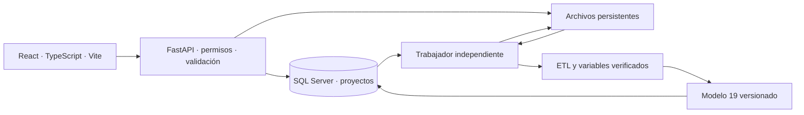

# Fase 1: revisión y arquitectura propuesta

Fecha: 23 de octubre de 2026. Alcance maestro: [ESPECIFICACION.md](ESPECIFICACION.md).

Entrega posterior a esta revisión: [prototipo 0.1](../plataforma_gaitana/README.md). Este archivo conserva lo observado antes de programar; el estado actual de la implementación se registra [por separado](../plataforma_gaitana/ESTADO_PROTOTIPO.md).

Se revisaron archivos locales y documentación técnica oficial. No se ejecutaron cargas SQL, migraciones ni entrenamientos; no se modificaron fuentes ni notebooks. Las métricas de esta revisión se recalcularon a partir de predicciones existentes. El manifiesto [baseline_cuaderno19_observado.json](baseline_cuaderno19_observado.json) identifica archivos y huellas, entorno local observado y métricas; todavía no certifica una reproducción del entrenamiento.

## 1. Lo que existe y se puede reutilizar

| Evidencia local | Uso en la plataforma |
| --- | --- |
| `Notebooks/Limpieza data, Notebooks y Scripts/01` a `05` | Limpiezas oficiales de curvas/pilotos, clima, estimados, planos y producción. |
| `Notebooks/Proyecciones Teoricas Propias/00_catalogo_variedades.ipynb` | Homologación comercial central; reutilizar sus equivalencias. |
| `Auditoria_calidad_curvas.ipynb` y `Proyecciones_teoricas_todos_los_anios.ipynb` | Auditoría, curvas por edad y proyecciones absolutas por plano. |
| `Notebooks/Analisis/10_base_analitica_proyecciones.ipynb` | Base serie–origen–horizonte, uniones y memoria semanal. |
| `Notebooks/Modelo_de_series_diario/01_base_diaria_EDA.ipynb` | Señales diarias que alimentan el semanal; no exige poner el pronóstico diario en producción. |
| `Notebooks/Analisis/19_modelos_clima_y_curvas_gaitana.ipynb` | Preprocesamiento, selección de variante, entrenamiento por grupo/ruta y evaluación. |
| `Notebooks/Analisis/13_comparacion_ingeniero_modelo_2026.ipynb` y `20_EDA_origen_error_modelo_ingeniero.ipynb` | Emparejamiento del ingeniero y análisis del error, separados de inferencia. |
| `Notebooks/Extracción SQL/Datos/01_maestros_y_geografia/Catalogo_analitico/` | Catálogo integrado: 2.974 filas; IDs de variedad/producto/color, nombres y equivalencias. |
| `Notebooks/Extracción SQL/Datos/00_metadata/` y `Diagramas sql/data structure.xlsx` | Evidencia local del esquema de fuentes SQL y relaciones. No prueba del estado actual de `proyectos`. |
| `Datos/Estimados semanales/2026/` | 44 libros encontrados; muestras para estudiar el Excel real del ingeniero. |

No se encontró una aplicación web, API, migraciones o configuración Docker existente en los archivos revisados. Node y npm están disponibles; `docker` no apareció en el PATH de esta sesión. La versión del motor SQL Server, conectividad, permisos y esquema actual de `proyectos` se verificarán antes de crear migraciones.

## 2. Referencia exacta del modelo semanal

### Arquitectura observada en el código

Variante seleccionada: `Sin_clima`, fijada con validación de noviembre–diciembre de 2025. La evaluación 2026 reentrena mensualmente con objetivos cerrados antes del corte. No hay división aleatoria.

- Grupos independientes: H1–H2 y H3–H5.
- Dentro de cada grupo, HistGradientBoosting aprende `real − Media4` como respaldo. Si existen al menos 40 casos de entrenamiento con teoría aplicable, aprende además `real − teoría` en ese subconjunto.
- Cada caso toma una sola ruta; si la regresión teórica no pudo entrenarse, conserva el respaldo. Se limita la predicción a un mínimo de cero.
- Numéricas: mediana con indicadores de ausencia, ajustada en entrenamiento. Categorías: OneHotEncoder, ignorando categorías desconocidas. El modelo final no usa StandardScaler.
- Parámetros comunes: `learning_rate=0.08`, `max_iter=80`, `max_leaf_nodes=15`, `min_samples_leaf=40`, `l2_regularization=1`, `early_stopping=False`, `random_state=42`.
- Entradas: producto/color/variedad, horizonte y calendario cíclico, nueve señales semanales, 19 señales diarias de corte y siete de memoria larga. La ruta teórica agrega `teoria_modelo`, `antiguedad_curva` y `desviacion_reciente_teoria`. Son 41/44 columnas antes de codificación e indicadores.
- Las teorías previas aparecen definidas en el notebook, pero no se incorporan a las listas finales de entradas de esta variante. Los estimados del ingeniero tampoco son entradas.

La base analítica observada contiene 621.195 registros y 47 columnas. El conjunto de comparaciones guardadas tiene 19.174 registros; el panel principal estricto usa 16.325. No son poblaciones intercambiables.

### Métricas verificadas en las salidas locales

Archivo: `Datos_analiticos_proyecto/revision_clima_finca/comparacion_clima_curvas_2026.parquet`; filtro `grupo_comparacion == principal_estricta_nominal`; modelo `Seleccion_pre2026`, cuyo nombre seleccionado es `Sin_clima`. Única finca de esta evaluación: GAITANA.

| Horizonte | Casos | WAPE modelo | WAPE ingeniero | Sesgo modelo | Sesgo ingeniero |
| --- | ---: | ---: | ---: | ---: | ---: |
| H1 | 3.512 | 15,53 % | 16,93 % | −1,34 % | −7,54 % |
| H2 | 3.388 | 17,49 % | 19,16 % | −2,01 % | −7,97 % |
| H3 | 3.264 | 20,33 % | 20,26 % | −2,46 % | −9,38 % |
| H4 | 3.141 | 21,78 % | 20,97 % | −3,18 % | −11,52 % |
| H5 | 3.020 | 22,20 % | 21,60 % | −2,97 % | −13,09 % |
| Total | 16.325 | 19,36 % | 19,71 % | −2,36 % | −9,81 % |

`WAPE = sum(abs(predicción − real)) / sum(real)`. `Sesgo % = 100 × sum(predicción − real) / sum(real)`. Denominador cero: métrica no definida, no cero. No promediar los WAPE de los horizontes para construir el total.

El 19,59 % del prompt no coincide con este panel actual. Se conserva como referencia aproximada de otra revisión hasta identificar su evidencia. El valor de la aplicación se calculará sobre el panel y versión seleccionados; no se escribirá como una cifra fija.

### Hallazgos que deben resolverse antes de declarar reproducción

1. **Ruta duplicada en el código actual del 19.** `DESTINO` ya apunta a `modelo_con_proyecciones_teoricas`, pero la lectura de `actual` vuelve a añadir esa carpeta. El archivo en la ruta duplicada no existe; sí existe en `DESTINO/comparacion_ingeniero_modelo_2026.parquet`. El notebook conserva salidas ejecutadas. Corregir únicamente esta referencia, registrar el cambio y contrastar resultados desde un kernel limpio. No se ha aplicado esa corrección en esta fase.
2. **No hay persistencia del modelo en el código del 19.** `pronosticar` ajusta modelos y devuelve predicciones; no conserva los pipelines entrenados. Se debe exportar el paquete por corte con grupos, rutas, columnas y transformaciones, y verificar sus predicciones antes de servirlo por API.
3. **Evaluación e inferencia están juntas.** El notebook selecciona filas con `y` observado y restringe su evaluación a un panel del ingeniero. En producción hay que construir H1–H5 sin exigir `y` futuro ni un estimado del ingeniero; conservar exactamente la preparación de variables y probar la separación contra el panel histórico.
4. **Calendario nominal y disponibilidad real.** El lunes nominal de H1 se distingue del jueves de envío anterior y de la fecha real de carga. Una ejecución el jueves no puede usar producción del viernes/domingo futuro. El benchmark histórico con origen lunes no demuestra automáticamente la misma precisión al emitir el jueves. Registrar ambos relojes y validar ese escenario operativo antes de prometer equivalencia.
5. **Reconstrucciones retrospectivas.** La limpieza documenta recuperaciones desde entregas posteriores e imputación de Tipo Corte con semanas adyacentes. Preservarlas para reproducir la evaluación; registrar su condición retrospectiva y verificar disponibilidad para el flujo operativo. No introducir correcciones futuras en emisiones históricas.

Congelar la referencia significa fijar código, entradas, cortes, variables, entorno y predicciones; no sustituir el reentrenamiento mensual por un único ajuste arbitrario. El entorno local observado usa Python 3.14.5 y scikit-learn 1.9.0, con versiones adicionales en el manifiesto. No consta que éste fuera el entorno original de todos los entrenamientos guardados. El paso a contenedor Linux se debe validar por predicción, no asumir equivalente.

## 3. Fuentes y SQL: confirmado frente a propuesto

Las salidas locales conservan movimientos y trazabilidad: producción limpia tiene 6.389.201 filas; clima 191.572; estimados 176.140. Estos conteos describen archivos observados, no un resultado de ETL en SQL Server.

El catálogo SQL local contiene 287 objetos, 1.199 columnas y 273 relaciones. Los diagramas y metadatos describen `Basico.Finca`, `Mapa.Invernadero`, `Mapa.CamaFisica`, `TablasBasicas.Producto/Color/Variedad` y objetos `Siembra.*`. No se consultó el servidor ni se verificó que esos esquemas correspondan a la base `proyectos`. Se usarán como evidencia para el mapeo, no como autorización para alterar fuentes productivas.

| Fuente | Grano observado o referencia | Decisión de carga |
| --- | --- | --- |
| Producción | Movimientos con fecha, finca, invernadero, producto/color/variedad, grado y otros atributos; archivo/hoja/fila. | Conservar movimientos legítimos. Falta confirmar ID estable para solapamientos entre archivos; no deduplicar sólo por día/variedad/cantidad. |
| Clima | Medición con finca, instante, código y validaciones de conflictos. | Conservar tratamiento original de unidades, fechas y conflictos. Verificar clave de medición y cobertura por intervalo. |
| Planos | Edición del plano, siembras y fechas/edades. | Versionar la edición; cargar faltantes dentro de ella sin convertir planos históricos en un estado mutable único. |
| Estadísticas/pilotos | Observaciones de productividad usadas por curvas y auditoría. | Nueva versión completa validada y activada de forma atómica; reconstruir derivados con su versión. |
| Estimados | Serie, semana objetivo, origen nominal/solicitado, revisión y archivo. | Guardar original/ajustado y regla H1. Archivo 18–22: H1=18; la semana 17 residual sólo se recupera para un origen faltante y queda marcada. No aparentar disponibilidad temprana de un archivo posterior. |
| Catálogo | IDs y equivalencias ya centralizados. | Reutilizar alias existentes; conservar identidad original y normalizada, ambigüedades y versión del catálogo. |

El modelo inicial validado es GAITANA. La plataforma contempla dimensiones por finca y puede consultar datos de ARABELLA cuando existan, pero no debe permitir generar su pronóstico con el paquete de GAITANA sin validación específica. GAITANA PPTO permanece separada.

### Excel del ingeniero

Se inspeccionaron libros 18–22 y 42–46 de 2026: cada uno tiene 16 hojas, 16 tablas dinámicas y una caché. Las hojas cambian entre entregas, por ejemplo Trachelium/Lepidium. No es una plantilla rectangular única.

La exportación será un adaptador de plantilla versionada, con comprobaciones de hojas, encabezados, orden, semanas, fórmulas, totales y apertura en Excel. Modificar celdas no garantiza que las tablas dinámicas/cachés se actualicen. Antes de comprometer el formato exacto, confirmar cuál libro es la plantilla definitiva y cómo debe manejarse su caché. No escoger silenciosamente una muestra como plantilla oficial.

## 4. Arquitectura propuesta

Monolito modular en Python con un proceso trabajador separado para ETL/modelo. Una aplicación React y un único contrato API. El trabajador comparte el mismo paquete de dominio y cálculo que la API; los notebooks permanecen como referencia, fuera de las solicitudes web.



| Parte | Elección propuesta y responsabilidad |
| --- | --- |
| Frontend | React/TypeScript/Vite, shadcn/ui y Apache ECharts como biblioteca principal. Tres módulos, colores institucionales y jerarquía finca→producto→color→variedad. |
| API | FastAPI, contratos tipados, autenticación, autorización por rol, consultas, ajustes y publicación. |
| Cálculo | Paquete Python compartido: ETL → variables → modelo. Sin lógica de limpieza repetida en endpoints. |
| Datos | SQLAlchemy con pyodbc y controlador Microsoft ODBC; migraciones Alembic limitadas a objetos de la aplicación. |
| Trabajo pesado | Proceso trabajador separado y registro durable de trabajos en SQL. Inicialmente un trabajador; no añadir Redis/Celery sin necesidad de escala comprobada. |
| Archivos | Volumen persistente para originales, manifiestos, artefactos y exportaciones. SQL guarda referencias y huellas. |
| Contenedores | Web, API y trabajador. Conexión a la instancia existente de `proyectos`; SQL local de desarrollo, si se necesita, debe ser independiente. |

La solicitud de trabajo devuelve ID y HTTP 202; la interfaz consulta estado/progreso. La toma de trabajos debe ser atómica, con vencimiento de concesión, recuperación tras interrupciones e idempotencia; su concurrencia se validará sobre SQL Server antes de habilitar varios procesos. Las escrituras finales sólo se activan tras validación. No usar tareas en memoria del proceso HTTP para sostener entrenamientos o cargas largas.

Estructura propuesta; todavía no creada como aplicación:

```text
docs/                         especificación, decisiones y evidencia
frontend/                     React y componentes por módulo
backend/
  app/
    api/                      endpoints, contratos y permisos
    domain/                   reglas de pronósticos, ajustes y publicación
    persistence/              SQLAlchemy, consultas y transacciones
    pipeline/etl/             transformaciones existentes modularizadas
    pipeline/features/        variables temporales compartidas
    pipeline/model19/         entrenamiento, inferencia y manifiestos
    worker/                   ejecución y progreso de trabajos
  migrations/                 Alembic
  tests/                      contratos y regresión
deploy/                       Docker y servicios
Notebooks/                    evidencia metodológica existente
.env.example                  variables sin secretos
```

## 5. Persistencia conceptual de la aplicación

Los siguientes son **objetos nuevos propuestos**, no tablas encontradas en el servidor. Usar un esquema propio, tentativamente `pronostico`, dentro de `proyectos`; confirmar permisos y colisiones antes de migrar. Mantener los maestros existentes cuando su relación se verifique.

| Entidad propuesta | Qué conserva |
| --- | --- |
| ArchivoFuente, Carga, IncidenciaCarga | Ubicación/huella, fuente, ejecución, modalidad, usuario, estado, conteos y errores. |
| Datos normalizados por fuente | Movimientos/mediciones/planos/pilotos/estimados con su grano y versión de carga; sin tabla por archivo. |
| VersionDatos | Manifiesto de cargas, catálogo y derivados compatibles; no copia completa de todas las tablas por simulación. |
| VersionModelo | Algoritmo, variables, parámetros, entrenamiento, ámbito validado, clima, huella y ubicación del artefacto. |
| Trabajo | Tipo, estado, progreso, entrada versionada, salida, reintentos y diagnóstico. |
| Pronostico y LineaPronostico | Ejecución, origen, H1–H5, versión de datos/modelo y sugerencias a nivel finca/producto/color/variedad. |
| Revision y Ajuste | Valor anterior/nuevo, autor y momento; originales del modelo inmutables. |
| Publicacion | Revisión publicada y vigente por finca/origen, con versión previa reemplazada en una transacción. |
| Usuario/Rol y EventoAuditoria | Autorización, actor, operación, objeto y fecha. Integración de identidad corporativa por definir. |

Restricciones: una línea por ejecución/serie/horizonte; cantidades ajustadas no negativas; una versión vigente por finca/origen; revisión publicada inmutable. Para dos ediciones simultáneas usar control de versión y devolver conflicto en lugar de sobrescribir cambios.

Una carga publicada puede generar nuevos derivados, pero no reescribe los datos usados por un pronóstico anterior. La versión de datos referencia qué versiones normalizadas estaban activas; para correcciones se conserva la revisión anterior necesaria, no copias indiscriminadas de cada archivo.

Ajustes agregados: distribuir proporcionalmente entre variedades y resolver tallos enteros mediante restos mayores, con orden estable para empates. Si la base suma cero y se pide un total positivo, solicitar distribución explícita en lugar de inventar proporciones. El total almacenado y exportado debe coincidir exactamente con la suma de sus líneas. El redondeo de las predicciones flotantes del modelo se hará en la capa de presentación/publicación y tendrá una regla documentada; nunca modificar los valores de referencia utilizados para evaluar equivalencia.

## 6. Contratos funcionales de API propuestos

| Operación | Endpoint propuesto | Regla |
| --- | --- | --- |
| Estado de fuentes | `GET /api/v1/datos/estado` | Frescura, cobertura y suficiencia por variante/finca/origen. |
| Registrar una carga | `POST /api/v1/cargas` | Archivo y modalidad; ejecución mediante trabajo. |
| Consultar carga/trabajo | `GET /api/v1/cargas/{id}` y `/trabajos/{id}` | Progreso, conteos e incidencias autorizadas. |
| Modelos disponibles | `GET /api/v1/modelos` | Sólo variantes/ámbitos habilitados; métricas con su panel. |
| Generar simulación | `POST /api/v1/pronosticos` | Datos/modelo fijados, reloj nominal y fecha real; no publica. |
| Consultar detalle | `GET /api/v1/pronosticos/{id}` | Jerarquía, modelo original, revisión y vigencia. |
| Ajustar borrador | `POST /api/v1/pronosticos/{id}/ajustes` | Autorización, validación, revisión esperada y coherencia. |
| Publicar | `POST /api/v1/pronosticos/{id}/publicaciones` | Publica una revisión concreta y reemplaza el vigente atómicamente. |
| Exportar | `GET /api/v1/pronosticos/{id}/exportacion` | Revisión y plantilla identificadas; permiso de descarga. |
| Historia y desempeño | `GET /api/v1/historico` y `/desempeno` | Filtros y panel comparable, real disponible y denominadores explícitos. |

Operaciones de creación con protección frente a reenvíos; la clave de idempotencia incluye ámbito y solicitud. Autorización en todos los endpoints, archivos y resultados. No retornar credenciales en errores ni logs. Consulta no puede mutar; ingeniero opera pronósticos; administración gestiona usuarios/configuración y versiones.

Sin_clima será la opción inicial. El selector con clima queda deshabilitado hasta tener el artefacto y la comprobación de la variante correspondiente. La falta de clima no debe bloquear el modelo sin clima; sí debe mostrarse el estado real de esa fuente. No existe un porcentaje global de clima que, por sí solo, certifique suficiencia.

## 7. Plan por fases y pruebas de salida

| Fase | Siguiente trabajo concreto | Evidencia de cierre |
| --- | --- | --- |
| 1 · revisión | Especificación, inventario, arquitectura y referencia observada. | Estos documentos y manifiesto; pendientes visibles. |
| 2A · referencia | Copia aislada de entradas, corrección de ruta y ejecución limpia del 19; preservar salidas previas. | Comparación por llave completa de predicciones, selección, WAPE y sesgo. Registrar diferencias numéricas antes de aceptar tolerancias. |
| 2B · infraestructura | Estructura de aplicación, entorno fijado, Docker, conexión de lectura a `proyectos`, inspección de esquema y migración inicial de aplicación. | Arranque, comprobación de conexión/permisos, migraciones repetibles y persistencia al recrear contenedores. |
| 2C · ETL | Extraer una limpieza a la vez; empezar por catálogo y producción, luego estimados, clima, planos/pilotos y derivados. | Mismas llaves, filas, tallos, fechas, faltantes y trazabilidad que la referencia; recarga y fallo transaccional probados. |
| 3 · modelo | Modularizar variables y guardar/cargar pipelines por corte; generar objetivos futuros sin real/ingeniero. | Equivalencia contra el 19 y prueba de que alterar el futuro no cambia entradas pasadas. Entrenamiento mensual preservado. |
| 4 · interfaz | Shell institucional y flujo conectado: datos→generar→examinar; histórico y guía. | Datos reales identificados, filtros correctos, jerarquía y estados accesibles. |
| 5 · operación | Ajustes, concurrencia, publicación, Excel y despliegue. | Sumas exactas; borrador no afecta vigente; versiones, roles, exportación y recuperación probados. |

La reproducción inicial precede a cualquier cambio estadístico y a declarar equivalente el ETL. Se conserva el orden de fases del usuario; 2A es una comprobación preparatoria, no un rediseño del modelo. No hace falta entrenar los experimentos 21–25 ni el diario para operar el modelo 19.

## 8. Pendientes y alcance de esta entrega

- Verificar conectividad, versión, autenticación, permisos y objetos actuales de `proyectos`. No se extrajeron ni mostraron credenciales.
- Designar plantilla Excel definitiva y logotipo corporativo. Hay ejemplos operativos disponibles, pero no una plantilla oficial identificada por el usuario.
- Confirmar claves estables para solapamientos de producción y otras fuentes antes de habilitar actualizaciones incrementales automáticas.
- Confirmar día/hora de emisión operativa y latencia de fuentes; conservar H1 del nombre del archivo y diferenciar jueves real de lunes nominal.
- Reproducir el 19 desde cero y luego validar el entorno Docker. El manifiesto actual sólo registra lo observado.
- Alcance de pronóstico inicial: GAITANA. Datos/consultas de otras fincas no implican modelo validado para ellas.

Estos pendientes no impiden organizar el código y preparar el entorno; sí condicionan los componentes que dependen de ellos. Esta entrega termina la revisión local y la propuesta de arquitectura, no la plataforma completa.

## 9. Referencias técnicas consultadas

- [FastAPI: tareas en segundo plano](https://fastapi.tiangolo.com/tutorial/background-tasks/#caveat): sustenta separar cómputo pesado del proceso HTTP.
- [SQLAlchemy: SQL Server con pyodbc](https://docs.sqlalchemy.org/en/20/dialects/mssql.html#module-sqlalchemy.dialects.mssql.pyodbc): soporte de acceso al motor propuesto.
- [Docker: volúmenes](https://docs.docker.com/engine/storage/volumes/): almacenamiento persistente separado del contenedor.
- [scikit-learn: persistencia de modelos](https://scikit-learn.org/stable/model_persistence.html): conservar entorno y versiones al cargar el modelo.
